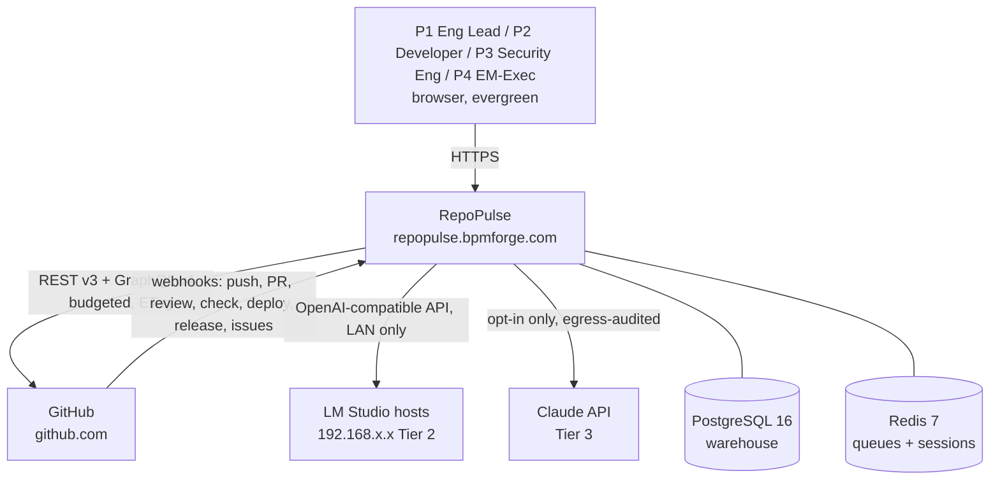
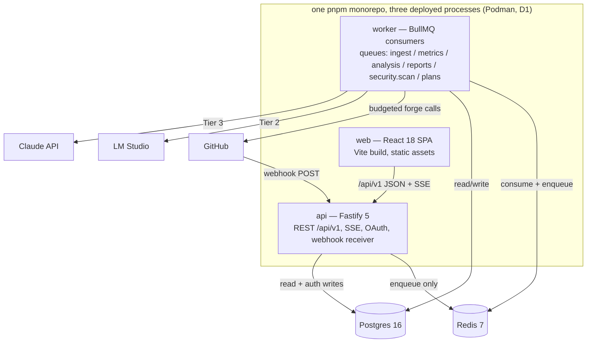
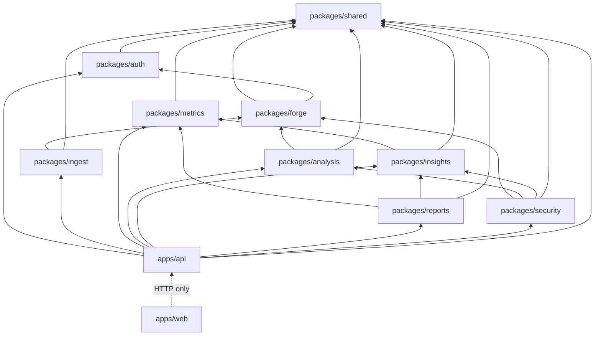
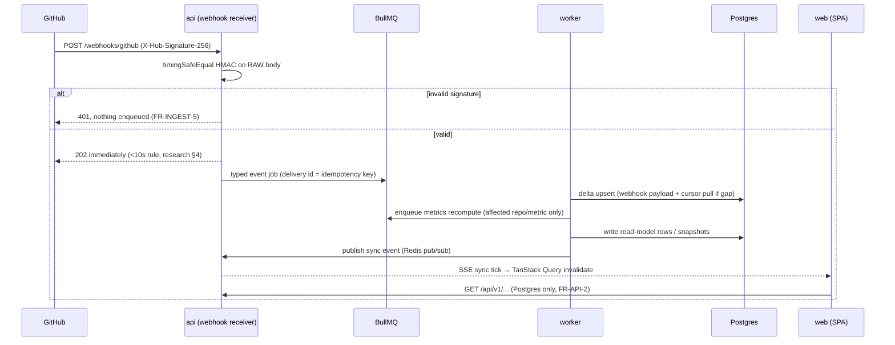
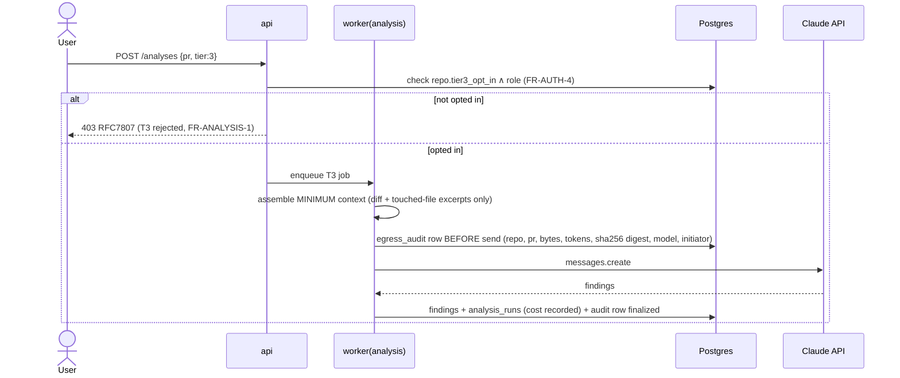
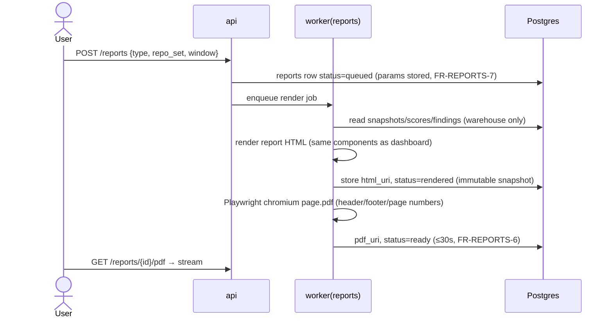
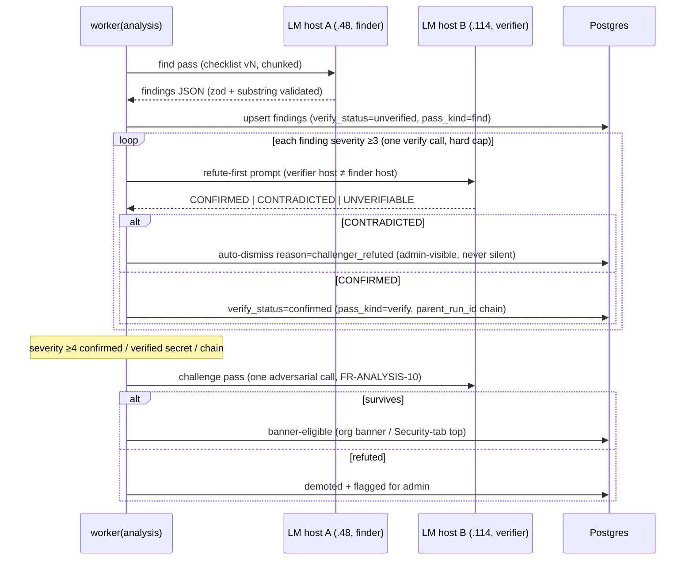
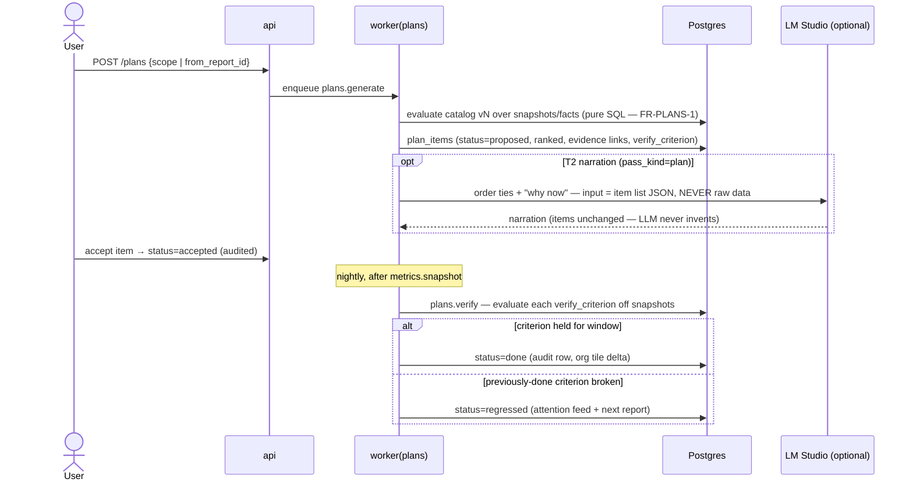
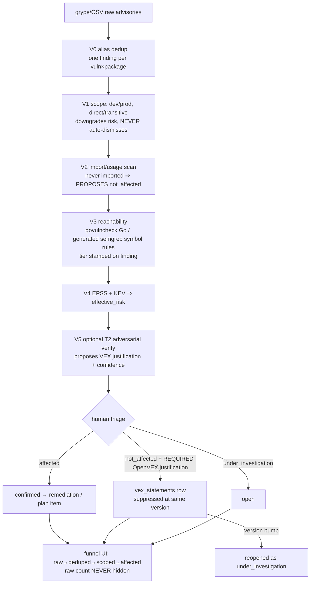

# RepoPulse — Architecture

Traces to: FOUNDING_BRIEF.md D1–D7 / C1–C3, SRS FR/NFR IDs inline, docs/research/github-api.md
(rate/limit ground truth). Versions: docs/TECH_STACK.md. This is the load-bearing doc: module
boundaries here are enforced by lint + review gate (CLAUDE.md Laws 4/6/7/8).

## 1. C1 — System Context



- Users never talk to GitHub through us live; every page reads the warehouse (FR-API-2, NFR-3).
- GitHub is both pull source (REST/GraphQL) and push source (webhooks, FR-INGEST-5).
- LM Studio egress is LAN-only; Claude API is the only external analysis egress and is
  opt-in + audited (D2, NFR-9).

## 2. C2 — Containers



Separation rules:
- **api** never calls a forge or LLM host (FR-API-2; the webhook receiver only verifies +
  enqueues). All egress lives in **worker**.
- **worker** hosts six queue families: `ingest` (backfill, delta sync, reconciliation),
  `metrics` (recompute, nightly snapshots), `analysis` (Tier-2/3 find/verify/challenge/
  narrate passes, v1.x), `reports` (HTML render + Playwright PDF), `security.scan`
  (W8/W9 scanners, own worker pool, priority below analysis — NFR-15), `plans`
  (generation + nightly auto-verify, D9). Independent concurrency per queue (NFR-11).
- web is a static bundle; api serves it (or a reverse proxy does). Scaling story: api and
  worker scale horizontally later; BullMQ + Postgres already tolerate N workers.

## 3. C3 — Components (packages) and dependency law

| Module | Lives in | Responsibility | FR anchor |
|---|---|---|---|
| forge | packages/forge | ForgeProvider port, GitHubProvider, budgeter, ETag cache, webhook sig verify | FR-FORGE-1..6 |
| ingest | packages/ingest | connect, backfill planner, webhook handlers, cursors, reconciliation | FR-INGEST-1..8 |
| metrics | packages/metrics | Tier-1 metric computations, snapshot writer, metric catalog | FR-METRICS-1..15 |
| analysis | packages/analysis | tiered LLM gateway, chunker, dimension checklists (v1.x) | FR-ANALYSIS-1..8 |
| insights | packages/insights | findings store, health score, trend deltas, hotspot ranking, improvement plans + agreements + intents (D9), narrative assembly | FR-INSIGHTS-1..6, FR-PLANS-1..6 |
| reports | packages/reports | report definitions, HTML render, PDF export, report diff | FR-REPORTS-1..8 |
| security | packages/security | scanner framework + registry, snapshot service + sandbox, W8/W9 scanners, CVE validation + VEX, rulepacks + rule lifecycle, tool adapters | FR-SEC-1..15, FR-CH-1..10 |
| shared | packages/shared | Drizzle schema, zod contracts, config, logger, errors | (all) |
| auth | packages/auth (wired by apps/api) | GitHub OAuth, Redis sessions, RBAC, workspace scoping, identity map, credential vault | FR-AUTH-1..6 |
| api / web | apps/* | HTTP surface / SPA | FR-API-*, FR-WEB-* |

### Allowed-dependency matrix (row imports column; ✅ allowed, blank forbidden — ESLint-enforced)

| imports → | shared | auth | forge | ingest | metrics | analysis | insights | reports |
|---|---|---|---|---|---|---|---|---|
| **auth** | ✅ | | | | | | | |
| **forge** | ✅ | ✅³ | | | | | | |
| **ingest** | ✅ | | ✅ | | | | | |
| **metrics** | ✅ | | | | | | | |
| **analysis** | ✅ | | ✅¹ | | | | | |
| **insights** | ✅ | | | | ✅ | | | |
| **reports** | ✅ | | | | ✅ | | ✅ | |
| **apps/api** | ✅ | ✅ | ✅² | ✅² | ✅ | ✅ | ✅ | ✅ |
| **apps/web** | (types only) | | | | | | | |

¹ analysis may call forge ONLY for on-demand `listPRFiles`/`getFileContents` through the
budgeted client (diff text is not warehoused wholesale; research §6). No other domain
package touches forge — metrics/insights/reports read the DB, never the forge (Law 6).
² api imports forge/ingest solely for webhook signature verification + job enqueueing;
route read-handlers must not (FR-API-2 static check).
³ forge imports only the credential vault's decrypt from auth so plaintext tokens exist
solely in forge memory (SC-1); no other auth surface.
No package ever imports `apps/api` or `apps/web` (Law 6). Everyone may import shared.
**security** (W8/W9 row, lands with its wave + validate-arch rule): imports shared ✅,
forge ✅⁴, analysis ✅⁴, insights ✅ (findings helpers); nothing else.
⁴ the snapshot service is the ONLY tarball caller (C1a lint gate); scanners receive repo
bytes exclusively via `ScannerContext` (→ BudgetedClient) and reach LLMs exclusively via
`AnalysisGateway` — never direct (Laws 7/8).



## 4. Data-flow sequences

### 4a. Org connect + 12-month backfill (FR-INGEST-1..4, NFR-1/2)

```mermaid
sequenceDiagram
    actor Admin
    participant API as api
    participant Q as Redis/BullMQ
    participant W as worker(ingest)
    participant F as forge (budgeted)
    participant GH as GitHub
    participant PG as Postgres
    Admin->>API: POST /connections (App install or PAT)
    API->>PG: forge_connections (credential AES-256-GCM)
    API->>Q: enqueue discover-repos
    W->>F: listOrgRepos (GraphQL/REST)
    F->>GH: budgeted request (ETag, headers persisted)
    W->>PG: repos rows, status=pending_backfill
    W->>Q: per-repo backfill jobs, priority = recent activity DESC
    loop per repo, entity order PRs→commits→checks→issues→releases
        W->>F: page N (GraphQL for PR metadata ≈2pts/50 PRs; REST elsewhere)
        F-->>W: data or BUDGET_FLOOR
        alt budget floor hit (FR-FORGE-3)
            W->>PG: checkpoint sync_cursors (repo, entity, cursor/page)
            W->>Q: re-enqueue self with delay to x-ratelimit-reset
        else page ok
            W->>PG: idempotent upsert on natural keys (FR-INGEST-6)
            W->>PG: advance cursor checkpoint (FR-INGEST-3 resumable)
        end
    end
    W->>Q: enqueue metrics recompute; PG repo status=live
```

Budgeter respects BOTH buckets: REST 5000/hr and GraphQL points separately (App tokens —
research §1), plus secondary limits (≤900 pts/min/endpoint → per-endpoint token buckets at
≤10 req/s, ≤100 concurrent global, ≥1s write spacing). Installation tokens refreshed at
~50 min (1h expiry, research §8).

### 4b. Webhook → delta sync → dashboard (FR-INGEST-5/6, NFR-10)



Webhooks are a hint; cursors + nightly reconciliation are truth (research §4 design rule).

### 4c. Tier-2 review dispatch (FR-ANALYSIS-1..5, NFR-7/8 — v1.x)

```mermaid
sequenceDiagram
    participant W as worker(analysis)
    participant F as forge
    participant GH as GitHub
    participant LM as LM Studio (LAN)
    participant PG as Postgres
    Note over W: PR synced + repo policy auto-T2 → job enqueued
    W->>F: listPRFiles (paginated /pulls/{n}/files — never raw diff >300 files/20k lines)
    F->>GH: budgeted, ETag'd
    W->>W: chunk by file / hunk-group, expected output ≤10k tokens (C2)
    loop per chunk × dimension checklist
        W->>LM: chat.completions (max_tokens 45000, checklist vN prompt)
        alt "model crashed" / timeout
            W->>LM: warm-up ping, retry with backoff (NFR-8)
        end
        LM-->>W: findings JSON
        W->>W: zod-validate (FR-ANALYSIS-5); malformed → retry once → DLQ
    end
    W->>PG: findings upsert by dedup_key (FR-ANALYSIS-6), analysis_runs row
```

LM Studio unreachable → queue parks with backoff, UI banner "Tier-2 paused"; Tier-1
dashboards unaffected (NFR-7, §6 below).

### 4d. Tier-3 opt-in path with egress audit (FR-ANALYSIS-7, NFR-9 — v1.x)



### 4e. Report generation → HTML → PDF (FR-REPORTS-1/6/7)



### 4f. Finding quality loop: find → verify (maker≠verifier) → challenge (FR-ANALYSIS-9/10 — D9)



Loop discipline (ported from bpm-opencode-experts, quoted as law): hard caps (1 verify +
1 challenge call per finding), no-progress halt, maker ≠ verifier, model output is data —
never executed (SC-13).

### 4g. Improvement plan: generate → accept → auto-verify (FR-PLANS-1..6 — D9)



### 4h. Dependency finding: validation funnel → VEX (FR-SEC-13/14/15 — D10)



### 4i. Scanner dispatch + rule shadow mode (FR-SEC-9, FR-CH-8 — D8/D11)

```mermaid
sequenceDiagram
    participant GH as GitHub webhook / cron
    participant Q as security.scan queue
    participant SB as sandbox (--network=none)
    participant PG as Postgres
    GH->>Q: pr_synced | push | daily | weekly (trigger matrix × enabled scanners, idempotency keys)
    GH->>Q: Run scans now / first scan: ONE mode=batch job (sec-batch-repo-window[-force]) with scannerKeys[]
    Note over Q: batch (W23-02, C1a "one scan batch"): resolve head once, isUpToDate per scanner,<br/>ONE snapshotForScan bracket (one tarball, scan lane) shared by every<br/>snapshot scanner, run sequentially, failure of one never stops the rest;<br/>dir deleted in finally; all up to date = zero fetches
    Q->>SB: scanner run (snapshot ro,noexec | diff stream | manifests)
    SB-->>Q: schema-valid findings JSON on stdout (only exit path)
    Q->>PG: upsert via dedup_key; candidate-rule findings stamped experimental=true
    Note over PG: experimental findings: Explorer facet only —<br/>EXCLUDED from scores, banners, plans, reports (FR-CH-8)
    Q->>Q: completion job: attack_chainer + compound-risk (SQL)
    Q->>PG: scan_run row (trigger, SHA, status, tool/rulepack versions)
```

## 5. Architecture decision records

**ADR-1 — Clone-free, API-only, with a persistent ETag cache layer.** (C1, FR-FORGE-4/6)
Decision: zero git clone/tarball code paths (lint + review gate); all ingestion via
ForgeProvider; every GET goes through an ETag store (`forge_etag` table) so repeat polls of
unchanged resources cost 0 rate-limit points (304s are free — research §2). Consequence:
churn facts come from commit-detail / GraphQL PR files / stats endpoints with the 10k-commit
degradation fallback (research §3), never from local diffing.

**ADR-2 — CQRS-lite.** Ingest writes normalized facts (commits, prs, reviews, files, runs…);
metrics materializes read models — `metric_snapshots` append-only + current-state rollups;
UI/API read ONLY read models + warehoused facts (FR-API-2, FR-METRICS-13, NFR-3 p95<500ms).
No request-time aggregation over raw facts for dashboard tiles; drill-down lists may read
facts through indexed queries. Rejected: full event-sourcing (overkill, hostile to C3).

**ADR-3 — Tenancy via `workspace_id` everywhere, RLS-ready.** (D1, FR-AUTH-3, NFR-4)
Every tenant-scoped table carries `workspace_id` + composite indexes leading with it.
v1 ships one `default` workspace but all queries filter by it (repo-layer helpers force the
predicate). Postgres RLS policies are written but not enabled at launch; enabling them +
`SET app.workspace_id` per request is the SaaS flip (§7).

**ADR-4 — Queue topology + per-endpoint token buckets.** (FR-FORGE-3, FR-INGEST-4, NFR-1/11)
Four BullMQ queue families (ingest/metrics/analysis/reports) with independent concurrency;
ingest jobs are small (one repo × one entity-type × one page-range) so budget pauses lose
≤1 page of work. The forge budgeter maintains: global REST budget from `x-ratelimit-*`
headers persisted per installation, a separate GraphQL points budget, per-endpoint buckets
honoring the 900 pts/min secondary limit, ≤100 concurrency, `Retry-After` compliance
(research §1). Jobs that hit the floor checkpoint + self-reschedule (FR-INGEST-3/4).

**ADR-5 — ForgeProvider port/adapter.** (D3, FR-FORGE-1/7) One TypeScript interface in
packages/forge; GitHubProvider v1, GiteaProvider v1.x. Interface is capability-annotated
(e.g. `supportsDeployments`, `supportsStats`) because Gitea lacks deployments/stats/GraphQL
(research §7) — metrics code branches on capabilities, never on provider name.

**ADR-6 — Tiered analysis gateway.** (D2, FR-ANALYSIS-1, NFR-8/9) One gateway in
packages/analysis owns ALL LLM egress: T2 = OpenAI-compatible client → LM Studio with C2
discipline baked in; T3 = Anthropic SDK gated by opt-in flag + egress audit. Dimension
checklists are versioned prompt assets; runs record checklist + model ids. Lint forbids
direct HTTP to LM/Claude hosts anywhere else.

**ADR-7 — Metric snapshots as append-only time series.** (FR-METRICS-13, FR-INSIGHTS-4)
Nightly job writes `(workspace, repo|org, metric_key, window, dims, value, computed_at)`
rows; trends/deltas read snapshots only, never recompute. Retained ≥400d. This is what
makes trend charts O(rows-in-range) and keeps NFR-3.

**ADR-8 — One findings store, registry-driven scanners.** (D8, FR-SEC-1/12) Every
producer — T2/T3 review, five W8 scanners, W9 code-health scanners, chainer, compound
detector — persists into the SAME findings table with the same dedup/lifecycle/triage
rails; dispatch, budgets, facets, and report sections are registry-metadata-driven.
Rejected: per-domain stores (would fragment triage, dedup, and the Explorer).

**ADR-9 — Maker≠verifier quality loops.** (D9, FR-ANALYSIS-9/10) Ported from
bpm-opencode-experts: findings sev≥3 are re-judged refute-first on the *other* LAN host;
sev≥4 must additionally survive one challenge call before banner surfacing; contradicted
findings auto-dismiss visibly. Bounded: 1 verify + 1 challenge per finding, no-progress
halts. Rationale: RISKS R-4 — FP noise is the product's biggest trust risk; redundancy
across models is the cheapest defense we own (two hosts already exist).

**ADR-10 — Rules-first, LLM-second.** (D9/D11, FR-PLANS-1, FR-CH-8/9) Deterministic
catalogs and rulepacks are the only sources of plan items and pack findings; LLM passes
order, narrate, draft, and propose — never invent, activate, or dismiss. Consequence:
every surface is fully functional on a Tier-1-only install; anti-hallucination is
structural, not prompt-dependent.

**ADR-11 — Validation funnel + VEX for dependency findings.** (D10, FR-SEC-13/14/15)
Raw CVE lists are pipeline input, never a deliverable: tiers stamp honesty labels
(reachability, scope, effective risk); suppression requires an OpenVEX justification,
persists per (purl, vuln, version-range), and reopens on version bump; raw counts are
never hidden. Rejected: severity-threshold filtering (hides the funnel, unauditable).

**ADR-12 — Rule lifecycle with shadow mode.** (D11, FR-CH-8/9) New rules run
`experimental` — visible for evaluation, excluded from scores/banners/plans — until
measured FP rate earns promotion; imports are license-gated deny-by-default. Rejected:
auto-activating synced packs (turns every upstream rule bug into user-facing noise).

## 6. Failure modes & degradation

| Failure | Detection | Behavior | User-visible | FR/NFR |
|---|---|---|---|---|
| LM Studio host down | T2 call timeout/refused | analysis queue parks, exponential backoff; Tier-1 untouched | banner "Tier-2 analysis paused — host unreachable" | NFR-7 |
| LM "model crashed" | error string match | warm-up ping + retry (bounded), then park | per-PR analysis status = retrying | FR-ANALYSIS-2, C2 |
| GitHub rate exhaustion | budgeter floor / 403+Retry-After | jobs checkpoint + reschedule at reset; no request emitted over budget | sync status = paused-for-budget, lag shown | NFR-1, FR-INGEST-8 |
| Secondary-limit 403 | Retry-After header | per-endpoint bucket drains to zero, honors header exactly | sync lag metric rises | research §1 |
| Webhook delivery lost | cursor gap / nightly sweep | nightly reconciliation re-lists updated-since entities (ETag-cheap) | ≤24h drift worst case, usually none | FR-INGEST-7 |
| Worker crash mid-backfill | BullMQ stalled-job | resume from sync_cursors checkpoint, idempotent upserts | progress % stalls then resumes | FR-INGEST-3, NFR-11 |
| Claude API error/cost spike | SDK error / cost row | T3 job fails to DLQ with audit row intact; never silent retry-loop | analysis status = failed, admin DLQ page | NFR-9/11 |
| Postgres down | api healthcheck | total outage — Postgres is the single source for UI, no forge fallback ever | 503 | FR-API-2 |
| Redis down | api/worker healthcheck | reads still served (sessions fail → re-login); ingestion halts | login required; sync paused | FR-AUTH-2 |
| Malformed LLM output | zod parse fail | retry once → dead-letter with raw payload kept | finding absent; DLQ visible on ops page | FR-ANALYSIS-5, NFR-11 |
| Stats endpoint 202/422 (10k+ commits) | status code | retry-after-202 loop; 422 → per-commit REST fallback queued low-priority | none (slower churn backfill) | research §3 |
| Verifier/challenger host down | T2 health probe | verify/challenge jobs park + backoff; findings stay `unverified` (visible with badge), banner escalation deferred — never skipped | "verification paused" chip on affected findings | FR-ANALYSIS-9/10, NFR-7 |
| Scanner crash / budget blown | scan_run status | partial findings kept + flagged; other scanners, ingest, Tier-1 unaffected (own queue/workers) | per-scanner error chip, never a broken page | NFR-15, SC-30 |
| plans.verify job failure | job retry/DLQ | plan items keep last status; `stale_verify` flag after 48h without evaluation | staleness note on plan progress | FR-PLANS-3, NFR-11 |
| db-sync (OSV/KEV/EPSS/rulepacks) failure | checksum/refresh monitor | previous read-only volume stays mounted; scan_runs stamp data-version so staleness is auditable | data-age note on Security tab | SC-28 |

## 7. SaaS-readiness (what flips for multi-tenant, D1)

Designed-in now, activated later — no schema migration required:
1. **Workspaces**: creation/invite flows replace the seeded `default` workspace;
   `workspace_members` and roles (FR-AUTH-4) already model it.
2. **RLS enable**: `ALTER TABLE ... ENABLE ROW LEVEL SECURITY` + policies on
   `workspace_id = current_setting('app.workspace_id')`; api sets the GUC per request from
   the session. Tenancy test suite (NFR-4) already proves query-level isolation pre-RLS.
3. **Per-workspace budgets**: budgeter keys are already `(workspace, connection)`; expose
   budget share config per workspace (SRS §1.1 Budget).
4. **Per-workspace LLM config**: LM host list, concurrency cap, T3 opt-in and spend caps
   are workspace columns from day one (FR-ANALYSIS-8, NFR-9).
5. Out of scope until then: billing, self-serve onboarding, email (D7 non-goals v1).
