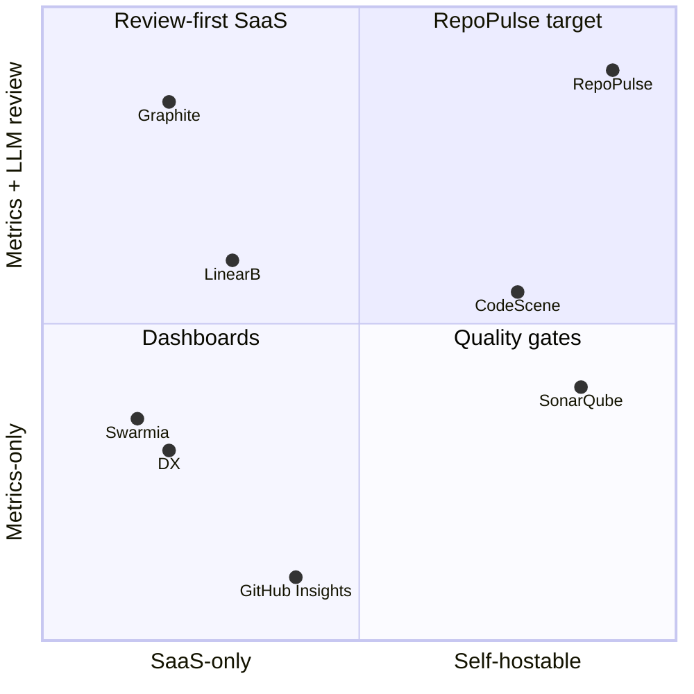

# RepoPulse — Competitive Analysis

Verified 2026-07-07 via vendor pricing pages and searches; anything not confirmed against a
primary source is marked `UNVERIFIED`. Traces to [Founding Brief](work/FOUNDING_BRIEF.md)
(D1 internal/SaaS-ready, D2 tiered LLM analysis, C1 clone-free).

## Landscape table

| Tool | Category | Pricing (verified unless noted) | Analysis source | Self-hostable | LLM review |
|---|---|---|---|---|---|
| CodeScene | Code health + behavioral analysis | €18 (Standard) / €27 (Pro) per active author/mo, Enterprise custom — codescene.com/pricing | Git history (behavioral); code-health scoring needs source access | **Yes** (on-prem all tiers) | ACE AI auto-refactoring add-on |
| LinearB | Engineering metrics + workflow automation | Essentials $29/user/mo (1,000 credits), Enterprise $59/user/mo — linearb.io/pricing | Forge **API** (GitHub/GitLab/Bitbucket/ADO) | SaaS; "on-prem agents" Enterprise only | AI code reviews, AI retros, MCP server |
| Swarmia | Engineering effectiveness | Free ≤9 devs; Lite €20, Standard €39 /dev/mo, Enterprise — swarmia.com/pricing, help.swarmia.com | Forge **API** | No (SaaS only; no self-host offering found) | Measures AI-tool impact; no LLM reviewer (`UNVERIFIED`) |
| Codacy | Static analysis + AppSec | Free (IDE); Team $18/dev/mo annual ($21 monthly, ≤30 devs); Business custom — codacy.com/pricing | **Clone-based** (runs 49-language static analyzers server-side) | No — pricing page states cloud-only (prior self-hosted offering retired) | AI-generated fixes/tests, IDE guardrails |
| SonarQube (Server/Cloud) | Static analysis / code quality gate | Cloud: free ≤50k LOC, Team from ~$34/mo per 100k LOC; Server: Community free, Developer ≈$2.5k/yr@100k LOC, Enterprise ≈$16k/yr@1M LOC (server prices via resellers/3rd-party, `UNVERIFIED` exact) — sonarsource.com/plans-and-pricing | **Scanner over full checkout** (CI-side clone) | **Yes** (SonarQube Server) | AI CodeFix / AI Code Assurance (`UNVERIFIED` scope) |
| Code Climate Velocity | SEI platform | Sales-only; free tier removed (`UNVERIFIED`, 3rd-party) | Forge API + git metadata | No | Repositioned "AI-native org" SEI; details sales-gated. Status: Quality product spun off to Qlty Software (2025); Velocity continues enterprise-only — codeclimate.com |
| Graphite | Stacked PRs + AI review + insights | Hobby free; Starter $20, Team $40 /user/mo annual (unlimited AI reviews on Team); Enterprise — graphite.com/pricing | Forge **API** (GitHub App) | No | **Yes** — Diamond AI reviewer is the headline feature; Insights dashboards on paid tiers (`UNVERIFIED` tier split) |
| DX (getdx.com) | Developer intelligence (research-based) | Sales-only; median ≈$51.5k ARR per Vendr (`UNVERIFIED`) | Forge/Jira **API** + self-reported surveys (DevEx Cloud + Data Cloud) | Not advertised (`UNVERIFIED`) | AI-impact measurement focus; no diff reviewer (`UNVERIFIED`) |
| Sleuth | DORA / deploy tracking | Pricing not verified (`UNVERIFIED`); docs and GitHub/Atlassian marketplace listings still live; 3rd-party blogs claim 2024 acquisition + slowed development (`UNVERIFIED`) | Deploy events + forge **API** | No | None found |
| GitHub Insights (native) | Built-in repo graphs | Included: public repos free; private repos need Pro/Team/Enterprise — docs.github.com | GitHub internal | n/a (GHES ships same graphs) | None (Copilot is separate) |

## Per-tool notes

- **CodeScene** — closest philosophical neighbor: hotspots = churn × complexity, knowledge
  maps/bus factor, PR quality gates. Differences: code-health scoring parses full source
  (needs checkout/integration), pricing per active author, heavyweight; no tiered
  local-LLM option. Its hotspot/ownership math validates our Tier-1 catalog.
- **LinearB** — DORA + project delivery + gitStream PR automation; credits system meters AI
  features. API-based like us, but SaaS-first and automation-oriented rather than
  drill-down analysis; no self-host of the platform itself.
- **Swarmia** — best-in-class UX for DORA/investment balance/working agreements; the free
  ≤9-dev tier is the adoption wedge we'll be compared against. SaaS only — a hard blocker
  for the internal/bpmforge deployment story.
- **Codacy** — quality/security scanning, not delivery metrics; clone-based analyzers.
  Complementary rather than competitive: RepoPulse's Tier-2/3 LLM review overlaps its PR
  feedback but from diffs, not full-source AST.
- **SonarQube** — the incumbent quality gate; self-hostable and often already present.
  We do not replicate rule-based SAST; we can ingest its status checks as a CI signal.
- **Code Climate Velocity** — cautionary tale: SEI product pivoted enterprise-sales-only and
  killed its self-serve tier; churned users are an audience for lightweight alternatives.
- **Graphite** — proves demand for LLM PR review at $20–40/user/mo, but review runs only on
  frontier SaaS models and its insights are shallow (PR flow stats); no self-host, no
  tiered local model support.
- **DX** — the research-credibility leader (DORA/SPACE lineage), sells to VPs. Survey+data
  hybrid; expensive, sales-gated, aimed at 100+ dev orgs. Not a tool a 10-person platform
  team can stand up on a Saturday.
- **Sleuth** — deploy-event-centric DORA; treat as validation that DORA-from-deployments
  works, but its uncertain status (`UNVERIFIED` acquisition claims) shows the niche is
  consolidating.
- **GitHub native Insights** — free baseline every buyer compares against: Pulse,
  contributors, code frequency. Hard caps (graphs degrade at 10,000+ commits, top-100
  contributors only), repo-scoped only (no org rollup), no PR cycle-time stages, no review
  metrics, no export/report center. Clearing this bar is table stakes for MVP D5.

## Positioning

### Gaps RepoPulse fills

1. **Self-hosted + internal-first, SaaS-ready.** Only CodeScene and SonarQube self-host, and
   neither covers delivery metrics + LLM diff review. Nothing in the table runs on a Podman
   box behind your firewall with your LAN LLM.
2. **Clone-free by architecture (C1).** Codacy/SonarQube need full source; CodeScene needs
   git history. RepoPulse ingests exclusively via forge APIs (see
   [github-api.md](research/github-api.md) budget math) — no mirror storage, no repo-content
   custody beyond targeted diff/content fetches, faster onboarding, cleaner security story.
3. **Tiered local + frontier LLM review (D2).** Graphite/LinearB run frontier-only SaaS
   review. RepoPulse: Tier-2 bulk review on local LM Studio (cost ≈ 0, data never leaves
   LAN), Tier-3 Claude opt-in per repo/PR. Nobody else offers a cost/privacy dial.
4. **Expert-system review dimensions.** Review checklists ported from bpm-opencode-experts
   (code health, security, performance, test coverage) give structured, dimension-scored
   findings rather than free-form AI comments — closer to CodeScene's code-health rigor but
   LLM-driven and diff-scoped.
5. **Drill-down custom views + report center (D5/D7).** Org → repo → PR/file → finding in
   one navigation tree, personalized views via GitHub OAuth identity (D6), and audit-ready
   PDF packs (P3) — Swarmia/LinearB export dashboards but none target audit deliverables.
6. **Gitea/forge-portable.** ForgeProvider interface (D3) targets the self-hosted-forge
   crowd that every SaaS in the table ignores.

### What we deliberately don't compete on

- **Rule-based SAST / quality gates** — SonarQube/Codacy own AST-level static analysis; we
  consume their check results as signals.
- **Workflow automation** — no gitStream-style PR routing/merge queues (LinearB, Graphite).
- **Survey-based DevEx research** — no DX-style survey instrument or org-psych benchmarks.
- **Stacked-PR authoring tooling** — Graphite's core is out of scope.
- **Billing/onboarding SaaS machinery in v1** — single `default` workspace, per D1.
- **Issue-tracker project analytics** — Jira/Linear delivery forecasting (LinearB Monte
  Carlo) is out; issue throughput comes only from forge issues.
