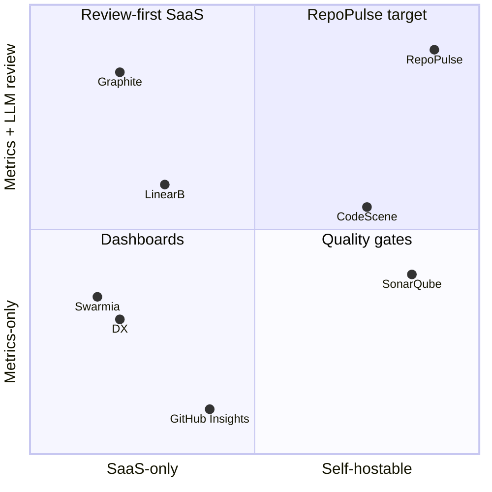

# RepoPulse — Competitive Analysis

Traces to [Founding Brief](work/FOUNDING_BRIEF.md) (D1a customer-hosted, D2 tiered LLM
analysis, D9a never writes to repos, D16 code security and quality platform, C1 clone-free).

Two passes, kept separate so each stays checkable against its sources:
- **2026-10-15 (D16): code review and SAST.** The market Repo Pulse now competes in. Written
  from Sourcegraph's 2026 roundup of 13 automated code-review tools and the sources listed at
  the end of that section. Vendor-funded numbers are marked as vendor-funded.
- **2026-07-07: delivery metrics.** Verified via vendor pricing pages and searches; anything
  not confirmed against a primary source is marked `UNVERIFIED`. Delivery metrics are now
  context (D16), so this pass is kept for the metrics comparison but its positioning is
  superseded where marked.

## 2026-10-15 (D16): code review and SAST

### What the market looks like from the customer's side

The market splits into SaaS AI reviewers (CodeRabbit, Qodo, Greptile, Copilot) and rule-based
gates (SonarQube, Codacy, Semgrep, Snyk, DeepSource).

**The bar for AI reviewers is high on precision and low on proof.** Signal65 ran five AI
reviewers on 60 real bug-introducing PRs. Precision ranged from 64% (Copilot, 41 false
positives) to 96% (CodeRabbit, 4; Cursor BugBot, 3). The most bugs found was Qodo Merge's 129,
at 81% precision. The study was run in a CodeRabbit partner context, so treat the ranking with
care. The useful point is that customers now expect over 90% precision, and almost no vendor
publishes a reproducible number.

**SAST still drowns people.** Typical findings from vendor and benchmark reports:
- 60–90% false positives out of the box, and 10–20% even after tuning (Mend).
- 91% false positives on a 2,116-finding open-source scan (Ghost Security).
- Under 0.1% of 216 million enterprise findings were critical once reachability was applied
  (OX Security 2026).
- Security engineers spend 50–80% of their time on triage.

Customers say unresolved findings "generally get ignored", and one asked a vendor "how are you
coming up with the confidence rate?" Buyers are moving their evaluation from *coverage* to
*signal quality*.

**What AI reviewers keep missing**, according to the 2026 comparisons: business-logic errors,
auth and permission-check changes, IDOR, and races across services; the same blind spots AI
code generators have. They create false confidence: "AI review doesn't fail by missing bugs,
it fails by making you stop looking". Users also can't tell *why* a comment appeared, review
quality shifts when the vendor swaps the model underneath (Copilot's 2026 model churn), and
metered credits are hard to budget.

**AI code needs governing, and few check it.** Vendor reports put AI-generated code at about
2.7× the vulnerabilities of human code (CodeRabbit, vendor-funded), and say only 24% of
organisations comprehensively evaluate it (Black Duck).

**Self-hosting.** Every AI reviewer in the Sourcegraph roundup is SaaS. Self-hosting is
Enterprise-only for Qodo, CodeRabbit, Greptile and DeepSource, and none of them offers a local
model.

**The close neighbour: Kodus.** Outside the roundup, Kodus is open source (AGPL), self-hosted,
works with any OpenAI-compatible local model, and supports Gitea and Forgejo. So "self-hosted
with a local model" is **not unique on its own**. Kodus is a PR commenter: it has no rule engine
of its own, no risk ranking, no tracking of whether fixes happen, and no delivery metrics. Repo
Pulse has to win on what comes *after* "runs on your network".

### Do what they do, but better

| What they do | How they do it | How Repo Pulse does it | Status |
|---|---|---|---|
| **Find bugs in PRs** (CodeRabbit, Qodo, Greptile, Copilot) | LLM reads the diff and comments | Mechanical rules settle what they can on CPU. The LLM only judges the leftovers, and a second model on a different host has to agree before anything shows. Every finding carries a verbatim evidence quote | Verify pass built (D9); fast lane W18-01..10 |
| **Suggest fixes** (CodeRabbit, Qodo, DeepSource Autofix) | LLM-written suggestion, applied blind | **Verified patches**: applied to the snapshot and re-scanned; shown only if the finding clears and nothing new appears | W18-19 |
| **PR-time feedback** | Bot comments with write access | **Customer CI pulls results** through the API with its own token, so Repo Pulse needs no write access to any repo (D9a) | W18-18 |
| **Quality gate** (SonarQube, Codacy) | Thousands of rules on day one; weeks of tuning | Rules earn their place: shadow first, promoted on measured precision, flagged when noisy. Each rule's precision is shown to the customer | Lifecycle built (D11); precision display W18-22 |
| **Prioritise** (Snyk, Sonar) | Severity, sometimes reachability for dependencies | One risk score: severity × likelihood × exposure, where exposure is how often the code changes (and, planned, whether anything imports it) | Built (D12); import-graph exposure W18-25 |
| **Repo context** (Greptile, Sourcegraph) | Indexed code graph, SaaS or a $16K+/yr enterprise tier | Import graph built in-process; feeds dead-export and phantom-import checks, and will feed the LLM's context | Partly built; W18-02, W18-25 |
| **Many linters under one roof** (CodeRabbit runs 40+) | Hidden behind the bot | Tool adapters with a dedup table, so the same defect shows once, credited to the tool that explains it best | Built (ruff, Biome); W18-26 |
| **Language breadth** (SonarQube, Semgrep, Codacy) | 30+ languages | JS/TS today; Python, Go, Java/Kotlin, Rust, C/C++, C#, PHP, Ruby | W18-11..16 |
| **IaC, Dockerfile and CI config** (Snyk, Codacy, Checkov-based tools) | Bundled scanners | checkov, hadolint, actionlint, shellcheck adapters in the no-network sandbox | W18-26 |
| **Pull in other tools' results** (CodeRabbit, reviewdog) | Runs linters inside the bot | SARIF and code-scanning ingest, deduped and risk-priced with Repo Pulse's own findings | W18-24 |
| **Self-host** | Enterprise-only for most; Kodus free | Every install self-hosted (D1a); bundle install proven on arm64 Podman | Built |

### What others are missing, and the ticket that delivers it

1. **A published, reproducible accuracy number** per release (W18-17).
2. **AI-code governance:** AI-authored vs human changes compared on findings, rework, reverts
   and review depth (W18-20). No reviewer or SAST tool in the comparison reports this.
3. **A sensitive-change radar** for what AI reviewers miss: changes that remove or loosen auth,
   validation, crypto, CORS/TLS or rate limits, flagged for a human (W18-21).
4. **An honest coverage map**, the opposite of a green LGTM: what a scan did *not* check
   (W18-22). Builds on D15's rule that an unsupported capability never reads as an empty green
   panel.
5. **Measuring the AI reviewers a team already pays for** (W18-23). Nobody in the market
   measures the others.
6. **Stable, pinned models**: the customer picks the model and its version; no vendor model
   churn underneath (D2).
7. **Fixes tracked until done or regressed** (D9). Others report findings; none verifies over
   time that a fix landed and stayed.

### Positioning against each

- *vs CodeRabbit, Qodo, Greptile, Copilot:* same bug-finding, but self-hosted on every tier,
  with verified findings and fixes, and a measured accuracy number instead of a claim.
- *vs SonarQube and Codacy:* fewer, proven findings, ranked by risk and churn, plus rules for
  AI-written code and an LLM layer they don't have.
- *vs Snyk:* reachability-style triage for code findings, not only for dependencies, and
  self-hosted.
- *vs Kodus:* a scanner with a rule engine, a risk model and fix tracking, not only a PR
  commenter.

**Who to sell to first:** platform and security leads at regulated or IP-sensitive teams
(finance, health, government contractors, and companies on Gitea or GitLab self-managed). They
need SAST plus AI review, can't send code to SaaS, and are drowning in findings.

### Sources (2026-10-15 pass)

- [Signal65: Evaluating AI Code Review Tools (2026)](https://signal65.com/wp-content/uploads/2026/03/Signal65-Insights_Evaluating-AI-Code-Review-Tools.pdf)
- [Pixee: Why your SAST tool cries wolf](https://www.pixee.ai/blog/sast-false-positives-reduction) (cites Ghost Security, OX Security 2026, Mend, Veracode 2026, Black Duck 2026, CodeRabbit 2026)
- [AI Code Review Tools 2026 Compared (Kunal Ganglani)](https://www.kunalganglani.com/blog/ai-code-review-tools-2026-compared)
- [Kodus: self-hosted AI code review](https://kodus.io/self-hosted-ai-code-review/)
- [Sourcegraph: automated code review tools](https://sourcegraph.com/blog/automated-code-review-tools)

## 2026-07-07: delivery metrics

### Landscape table

| Tool | Category | Pricing (verified unless noted) | Analysis source | Self-hostable | LLM review |
|---|---|---|---|---|---|
| CodeScene | Code health + behavioral analysis | €18 (Standard) / €27 (Pro) per active author/mo, Enterprise custom — codescene.com/pricing | Git history (behavioral); code-health scoring needs source access | **Yes** (on-prem all tiers) | ACE AI auto-refactoring add-on |
| LinearB | Engineering metrics + workflow automation | Essentials $29/user/mo (1,000 credits), Enterprise $59/user/mo — linearb.io/pricing | Forge **API** (GitHub/GitLab/Bitbucket/ADO) | SaaS; "on-prem agents" Enterprise only | AI code reviews, AI retros, MCP server |
| Swarmia | Engineering effectiveness | Free ≤9 devs; Lite €20, Standard €39 /dev/mo, Enterprise — swarmia.com/pricing, help.swarmia.com | Forge **API** | No (SaaS only; no self-host offering found) | Measures AI-tool impact; no LLM reviewer (`UNVERIFIED`) |
| Codacy | Static analysis + AppSec | Free (IDE); Team $18/dev/mo annual ($21 monthly, ≤30 devs); Business custom — codacy.com/pricing | **Clone-based** (runs 49-language static analyzers server-side) | No — pricing page states cloud-only (prior self-hosted offering retired) | AI-generated fixes/tests, IDE guardrails |
| SonarQube (Server/Cloud) | Static analysis / code quality gate | Cloud: free ≤50k LOC, Team from ~$34/mo per 100k LOC; Server: Community free, Developer ≈$2.5k/yr@100k LOC, Enterprise ≈$16k/yr@1M LOC (server prices via resellers/3rd-party, `UNVERIFIED` exact) — sonarsource.com/plans-and-pricing | **Scanner over full checkout** (CI-side clone) | **Yes** (SonarQube Server) | AI CodeFix / AI Code Assurance (`UNVERIFIED` scope) |
| Code Climate Velocity | SEI platform | Sales-only; free tier removed (`UNVERIFIED`, 3rd-party) | Forge API + git metadata | No | Repositioned "AI-native org" SEI; details sales-gated. Status: Quality product spun off to Qlty Software (2025); Velocity continues enterprise-only — codeclimate.com |
| Graphite | Stacked PRs + AI review + insights | Hobby free; Starter $20, Team $40 /user/mo annual (unlimited AI reviews on Team); Enterprise — graphite.com/pricing | Forge **API** (GitHub App) | No | **Yes** — Diamond AI reviewer is the headline feature; Insights dashboards on paid tiers (`UNVERIFIED` tier split) |
| DX (getdx.com) | Developer intelligence (research-based) | Sales-only; median ≈$51.5k ARR per Vendr (`UNVERIFIED`) | Forge/Jira **API** + self-reported surveys (DevEx Cloud + Data Cloud) | Not advertised (`UNVERIFIED`) | AI-impact measurement focus; no diff reviewer (`UNVERIFIED`) |
| Sleuth | DORA / deploy tracking | Pricing not verified (`UNVERIFIED`); docs and GitHub/Atlassian marketplace listings still live; 3rd-party blogs claim 2024 acquisition + slowed development (`UNVERIFIED`) | Deploy events + forge **API** | No | None found |
| GitHub Insights (native) | Built-in repo graphs | Included: public repos free; private repos need Pro/Team/Enterprise — docs.github.com | GitHub internal | n/a (GHES ships same graphs) | None (Copilot is separate) |

### Per-tool notes

- **CodeScene** — closest philosophical neighbor: hotspots = churn × complexity, knowledge
  maps/bus factor, PR quality gates. Differences: code-health scoring parses full source
  (needs checkout/integration), pricing per active author, heavyweight; no tiered
  local-LLM option. Its hotspot/ownership math validates our Tier-1 catalog.
- **LinearB** — DORA + project delivery + gitStream PR automation; credits system meters AI
  features. API-based like us, but SaaS-first and automation-oriented rather than
  drill-down analysis; no self-host of the platform itself.
- **Swarmia** — best-in-class UX for DORA/investment balance/working agreements; the free
  ≤9-dev tier is the adoption wedge we'll be compared against. SaaS only — a hard blocker
  for the internal/bpmforge deployment story.
- **Codacy** — quality/security scanning, not delivery metrics; clone-based analyzers.
  Complementary rather than competitive: RepoPulse's Tier-2/3 LLM review overlaps its PR
  feedback but from diffs, not full-source AST.
- **SonarQube** — the incumbent quality gate; self-hostable and often already present.
  ~~We do not replicate rule-based SAST; we can ingest its status checks as a CI signal.~~
  **Superseded by D16 (2026-10-15):** Repo Pulse is now a rule-based SAST and quality
  platform itself; see the 2026-10-15 section for how it competes with SonarQube.
- **Code Climate Velocity** — cautionary tale: SEI product pivoted enterprise-sales-only and
  killed its self-serve tier; churned users are an audience for lightweight alternatives.
- **Graphite** — proves demand for LLM PR review at $20–40/user/mo, but review runs only on
  frontier SaaS models and its insights are shallow (PR flow stats); no self-host, no
  tiered local model support.
- **DX** — the research-credibility leader (DORA/SPACE lineage), sells to VPs. Survey+data
  hybrid; expensive, sales-gated, aimed at 100+ dev orgs. Not a tool a 10-person platform
  team can stand up on a Saturday.
- **Sleuth** — deploy-event-centric DORA; treat as validation that DORA-from-deployments
  works, but its uncertain status (`UNVERIFIED` acquisition claims) shows the niche is
  consolidating.
- **GitHub native Insights** — free baseline every buyer compares against: Pulse,
  contributors, code frequency. Hard caps (graphs degrade at 10,000+ commits, top-100
  contributors only), repo-scoped only (no org rollup), no PR cycle-time stages, no review
  metrics, no export/report center. Clearing this bar is table stakes for MVP D5.

### Positioning (2026-07-07 view, delivery-metrics axis)

#### Gaps RepoPulse fills

1. **Self-hosted, SaaS-ready.** Only CodeScene and SonarQube self-host, and
   neither covers delivery metrics + LLM diff review. Nothing in this table runs on a Podman
   box behind your firewall with your LAN LLM. (Outside this table, Kodus does self-host with
   a local model; see the 2026-10-15 section.)
2. **Clone-free by architecture (C1).** Codacy/SonarQube need full source; CodeScene needs
   git history. RepoPulse ingests exclusively via forge APIs (see
   [github-api.md](research/github-api.md) budget math) — no mirror storage, no repo-content
   custody beyond targeted diff/content fetches, faster onboarding, cleaner security story.
3. **Tiered local + frontier LLM review (D2).** Graphite/LinearB run frontier-only SaaS
   review. RepoPulse: Tier-2 bulk review on local LM Studio (cost ≈ 0, data never leaves
   LAN), Tier-3 Claude opt-in per repo/PR. Nobody else offers a cost/privacy dial.
4. **Expert-system review dimensions.** Review checklists ported from bpm-opencode-experts
   (code health, security, performance, test coverage) give structured, dimension-scored
   findings rather than free-form AI comments — closer to CodeScene's code-health rigor but
   LLM-driven and diff-scoped.
5. **Drill-down custom views + report center (D5/D7).** Org → repo → PR/file → finding in
   one navigation tree, personalized views via a linked forge identity (D14), and audit-ready
   PDF packs (P3) — Swarmia/LinearB export dashboards but none target audit deliverables.
6. **Gitea/forge-portable.** ForgeProvider interface (D3) targets the self-hosted-forge
   crowd that every SaaS in the table ignores.

#### What we deliberately don't compete on

- ~~**Rule-based SAST / quality gates** — SonarQube/Codacy own AST-level static analysis; we
  consume their check results as signals.~~ **Withdrawn by D16 (2026-10-15):** Repo Pulse
  competes on SAST and code quality. It still ships no blocking gate bot (N-3); a customer's
  own CI can gate on the results it pulls (W18-18).
- **Writing to customer repos** — no PR comments, branches or fix PRs from Repo Pulse (D9a).
  PR-time feedback is pulled by the customer's CI; fixes are verified patches the developer
  copies (D16).
- **Workflow automation** — no gitStream-style PR routing/merge queues (LinearB, Graphite).
- **Survey-based DevEx research** — no DX-style survey instrument or org-psych benchmarks.
- **Stacked-PR authoring tooling** — Graphite's core is out of scope.
- **Billing/onboarding SaaS machinery in v1** — single `default` workspace, per D1/N-5.
- **Issue-tracker project analytics** — Jira/Linear delivery forecasting (LinearB Monte
  Carlo) is out; issue throughput comes only from forge issues.
