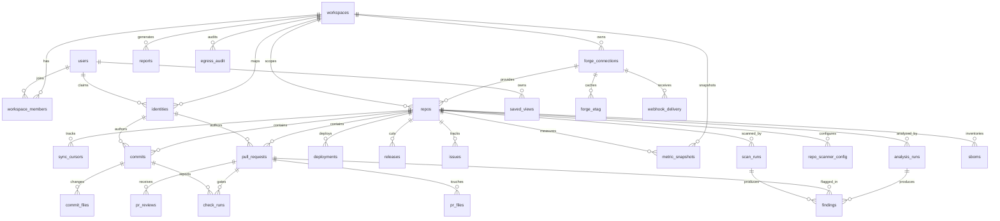

# RepoPulse — Database Design (PostgreSQL 16 + Drizzle)

Traces to: ARCHITECTURE.md ADR-2/3/7, SRS FR/NFR IDs inline. Conventions: `snake_case`;
PKs are `bigint generated always as identity` unless noted; timestamps `timestamptz`;
**every tenant-scoped table carries `workspace_id`** (Law 5, FR-AUTH-3, NFR-4) with
composite indexes leading on it. Forge-native ids are stored as `forge_id text` + natural
unique keys for idempotent upserts (FR-INGEST-6).

## 1. ER diagram

W8 additions (dashed conceptually — land with the W8 security-suite migration, D8):
`repo_scanner_config`, `scan_runs`, `sboms`, plus the findings-table delta below.

## 2. Tables

### Tenancy & identity

**workspaces** — `id, slug unique, name, settings jsonb, created_at`. `settings` holds
score weights (FR-INSIGHTS-2), bot-login list (SRS §1.1), stale-PR N days (FR-METRICS-8),
LM host list + concurrency cap, budget share. Seeded with `default` (D1).

**users** — `id, forge_user_id text, login, name, avatar_url, created_at`; unique
`(forge_user_id)`. Created on first OAuth login (FR-AUTH-1). Not workspace-scoped (a user
may join many workspaces).

**workspace_members** — `workspace_id, user_id, role enum('admin','member'), created_at`;
PK `(workspace_id, user_id)` (FR-AUTH-3/4).

**forge_connections** — `id, workspace_id, provider enum('github','gitea'), auth_kind
enum('pat','app'), credential_ciphertext bytea, credential_iv bytea, key_version int,
credential_fingerprint text (last-4/hash for UI), app_installation_id text null, webhook_secret_ciphertext bytea,
status, created_by, created_at`. AES-256-GCM, key from env — plaintext never in DB/logs
(FR-AUTH-5, NFR-6). Decryption only inside packages/forge memory.

**identities** — the forge-login→human map (FR-AUTH-6, FR-METRICS-3 ownership).
`id, workspace_id, provider, forge_login, forge_user_id text null, display_name,
user_id null FK users, is_bot bool default false, merged_into_id null self-FK`.
Resolution strategy: (1) auto-link on OAuth login by forge_user_id; (2) auto-flag bots by
`*[bot]` pattern + workspace bot list; (3) same-human-across-forges (v1.x Gitea) via admin
merge UI (plan W5-05) writing `merged_into_id` — all fact tables FK the RAW identity, queries
resolve through `COALESCE(merged_into_id, id)` so merges are non-destructive and reversible.
(4) **Email-only commits** (`authorLogin: null`, FORGE_PROVIDER.md §1): ingest creates a
provider-scoped fallback row with `forge_login = 'email:{address}'` so churn/ownership never
silently drop them; these rows are mergeable like any other identity (W5-05).
Unique `(workspace_id, provider, forge_login)`.

### Sync machinery

**repos** — `id, workspace_id, connection_id, forge_repo_id text, org, name, default_branch,
is_private, is_archived, sync_status enum('pending_backfill','backfilling','live','error',
'paused_budget','paused') , backfill_pct smallint, last_synced_at, last_error text,
tier2_auto bool, tier3_opt_in bool default false, pushed_at` (FR-INGEST-8, FR-ANALYSIS-1).
Unique `(workspace_id, connection_id, forge_repo_id)`.

**sync_cursors** — resumable checkpoints (FR-INGEST-3/6). `workspace_id, repo_id,
entity_type enum('commits','prs','reviews','pr_files','checks','issues','releases',
'deployments','workflow_runs'), cursor_value text (updated_at watermark | page cursor |
delivery id), backfill_done bool, updated_at`; PK `(repo_id, entity_type)`.

**forge_etag** — ETag store (FR-FORGE-4, ADR-1; canonical name per FORGE_PROVIDER.md §3 —
early drafts said `api_cache`). `connection_id, installation_id text null, endpoint_key text
(method+path+params hash), etag text, last_modified text null, last_status smallint,
body_digest text, cached_body jsonb, fetched_at`; PK `(connection_id, endpoint_key)`.
Not workspace-critical (derivable), but carries `workspace_id` anyway for uniform RLS.
Prunable cache — safe to truncate.

**webhook_delivery** — replay/dedup ledger (SC-4, FR-INGEST-5/6; INGESTION.md §4).
`workspace_id, connection_id, delivery_id text unique, event, action text null,
repo_full_name, received_at, payload_digest text`. Insert-or-ignore on `delivery_id`
(duplicate ⇒ 202 no-op); prunable after 30 days.

**job_failure** — DLQ ledger (NFR-11; INGESTION.md §6). `workspace_id, queue text,
job_id text, payload jsonb, error text, failed_at, replayed_at timestamptz null`.
Feeds the admin ops page's DLQ list + replay button.

### Facts (normalized ingest writes — ADR-2 write side)

**commits** — `id, workspace_id, repo_id, sha, author_identity_id, committer_identity_id,
authored_at, committed_at, message_head text (first line), is_revert_heuristic bool,
additions int null, deletions int null, files_count int null, stats_source
enum('detail','stats_api','graphql') null`. Unique `(repo_id, sha)`. `is_revert_heuristic`
precomputed at ingest for FR-METRICS-12 CFR. additions/deletions nullable: filled by the
churn path chosen per research §8 (stats-first, per-commit fallback).

**commit_files** — churn fact granularity = per file per commit (FR-METRICS-1/2/3 need
file-level additions/deletions to compute churn, hotspots, ownership without cloning — C1).
`workspace_id, repo_id, commit_id, path text, additions int, deletions int, status
enum('added','modified','removed','renamed'), previous_path text null`;
PK `(commit_id, path)`. This is the biggest table (~files-per-commit × commits); no patch
text stored (diff text is fetched on demand for LLM tiers, never warehoused — ADR-1).

**pull_requests** — `id, workspace_id, repo_id, number int, forge_pr_id text, title,
author_identity_id, state enum('open','closed','merged'), is_draft bool, is_bot bool,
created_at, updated_at, closed_at, merged_at, merged_by_identity_id, base_ref, head_sha,
additions int, deletions int, changed_files int, first_review_at, first_approval_at,
last_activity_at, last_activity_kind text`. Unique `(repo_id, number)`.
`first_review_at/first_approval_at/last_activity_*` are ingest-maintained denormalizations
so cycle-time (FR-METRICS-4) and staleness (FR-METRICS-8) are index scans, not per-request
review-table aggregation.

**pr_reviews** — `id, workspace_id, repo_id, pull_request_id, forge_review_id text,
reviewer_identity_id, state enum('APPROVED','CHANGES_REQUESTED','COMMENTED','DISMISSED'),
submitted_at`. Unique `(pull_request_id, forge_review_id)` (FR-METRICS-4/5/6).

**pr_files** — `workspace_id, repo_id, pull_request_id, path, additions, deletions,
change_type text`; PK `(pull_request_id, path)`. From GraphQL backfill (research §6);
feeds PR-size (FR-METRICS-7) and file↔PR drill-down. No patch text.

**check_runs** — `id, workspace_id, repo_id, forge_run_id text, kind
enum('check_run','workflow_run'), workflow_name text null, head_sha, pull_request_id null,
status, conclusion, run_attempt smallint, started_at, completed_at, duration_ms bigint`.
Unique `(repo_id, kind, forge_run_id, run_attempt)`. `run_attempt` powers flakiness
(fail→pass same head SHA, FR-METRICS-9).

**deployments** — `id, workspace_id, repo_id, forge_deployment_id text, environment, sha,
created_at, latest_status text, status_updated_at`. Unique `(repo_id, forge_deployment_id)`
(FR-METRICS-12).

**releases** — `id, workspace_id, repo_id, forge_release_id text, tag, name, is_draft,
is_prerelease, published_at`. Unique `(repo_id, forge_release_id)` (FR-METRICS-11).

**issues** — `id, workspace_id, repo_id, number, author_identity_id, state, created_at,
closed_at, reopened_count smallint, is_pull_request bool (always excluded from issue
metrics — FR-METRICS-10)`. Unique `(repo_id, number)`.

### Read models & analysis (ADR-2 read side)

**metric_snapshots** — append-only time series (ADR-7, FR-METRICS-13/14).
`id, workspace_id, repo_id bigint null (NULL = org-level rollup row), metric_key text
(FR-METRICS-1..12 + insights score keys, from the FR-METRICS-15 catalog), window
enum('7d','30d','90d','365d'), dims jsonb default '{}' (e.g. {"author":..,"workflow":..,
"basis":"releases"}), value numeric, numerator numeric null, denominator numeric null,
computed_at`. Never updated, never deleted inside retention. Index:
`(workspace_id, repo_id, metric_key, window, computed_at DESC)`; org rollups indexed via
partial index `WHERE repo_id IS NULL`. numerator/denominator kept so org pooling stays
statistically correct (FR-METRICS-14) and deltas are auditable (FR-INSIGHTS-4).

**analysis_runs** — `id, workspace_id, repo_id, pull_request_id null, tier smallint (2|3),
dimension text, checklist_version text, model_id text, status enum('queued','running',
'succeeded','failed','dead_letter'), chunk_count int, prompt_tokens int, output_tokens int,
cost_usd numeric null (T3), started_at, finished_at, error text` (FR-ANALYSIS-4/7).

**findings** — `id, workspace_id, repo_id, analysis_run_id, pull_request_id null,
dimension enum('code_health','security','performance','test_coverage'), severity
smallint (1–5, 5=critical … 1=info — CANONICAL numeric scale per ANALYSIS_TIERS.md §4;
the SRS labels critical/high/medium/low/info are the presentation mapping; W8 chain math
max(member)+1 and KEV floors require numeric), confidence smallint (1–5, same source),
title, file text, line_start int, line_end int, evidence text, recommendation text,
tier smallint, dedup_key text — CANONICAL formula per ANALYSIS_TIERS.md §5:
`sha256(dimension + '\0' + file + '\0' + normalize(evidence_quote))` + line-bucket tiebreak
(supersedes the earlier normalized-title sketch in FR-ANALYSIS-6), status
enum('open','confirmed','dismissed','resolved','wont_fix') — CANONICAL lifecycle per
ANALYSIS_TIERS.md §5 (`open → confirmed | dismissed(reason) → resolved | wont_fix`;
the UI "acknowledge" action and the SRS/UX 'acknowledged' state map to `confirmed`;
semgrep REAL→confirmed, FP→dismissed(false_positive)), dismiss_reason text null,
status_changed_by, status_changed_at, first_seen_at, last_seen_at, occurrence_count int`.
Unique `(workspace_id, repo_id, dedup_key)` — re-analysis upserts, resolved-that-reappear
reopen (FR-INSIGHTS-1).
Status history in **finding_events** (`finding_id, from_status, to_status, actor, reason, at`).

**reports** — immutable snapshots (FR-REPORTS-1/7). `id, workspace_id, type
enum('repo_health','org_exec','security_posture','delivery_dora'), params jsonb
(repo_ids[], window, pinned_at), status enum('queued','running','ready','failed'),
html_uri text, pdf_uri text, generated_by, generated_at`. `*_uri` point at object/file
storage (local volume v1); DB stores pointers, not blobs.

**saved_views** — `id, workspace_id, owner_user_id, name, config jsonb (repo filter,
window, tile layout), is_shared bool default false, share_slug text unique null,
is_default_for_owner bool, created_at, updated_at` (FR-API-6, FR-WEB-4/5).

**egress_audit** — append-only, Tier-3 only (NFR-9). `id, workspace_id, repo_id,
pull_request_id, analysis_run_id, initiator_user_id, model_id, bytes_sent int,
tokens_sent int, tokens_received int, content_sha256 text, sent_at`. No content stored —
digest only. Admin-queryable, never deleted.

### Security scanning — **W8 migration delta** (D8, FR-SEC-12; docs/design/SECURITY_SUITE.md §1.3)

Scanner findings live in the EXISTING findings store — no parallel store. The W8
migration (additive-first per §5) applies:

**findings delta** — `dimension` enum extended `+= 'secrets'|'dependency'|'sast'|'iac'|
'chain'` (OWASP checklist scanners keep `security`); new nullable columns `scanner_key
text, rule_id text, cve_id text, chain_id text, preconditions jsonb, yields jsonb,
scan_run_id FK scan_runs`; `file`/`line_start`/`line_end` become nullable — repo-level
findings (dependency posture, chains) have no single location (`file` = manifest path for
dependency findings). Dedup key extended: `sha256(scanner_key + rule_id + dimension +
(file ?? '') + normalize(evidence_quote))` — occurrence/reopen semantics unchanged
(FR-ANALYSIS-6 extension). Lifecycle/triage/audit rails unchanged (FR-INSIGHTS-1).
**Secret redaction rule (SC-29):** secrets findings store a fingerprint hash + file/line
only — the matched secret value is NEVER written to any column, log, or report.

**scan_runs** — `id, workspace_id, repo_id, scanner_key, trigger
enum('pr_synced','push','schedule','manual'), commit_sha, status enum('queued','running',
'done','failed','budget_exceeded'), started_at, finished_at, findings_count int,
tool_versions jsonb, error text null`. Powers UI status, per-SHA reproducibility, and the
NFR-13 audit trail. Index `(workspace_id, repo_id, scanner_key, started_at DESC)`.

**sboms** — `id, workspace_id, repo_id, commit_sha, format text ('cyclonedx'), document
jsonb, created_at`; unique `(repo_id, commit_sha)`. The one allowed persistence beyond
findings (coordinates only, no repo code — SECURITY_SUITE.md §3.2). Feeds CVE matching,
`owasp_llm` auto-enablement, and posture rollups.

**repo_scanner_config** — `workspace_id, repo_id, scanner_key, enabled bool, config jsonb,
updated_by, updated_at`; PK `(workspace_id, repo_id, scanner_key)`. Admin-only mutation
(FR-AUTH-4, FR-SEC-11); workspace defaults per SECURITY_SUITE.md §1.

Findings facet index gains scanner columns: `findings(workspace_id, repo_id, scanner_key,
dimension, severity, status)` (W8 migration; supersedes nothing — additive).

### D9/D10 additions (2026-07-14; design: docs/design/IMPROVEMENT_PLANS.md, SECURITY_SUITE.md §3.6)

**analysis_runs delta (D9)** — `pass_kind enum('find','verify','challenge','synthesize',
'narrate','plan') default 'find'`, `parent_run_id bigint null self-FK` — the auditable
find→verify→challenge chain (FR-ANALYSIS-9/10).

**findings delta (D9/D10)** — `verify_status enum('unverified','confirmed','contradicted')
default 'unverified'` (FR-ANALYSIS-9); dependency findings additionally get
`reachability text ('manifest_only'|'imported'|'symbol_reachable'|'proven_unreachable')`,
`epss numeric(5,4) null`, `effective_risk numeric(6,2) null` (FR-SEC-13); `dimension`
enum += `'compound'` (FR-INSIGHTS-6).

**improvement_plans** — `id, workspace_id, repo_ids bigint[], window, created_from_report_id
null FK reports, catalog_version text, status enum('active','archived'), created_by,
created_at` (FR-PLANS-2).

**plan_items** — `id, workspace_id, plan_id FK, rank int, catalog_id text (FR-PLANS-1 entry),
source enum('metric','finding','chain','compound','agreement'), evidence jsonb (metric keys /
finding ids / PR ids), recommendation text, effort enum('S','M','L'), status
enum('proposed','accepted','in_progress','done','regressed','dismissed'), verify_criterion
jsonb ({metric_key, op, target, window} | {finding_ids}), verified_at, status_changed_by,
status_changed_at`. Transitions audited in **plan_item_events** (same shape as
finding_events). Index `(workspace_id, plan_id, status, rank)`.

**agreements** — `id, workspace_id, repo_ids bigint[], kind text (pr_size_max |
review_within_hours | no_unreviewed_merge | stale_ceiling | ci_pass_floor), threshold jsonb,
active bool, created_by, created_at` (FR-PLANS-4). Exceptions computed from facts at read
time (14d window) — no exception rows stored.

**file_intents** — `id, workspace_id, repo_id, path text, intent enum('refactor','supervise',
'acknowledged'), note text, created_by, created_at, warn_after_months smallint default 3`;
unique `(workspace_id, repo_id, path)` (FR-PLANS-5).

**vex_statements** — `id, workspace_id, repo_id, package_purl text, vuln_id text (CVE/GHSA
canonical), version_range text, vex_status enum('not_affected','affected','fixed',
'under_investigation'), justification text null (OpenVEX enum — REQUIRED when not_affected),
evidence jsonb (reachability tier, import scan refs, finding_id), author_user_id, created_at`;
unique `(workspace_id, repo_id, package_purl, vuln_id, version_range)` (FR-SEC-14).
Suppression joins on this at scan time; a version outside `version_range` reopens as
`under_investigation`.

## 3. Hot-path indexes (NFR-3: p95 < 500ms on every dashboard endpoint)

| Query (drill-down level) | Index |
|---|---|
| Org rollup tiles + trends | `metric_snapshots(workspace_id, repo_id, metric_key, window, computed_at DESC)` + partial `WHERE repo_id IS NULL` |
| Repo detail metrics | same snapshot index with `repo_id =` |
| PR list w/ cycle-time sort/filter | `pull_requests(workspace_id, repo_id, state, merged_at DESC)`; `(workspace_id, repo_id, last_activity_at)` for stale (FR-METRICS-8); `(workspace_id, author_identity_id, state)` for "my PRs" (FR-WEB-7) |
| Review-load widget | `pr_reviews(workspace_id, reviewer_identity_id, submitted_at DESC)` |
| File hotspot ranking | `commit_files(workspace_id, repo_id, path, commit_id)` + covering `(repo_id, path) INCLUDE (additions, deletions)`; hotspot scores precomputed into `metric_snapshots(metric_key='hotspot', dims->>'path')` nightly — ranking page reads snapshots, not raw commit_files (FR-METRICS-2, FR-INSIGHTS-5) |
| Churn by author | `commits(workspace_id, repo_id, author_identity_id, authored_at)` |
| CI pass rate | `check_runs(workspace_id, repo_id, workflow_name, completed_at)` |
| Findings filters | `findings(workspace_id, repo_id, dimension, severity, status)` |
| Webhook idempotency | unique natural keys listed per table above |

Why `metric_snapshots` instead of on-the-fly aggregation: org rollup = 50 repos × 12
metrics × trend points; aggregating raw facts per request would scan millions of
commit_files rows and blow NFR-3. Snapshots make every tile/trend a narrow index-range
scan; correctness is preserved by storing numerator/denominator for pooled re-aggregation
(FR-METRICS-14). Current-window "live" values are recomputed only on ingest events
(webhook → recompute affected metric), not on read (ADR-2).

## 4. Retention (SRS §5 A3)

- Raw facts (commits, commit_files, prs, …): indefinite at launch; every fact table keys on
  `(workspace_id, repo_id, time)` so a future retention knob is a ranged DELETE / partition
  drop — schema does not preclude it. commit_files is the candidate for pg_partman
  partitioning by month if it outgrows ~100M rows (defer until measured).
- `metric_snapshots`: ≥400 days (FR-METRICS-13); nightly prune beyond policy.
- `reports`: immutable, kept forever (FR-REPORTS-1); `egress_audit`: never deleted (NFR-9).
- `forge_etag`: prunable LRU, 90-day sweep; `webhook_delivery`: 30-day sweep.

## 5. Migration discipline (Drizzle)

- Schema lives in `packages/shared/src/db/schema/*.ts`; `drizzle-kit generate` produces SQL
  in `packages/shared/drizzle/` — committed, sequential, NEVER edited after merge.
- Every migration PR states: forward SQL, rollback note (explicit down-SQL in the PR
  description — Drizzle has no auto-down; destructive changes require a two-step
  expand→migrate→contract sequence across releases), and data backfill plan if any.
- Additive-first rule: new columns nullable-or-defaulted; renames = add + backfill + drop
  in separate migrations so old worker/api versions never break mid-deploy.
- `drizzle-kit migrate` runs as a one-shot job before api/worker start (compose/Podman
  dependency); CI gate applies all migrations to a scratch Postgres 16 + runs the tenancy
  suite (NFR-4) before merge.
- Enums: prefer text + CHECK constraint over Postgres enums for anything likely to grow
  (metric_key, dimension stays enum — checklist-bound).
