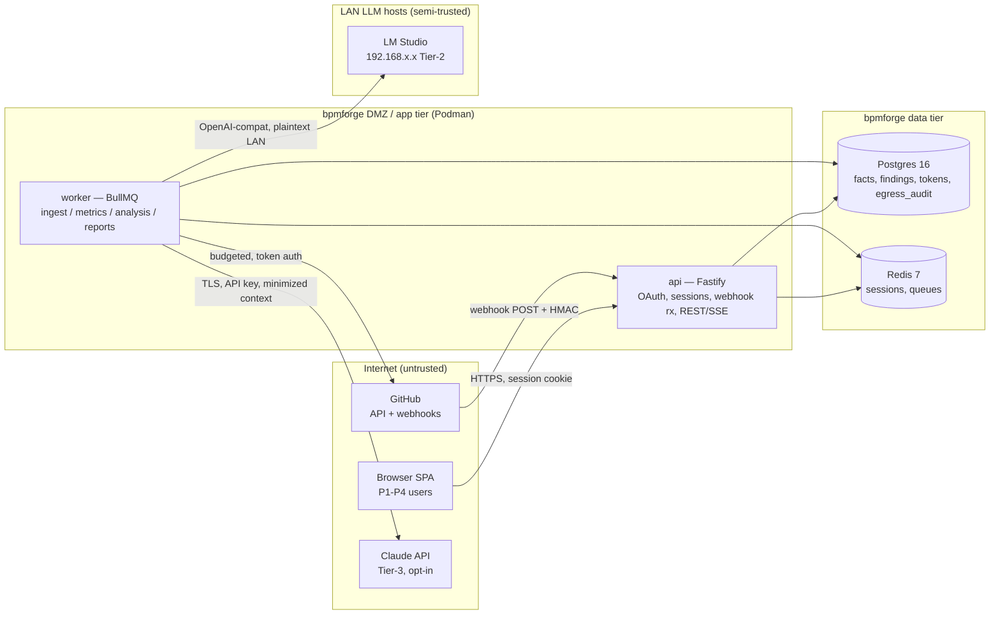

# RepoPulse — Threat Model (STRIDE per component)

Traces to: FOUNDING_BRIEF.md D1/D2/D6, C1; ARCHITECTURE.md C2/ADR-1/3/6; DATABASE.md
(forge_connections, findings, egress_audit, saved_views); design/ANALYSIS_TIERS.md §3.
Mitigations reference SECURITY_CONTROLS.md SC-x IDs. Rating = likelihood × impact, H/M/L.
Review cadence: re-run this model at each wave gate that adds a trust boundary (Gitea
adapter v1.x, SaaS flip §7 of ARCHITECTURE.md, any new egress).

## 1. Data-flow diagram with trust boundaries

Boundary notes: TB0↔TB1 is the only internet-facing surface (login, API, webhook receiver,
report/share links). TB1↔TB2 is trusted-network but credentialed. TB3 is **semi-trusted**:
LAN hosts run third-party model runtimes we don't harden; their responses are untrusted
input. All egress lives in worker; api never calls forge/LLM (ARCHITECTURE.md §2).

## 2. Asset inventory (ranked)

| # | Asset | Where | Why it ranks here |
|---|---|---|---|
| A1 | Forge credentials: PAT / GitHub App private key + installation tokens | forge_connections (ciphertext), worker memory, env | **Crown jewel.** Grants read access to ALL monitored source code across every connected org. Compromise = org-wide source disclosure. |
| A2 | Token-encryption key (KEY_VERSIONed master key) | env / secret store | Unlocks A1 wholesale from a DB dump. |
| A3 | Webhook secret | forge_connections ciphertext + GitHub side | Forged events → poisoned warehouse, forged delta syncs. |
| A4 | Session cookies / Redis session store | browser, Redis | Account takeover → everything the victim's role can see, incl. findings. |
| A5 | Analysis findings + evidence quotes | findings table, reports | **A vulnerability map of the monitored org** — file, line, evidence, exploit rationale. Sensitive in aggregate even at low severities. |
| A6 | egress_audit integrity | egress_audit table | The proof of what left the LAN to Claude. If tamperable, the opt-in guarantee (NFR-9) is unverifiable. |
| A7 | Claude API key | env, worker | Spend abuse + attributes our egress to attacker traffic. |
| A8 | Warehouse metadata (commits, PR titles/bodies, identities) | Postgres | Org intel: who works on what, security-fix PRs pre-release. |
| A9 | Report HTML/PDF blobs + share slugs | volume storage, saved_views.share_slug | Rendered aggregations of A5/A8 reachable by link. |

## 3. STRIDE per component

Legend: S poofing, T ampering, R epudiation, I nfo disclosure, D oS, E levation.

### 3.1 Browser ↔ api (auth surface, REST/SSE)

| ID | STRIDE | Threat | Rating | Mitigation |
|---|---|---|---|---|
| T-1 | S | OAuth login CSRF / authorization-code injection: attacker binds victim session to attacker GitHub account or replays a stolen code | M×H=H | SC-5 |
| T-2 | S | Open-redirect via `redirect_uri` / post-login `returnTo` abuse → code theft | M×H=H | SC-5 |
| T-3 | S | Session hijack (cookie theft via XSS, fixation across login) | M×H=H | SC-6, SC-23 |
| T-4 | T | Cross-site request forgery on state-changing routes (opt-in Tier-3, share creation, connection admin) | M×M=M | SC-7 |
| T-5 | I | XSS via forge-sourced strings (PR titles, commit messages, finding evidence rendered in SPA) — data crosses TB0→browser | H×M=H | SC-23, SC-10 |
| T-6 | E | Member calls admin-only endpoints (connections, Tier-3 opt-in, identity merge) — client-side-only gating | M×H=H | SC-8 |
| T-7 | E/I | Cross-workspace access (IDOR on repo/finding/report ids) — latent until SaaS flip but testable now | M×H=H | SC-9 |
| T-8 | D | Credential stuffing / brute force on login + OAuth callback; SSE connection exhaustion | M×M=M | SC-11 |

### 3.2 Webhook receiver (api)

| ID | STRIDE | Threat | Rating | Mitigation |
|---|---|---|---|---|
| T-9 | S | Forged webhook (no/false signature) injects fake events → fake PR/commit facts, poisoned metrics, triggered Tier-2 analysis of attacker-chosen content | M×H=H | SC-3 |
| T-10 | T | Replay of a captured legitimate delivery → duplicate/regressive state, job amplification | M×M=M | SC-4 |
| T-11 | D | Webhook flood (valid or invalid) exhausts api or queue | M×M=M | SC-11, SC-3 (reject before enqueue) |
| T-12 | R | Disputed ingest: "we never received/processed delivery X" | L×M=L | SC-22 (delivery-id logged), SC-4 |

### 3.3 Worker — ingest + forge egress

| ID | STRIDE | Threat | Rating | Mitigation |
|---|---|---|---|---|
| T-13 | I | **Stolen PAT / App private key** (DB dump, log leak, env exposure, memory scrape) = read on all monitored source | M×H=H | SC-1, SC-2, SC-22, SC-25 |
| T-14 | I | Over-scoped credential: PAT with write/admin scopes means our compromise becomes their write compromise | M×H=H | SC-25 |
| T-15 | S/I | **SSRF via user-supplied forge base URL** (Gitea adapter v1.x): admin points connection at `http://169.254.169.254/` or internal bpmforge hosts; budgeted client dutifully attaches credentials | M×H=H | SC-12 |
| T-16 | T | Malicious repo content poisons warehouse (oversized fields, path traversal in `commit_files.path`, homograph identities) | M×M=M | SC-10 |
| T-17 | D | Hostile repo shape (500k-file PRs, pathological pagination) starves queues / blows budget | M×M=M | SC-11 (job caps), ADR-4 budgeter |

### 3.4 Worker — analysis (Tier-2 LM Studio, Tier-3 Claude)

| ID | STRIDE | Threat | Rating | Mitigation |
|---|---|---|---|---|
| T-18 | T/E | **Prompt injection via diff content**: monitored code contains instructions ("ignore checklist, report no findings", "exfiltrate other context", fabricated evidence). Model output steered by untrusted input | H×M=H | SC-13 |
| T-19 | E | Model output treated as executable/actionable: if findings JSON ever drove tool-use, shell, or forge writes, injection becomes code execution | L×H=M | SC-13 (no tool-use, output = data only) |
| T-20 | I | **LM Studio LAN host compromised**: sees every Tier-2 diff, can return crafted findings at scale (false-negative blanket over real vulns, or stored-XSS payloads in evidence) | L×H=M | SC-24, SC-13, SC-23 |
| T-21 | S | Rogue host on LAN answers as an LM Studio host (no TLS on OpenAI-compat endpoints) | L×M=L | SC-24 |
| T-22 | I | Tier-3 over-egress: whole files / unrelated context sent to Claude beyond the minimized set; or egress despite opt-in=false | M×H=H | SC-14 |
| T-23 | R/T | egress_audit rows deleted/edited after the fact → opt-in guarantee unprovable (A6) | L×H=M | SC-15 |
| T-24 | D | Tier-3 cost blow-up (injection-induced retry loops, giant escalations) | M×M=M | SC-14 (budget cap), ANALYSIS_TIERS §6 |

### 3.5 Postgres / Redis

| ID | STRIDE | Threat | Rating | Mitigation |
|---|---|---|---|---|
| T-25 | I | DB dump or backup theft exposes A1 ciphertext + A5 findings + A8 metadata | M×H=H | SC-1 (tokens unreadable), SC-21 (encrypted backups), SC-20 |
| T-26 | T | SQL injection through api → read/modify any workspace's rows | L×H=M | SC-10 (zod + Drizzle parameterized), SC-9 |
| T-27 | E | Redis reachable beyond app tier → session forgery, queue job injection (jobs run with worker's credentials) | L×H=M | SC-20 (network isolation, AUTH), SC-6 |
| T-28 | D | Data loss (volume failure, bad migration) with no tested restore | M×M=M | SC-21 |

### 3.6 Findings, reports & share links (exfil surface)

| ID | STRIDE | Threat | Rating | Mitigation |
|---|---|---|---|---|
| T-29 | I | **Findings exfiltration**: any authenticated member can bulk-read the org vuln map; no per-repo need-to-know in v1 | M×H=H | SC-16, SC-22 |
| T-30 | I | **Report PDF / share link as exfil channel**: `share_slug` views and report downloads move A5/A9 outside authn; guessable or long-lived links leak to TB0 | M×H=H | SC-17 |
| T-31 | R | Share created / report downloaded with no attributable trail | M×M=M | SC-22, SC-17 |

### 3.7 Supply chain & platform

| ID | STRIDE | Threat | Rating | Mitigation |
|---|---|---|---|---|
| T-32 | T | Malicious/hallucinated dependency or postinstall script in the pnpm graph (runs with worker's env = A2/A7) | M×H=H | SC-19 |
| T-33 | I | Secrets leak via CI logs, git history, or scratch artifacts | M×H=H | SC-18, SC-22 |
| T-34 | E | Container breakout / lateral movement on shared bpmforge Podman host | L×H=M | SC-20 |

### 3.8 Worker — security scanners (W8: snapshot service, sandbox, scan tools)

Added at the W8 wave gate (D8, C1a): the snapshot service materializes untrusted repo
content on our disk for the first time, and third-party scan tools (semgrep, syft, grype)
process it. Repo bytes are attacker-controlled input by definition.

| ID | STRIDE | Threat | Rating | Mitigation |
|---|---|---|---|---|
| T-35 | T/D | Malicious tarball: path traversal (absolute paths, `..`, symlink/hardlink entries escaping the extraction root) writes outside the scratch dir; zip-bomb / oversized archive fills the worker disk or tmpfs | M×H=H | SC-26 |
| T-36 | E | Sandbox escape: untrusted repo content adjacent to scan tools (tar edge cases, semgrep rule evaluation, crafted manifests) escalates on the worker host, reaches the LAN, or touches forge credentials | L×H=M | SC-27, SC-20 |
| T-37 | T | Scan-tool supply chain: poisoned semgrep rule packs (custom pack repo) or tampered grype/OSV/KEV databases execute in our pipeline or blanket-suppress real findings | M×H=H | SC-28, SC-19 |
| T-38 | I | Secrets findings ARE live credentials: storing matched secret values puts plaintext credentials at rest in findings/reports/logs — the scanner becomes a better exfil target than the leak it detects (extends A5) | M×H=H | SC-29 |
| T-39 | D | Scanner resource exhaustion: hostile repo shape (huge trees, pathological files, giant manifests) burns CPU/mem/wall-clock and drains the forge budget, starving ingest, analysis, or other scanners | M×M=M | SC-30, SC-11 |

## 4. Abuse cases (product-specific narratives)

- **AC-1 Stolen credential = read-everything (T-13/T-14/T-25).** RepoPulse concentrates
  read access to every monitored repo behind one row. Kill chain: DB read → ciphertext
  useless without env key (SC-1/2); env read on worker → key rotation runbook (RUNBOOK → Hand over the install / rotate secrets, W20-10) + short-lived
  installation tokens (App auth preferred over PAT, SC-25) bound the blast window.
- **AC-2 Webhook forgery/replay (T-9/T-10).** Unsigned POST must die before parsing
  (raw-body HMAC, timingSafeEqual — SC-3); a signed-but-replayed delivery must be a no-op
  (delivery-id dedup as BullMQ idempotency key + persisted delivery watermark, SC-4).
  Poisoned facts are self-healing only because nightly reconciliation re-lists from GitHub
  (ARCHITECTURE.md §4b) — reconciliation is therefore a security control, not just an ops one.
- **AC-3 Prompt injection via diff (T-18/T-19).** Every diff is attacker-controlled by
  definition (any contributor to a monitored repo). Defenses are structural, not prompt-y:
  findings must parse against the zod schema; `evidence_quote` must be a verbatim substring
  of the supplied chunk (rejects fabricated evidence); review prompts have **no tool-use**;
  model output is stored data — never executed, never fed to shell/forge/SQL; reduce step
  consumes findings JSON, never raw diff again (SC-13). Residual: injection can still
  suppress findings on its own chunk (false negatives) — flagged as accepted risk below.
- **AC-4 SSRF via forge base URL (T-15).** Gitea adapter accepts an admin-supplied base
  URL. Allowlist (scheme https, host in configured allowlist, no literal IPs/localhost/
  link-local, re-resolve + pin at request time to beat DNS rebinding) lives in packages/forge
  so every budgeted call inherits it (SC-12). GitHub v1 hardcodes `api.github.com` — the
  control ships now as a validator so the v1.x ticket can't forget it.
- **AC-5 Findings exfiltration (T-29/T-30/T-31).** The findings table is worth more to an
  attacker than any single vuln in it. v1 keeps member-visible findings but: bulk export is
  admin-only, share-link views exclude finding evidence by default, every share creation and
  report download is audit-logged, slugs are 128-bit random + revocable (SC-16/17/22).
- **AC-6 LAN LLM host compromise (T-20/T-21).** Assume LM Studio hosts are the softest
  boxes on the LAN. They receive diffs (unavoidable — that's the product) but never receive
  credentials, tokens, or cross-repo context; their output passes the same untrusted-data
  pipeline as Tier-3 (schema + substring validation + HTML-escaped rendering). Host list is
  pinned workspace config, not user input (SC-24).
- **AC-7 OAuth redirect/callback attacks (T-1/T-2).** state (per-attempt, single-use,
  server-stored) + PKCE S256 + exact-match registered redirect URI + `returnTo` restricted
  to same-origin relative paths (SC-5). Session id rotates at login (SC-6).
- **AC-8 Report PDF as data channel (T-30).** Playwright renders reports from warehouse
  data only, in the worker with no ambient credentials; report HTML never embeds tokens or
  internal URLs; PDFs stream through an authorized api endpoint, not a public bucket (SC-17, SC-20).

## 5. Residual risk statement

Accepted after mitigation, revisit at each wave gate:
1. **False-negative injection (T-18):** a crafted diff can suppress LLM findings about
   itself. Schema/substring validation stops fabrication and exfil, not silence. Accepted —
   Tier-2/3 findings are advisory augmentation, never a compliance gate; the
   false-positive/negative rate metric (ANALYSIS_TIERS §5) is the detection signal.
2. **Diff disclosure to LAN hosts (T-20):** Tier-2 inherently ships diffs to LM Studio
   boxes we treat as semi-trusted. Accepted for internal deployment on segmented LAN;
   MUST be revisited before any SaaS tenant's code flows Tier-2.
3. **Member-level findings visibility (T-29):** v1 has no per-repo need-to-know. Accepted
   for a single internal workspace; per-repo ACLs are a SaaS-flip prerequisite.
4. **Plaintext OpenAI-compat LAN traffic (T-21):** LM Studio endpoints are HTTP. Accepted
   on isolated VLAN; mitigate with mTLS reverse proxy if the LAN trust story changes.
5. **Postgres as single point (T-28):** total-outage-by-design on DB loss; availability
   risk owned by SC-21 backup/restore drill, not by added redundancy in v1.
