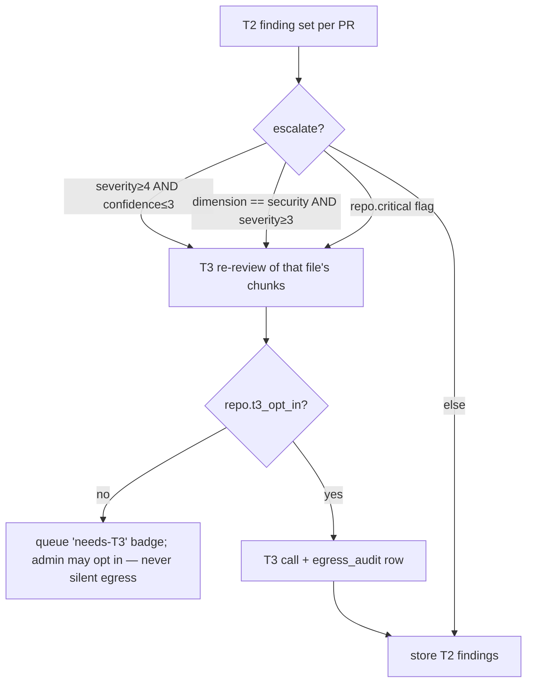

# Analysis Tiers — LLM Review Engine (packages/analysis) — v1.x wave 2

Traces: FR-ANALYSIS-1..8, FR-INSIGHTS-1, NFR-7/8/9, C2, D2. Rule (CLAUDE.md Law 8): all LLM
traffic goes through this gateway — lint forbids direct HTTP to LM Studio hosts or `@anthropic-ai/sdk`
imports outside `packages/analysis`.

## 1. Gateway interface (FR-ANALYSIS-1)

```ts
export type Tier = 'T2' | 'T3';
export interface CompleteOpts {
  tier: Tier; maxTokens: number;            // T2 MUST be 45000 (C2/NFR-8; enforced by wrapper, not callers)
  temperature?: number;                     // default 0.1 — findings, not prose
  expectJson: true;                         // all analysis calls are JSON-mode
  meta: { repoId: string; prNumber: number; dimension: Dimension; checklistVersion: string; initiator: string };
}
export interface CompleteResult { text: string; model: string; tokensIn: number; tokensOut: number;
  costUsd: number | null;                   // null for T2 (LAN), real for T3
  durationMs: number; }
export interface AnalysisGateway {
  complete(prompt: string, opts: CompleteOpts): Promise<CompleteResult>;  // routes by opts.tier
  health(tier: Tier): Promise<{ ok: boolean; model?: string }>;
}
```

Dispatcher rules (FR-ANALYSIS-1): default tier T2 for bulk/webhook-triggered review; T3 only
when `repo.t3_opt_in` (admin flag) or per-PR override — T3 without opt-in ⇒ **rejected**, not
downgraded silently (auditability). Scheduling per FR-ANALYSIS-8: repo policy `auto|manual|off`,
org-level concurrency cap on LAN hosts (workspace config), BullMQ queue `analysis.review`
(idempotency key `an:{repoId}:{pr}:{headSha}:{dimension}`; NFR-7: LAN host unreachable ⇒ park +
backoff retry, Tier-1 dashboards unaffected, UI banner "Tier-2 analysis paused — host unreachable").

## 2. Tier-2 — LM Studio (FR-ANALYSIS-2, NFR-8, C2)

```ts
interface T2Config {
  hosts: { baseUrl: string; modelSlot: string }[];   // OpenAI-compatible /v1/chat/completions, LAN
  maxTokens: 45000;                                  // literal type — headroom for thinking models
  warmup: { pingPrompt: 'ping'; timeoutMs: 15000; retries: 2 };
  crashRetry: { matches: ['model crashed', 'ECONNRESET', 'model_not_loaded']; attempts: 3; backoffMs: [5000, 15000, 60000] };
  concurrencyCap: number;                            // per host, workspace config (FR-ANALYSIS-8)
}
```

Wrapper behavior (every call, no exceptions): (1) if host cold or last call errored, send
warm-up ping and wait for completion before the real call; (2) on crash-match error: warm-up →
retry per backoff; (3) 45000 maxTokens always set; (4) **real usable output ≈10k tokens** on
qwen3.6-class models ⇒ chunking must keep projected output ≤10k (below).

### Chunking (FR-ANALYSIS-3)

Diff source = warehouse `pr_file` rows + on-demand REST `getPullRequestFiles` patches
(FORGE_PROVIDER.md — GraphQL has no patch text). Estimator: `tok(s) ≈ ceil(bytes/3.4)`;
projected output ≈ `min(10k, 0.35 × patchTokens + 800)` per chunk.

1. Split per file. Skip: `patchTruncated`, binary, generated (lockfiles, `*.min.*`, workspace
   globs) — record as `skipped` with reason (coverage honesty).
2. File whose patch fits budget (`promptTokens ≤ 24k` and projected output ≤ 10k) → one chunk;
   greedy-pack small files together per dimension.
3. Oversized file → split by hunk groups at hunk boundaries, never mid-hunk; each sub-chunk
   ≤ budget. Property: **every hunk in exactly one chunk** (FR-ANALYSIS-3 acceptance).
4. Every chunk prompt carries: PR title + description (truncated 1k tok), file path(s),
   language hint, dimension checklist.
   **Repo-wide context (W18-25):** checklist prompts also carry the callers and callees of
   the chunk's changed functions, read from the fast-lane import graph the weekly
   `anti_slop` pass persists (`metric_snapshots`, key `import_graph`, latest row only). The
   context is fenced as DATA beside the diff, never inside `chunk.text`, so it can never pass
   evidence validation; its budget is `min(1.2k, 24k − chunk promptTokens)`, cut at whole
   lines (`[context truncated]`), shipped files and callers before tests. An incomplete
   (capped) graph is labelled as such. Measured on 15 Repo Pulse branch diffs (24 chunks):
   prompts +1.9% (435,007 → 443,407 est. tokens), no chunk over budget; diffs of only new
   files get none (they are not in the base graph).
5. **Map-reduce**: chunk calls emit findings (map); a final small call gets the deduped
   finding list + PR metadata and emits a PR-level verdict/summary (reduce). Reduce input is
   findings JSON, never re-pasted diff — bounded regardless of PR size.

### Cacheable prompt prefix (W23-06, INCREMENTAL_SCAN_PLAN X7)

Every chunk of a dimension used to re-send the same checklist inside one user message, so
nothing gave a server a stable prefix to cache. A chunk prompt is now two parts
(`buildPromptParts` in `chunker/prompt.ts`):

- **static** = checklist + required-JSON schema + rules. Byte-identical for every chunk of
  one dimension at one checklist version (a test hashes it across chunks).
- **dynamic** = PR context + the chunk's file list + the diff. Everything that varies.

`text` is always `static + "\n\n" + dynamic`; that string is what the egress audit hashes,
so audit digests do not depend on the split. The split rides to transports on
`CompleteOpts.promptParts` and is honoured only when it reassembles to exactly the prompt
passed in, so a caller that appends a retry note must append it to `dynamic` too (the
specialist runner does) or the call falls back to one user message.

**Prompt reordering, deliberate.** The schema block used to trail the diff. A prefix has to
come first, so it moved ahead of the PR context, and "the diff above" became "the diff you
are given". The prompt is therefore not byte-identical to before; the golden digests in
`checklist-v2.test.ts` / `checklist-v3.test.ts` were re-recorded once for this. Checklist
versions are unchanged. Eval fixtures (W19-05) were not re-run for the new order.

| Transport | Request shape |
|---|---|
| OpenAI-compatible: LM Studio, Ollama, hosted, **Bedrock** and **Vertex** (both reached through their OpenAI-compatible chat surfaces) | `messages: [{system: static}, {user: dynamic}]`. The server's prefix/KV cache sees the same leading bytes each call. No `cache_control` is sent: those surfaces take none. |
| Tier-3 Anthropic API (`t3/client.ts`) | `system: [{type:"text", text: static, cache_control:{type:"ephemeral"}}]`, `messages: [{user: dynamic}]`. |
| Claude Code CLI | `--append-system-prompt <static>`; the diff stays on stdin. Appended, not replacing, so the CLI's own system prompt is unchanged. |

`max_tokens` (45000 on T2), temperature, streaming, warm-up and crash retry are untouched.

**Telemetry.** `CompleteResult.cacheReadTokens` (0 when the provider reports none), read from
`usage.prompt_tokens_details.cached_tokens` (OpenAI-compatible), `cache_read_input_tokens`
(Claude CLI and Anthropic). It is already inside `tokensIn`. Persisted per analysis run in
`analysis_runs.cache_read_tokens` (migration 0065) and shown on Settings → Models as
"Prompt cache per model": cache-read / input tokens over each model's last 50 runs
(`GET /admin/models/cache`). A model whose runs never reported a figure reads "not
reported", not 0%. Tier-3 cost estimates now price cache reads at 0.1x and cache writes at
1.25x of the input rate.

## 3. Tier-3 — Claude API (FR-ANALYSIS-7, NFR-9)

- Client: `@anthropic-ai/sdk` (verify model ids/params against the claude-api skill reference
  at implementation time — Law 2). Same finding schema, whole-PR context within model limits
  (large PRs reuse the T2 chunker with a much bigger budget).
- **Egress minimization** (NFR-9): send diff hunks + PR title/description + dimension
  checklist + ≤40 lines of surrounding context per finding-bearing file, fetched via targeted
  `getFileContent` (FR-FORGE-6) only when the checklist requires it — **never whole files
  unless targeted-fetched, and every such fetch is itself logged**. No repo tree, no unrelated files.
- **Audit row per call** (NFR-9): `egress_audit(workspace_id, ts, repo_id, pr_number, dimension,
  model, bytes_sent, tokens_in, tokens_out, content_sha256, cost_usd, initiator, checklist_version)`
  — written before the response is processed; admin-queryable; feeds the Security Posture
  report (REPORTS.md).

## 4. Dimension checklists (FR-ANALYSIS-4) — ported from bpm-opencode-experts, versioned assets

Prompt template (per dimension, `checklists/{dim}.v{N}.md`): system framing ("senior reviewer,
diff-scoped, cite only evidence present in the diff; no speculation beyond provided lines") +
dimension checklist + REQUIRED JSON schema + the chunk.

| Dimension | Checklist focus (diff-scoped) |
|---|---|
| `code_health` | cyclomatic/nesting growth, duplication introduced, error handling (swallowed/empty catch, exception control-flow), dead/unreachable code added, misleading names/comments |
| `security` | OWASP-informed: injection (SQL/cmd/path/template), authz gaps (missing checks on new routes/queries), secrets/credentials in diff, crypto misuse (weak hash, static IV/salt, homemade crypto), unsafe deserialization, SSRF-able fetches |
| `performance` | N+1 query patterns, O(n²)+ loops over unbounded input, blocking-in-async (sync fs/crypto in handlers), unbounded Promise.all / missing pagination, hot-loop allocations |
| `test_coverage` | does the diff add/modify tests matching changed behavior; **risky-untested-change heuristic**: non-trivial logic change (branching/auth/money/parsing) with zero test-file changes in the PR ⇒ finding |
| `best_practices` | (W19-03) departs from the surrounding pattern, misleading names, comment contradicts code, silent contract break, unvalidated boundary input, leaked resources, reaching through module boundaries, magic values |
| `ai_slop` | (W19-03) judgement-only slop: silent fallback hiding a dead primary path, one-use abstraction, speculative generality, cargo-cult patterns, narration comments, unwired scaffolding, stubs presented as features, model output used as trusted input — mechanical rules stay with the slop scanner |

### REQUIRED finding JSON (FR-ANALYSIS-5; zod-validated; malformed ⇒ retry once w/ error appended ⇒ dead-letter with raw payload kept)

```ts
const Finding = z.object({
  dimension: z.enum(['code_health', 'security', 'performance', 'test_coverage', 'best_practices', 'ai_slop']),
  severity: z.number().int().min(1).max(5),      // 5=critical … 1=info (maps to FR-ANALYSIS-5 scale)
  confidence: z.number().int().min(1).max(5),
  file: z.string(), line_range: z.tuple([z.number(), z.number()]),
  title: z.string().max(120),
  evidence_quote: z.string().max(600),           // verbatim from the diff — validator rejects non-substring quotes
  rationale: z.string().max(800),
  suggested_fix: z.string().max(800).nullable(),
});
// stored with: tier, model id, checklist_version, run id (FR-ANALYSIS-5)
```

## 5. Dedup, re-review, triage

- **Dedup** (FR-ANALYSIS-6): `dedup_key = sha256(dimension + '\0' + file + '\0' +
  normalize(evidence_quote))` where normalize = lowercase, collapse whitespace, strip line
  numbers/digits-only tokens; line-bucket (⌊start/10⌋) appended as tiebreak. Re-run on
  unchanged PR ⇒ update `last_seen` + `occurrence_count`, 0 new rows; a `resolved` finding
  whose key reappears **reopens** (status → open, audit row).
- **Re-review on PR update** (webhook `synchronize`): diff old vs new file list by
  (path, patch sha) — only changed/added files re-chunked; findings on files no longer in the
  diff auto-resolve with reason `outdated_diff`.
- **Triage** (FR-INSIGHTS-1): finding lifecycle `open → confirmed | dismissed(reason) →
  resolved | wont_fix`; every transition audited. Dismissals with reason `false_positive` feed
  metric `analysis_false_positive_rate{dimension, model, checklist_version}` — the tuning
  signal for checklist version bumps and T2 model selection.

## 6. Cost & routing policy (T2→T3 escalation)



T3 spend guarded by workspace monthly budget (config, USD); exceeding ⇒ escalations queue as
`needs-T3` instead of calling. Every T3 result stores `cost_usd`; per-repo cost rollup exposed
on the admin ops page (NFR-12).

## 7. Verified patches (W18-19, D16 "Verified + CI pull")

A model drafts a fix for ONE finding; Repo Pulse proves it before anyone sees it.
Code: `packages/security/src/patches/` (diff gate, prompt, verifier, runners, job),
`apps/api/src/routes/patches/` (API), `apps/api/src/workers/patch-processor.ts`
(`patches.draft` queue), `apps/web/src/widgets/findings/VerifiedFix.tsx` (drawer).

1. **Eligibility.** Only findings a deterministic rule produced: the shipped semgrep
   pack (`semgrep`), the `bpm-log-*` and `bpm-perf-*` packs, and the anti_slop fast
   lane (LDR, docstring inflation, unused exports, phantom imports). Model findings
   (`slop.judgment`, `logging.judgment`, OWASP checklists) have no rule to re-run;
   secrets are fixed by rotation, not a diff; `code_health_tools` (lizard/jscpd) is
   whole-tree and not re-runnable per file yet. The snapshot is the commit of the most
   recent successful run of the finding's scanner that could have sighted it.
2. **Draft.** Through the analysis gateway like every LLM call (Law 8): Tier-2 — the
   workspace's own model — by default, 45000 maxTokens, temperature 0. Tier-3 only when an
   admin asks AND the repo is opted in; the gateway re-checks the opt-in and writes the
   egress-audit row. The prompt carries the finding, its evidence and the file (whole up to
   600 lines, else ±150 lines around the finding, capped at 48 KB) — never the repo.
3. **Shape gate** (`diff.ts`). The reply must be a unified diff that modifies only the
   finding's file — no create/delete/rename/mode change, no second file, ≤ 16 KB and ≤ 200
   changed lines, and it must apply with EXACT content match at the scanned commit
   (hunks may sit at a different line than their header says; an ambiguous match is
   refused). The diff stored and shown is re-rendered from what was applied, so
   `git apply` takes it as-is.
4. **Verify** (`verify.ts`). The original and patched file are written to a `snap-*`
   scratch dir under the snapshot root (the sandbox's mountable volume; shredded in a
   `finally`, swept if killed) and every rule set is run on both: the YAML packs through
   the existing sandboxed runner (architecture rule 7 — no scan tool outside the
   sandbox), the fast lane in process, with the whole-tree rules fed the snapshot tree
   with the patched file substituted (when the forge supplies an archive). **Verified iff**
   the target's dedup key is present before and gone after, its rule fires fewer times
   (a patch that only pushes the finding into another 10-line bucket is caught), no rule
   fires more times than before (counted per rule so shifted lines are not "new"), and
   every rule set ran. A target the before-scan cannot reproduce is rejected, never
   verified; a rule set that fails makes the attempt `failed`.
5. **The verifier is not a model.** maker≠verifier (§5/FR-ANALYSIS-9) taken to its end:
   the judge is the same deterministic rules that raised the finding.
6. **Budget.** One model call per finding × commit (idempotent row), 50 requests per
   workspace per rolling day, 10/min per caller, one queue attempt (no auto-retry of a
   model call).
7. **Who sees what.** Verified: the diff, Copy, Download `.patch`, and a note that it
   was re-scanned. Rejected: nothing to a developer — the API does not send the diff or
   reason; an admin sees the reason (drawer note and `GET /admin/patches`).
8. **D9a.** Nothing is written to the forge — no branch, commit, PR or comment. The only
   forge calls are reads on the budgeted `scan` lane (the archive at the commit, or the
   one file). Pinned by `apps/api/test/security/verified-patch-no-forge-write.test.ts`
   and the forge proxy in `patches/run.integration.test.ts`.

Known limits: a verified patch is "clears this rule set and adds no finding to it", not
"correct" — the note tells the developer to review it like any change, and a prompt
injection in the scanned file can at most produce a patch the rules do not object to.
Rule sets are run twice per attempt (before and after) as separate sandbox runs.

## 8. Incremental re-review on a new push (W23-07)

A pull request that gets another push is not re-read from scratch. When a
review of the same PR already **finished cleanly** at an earlier head with the
**same prompt version**, only the hunks changed between the two heads go to the
model; every other finding is decided from evidence.

**Where it runs.** The review is the `pull_request` AI pass (`ai-pass-processor.ts`).
The forge compare happens in the **api worker** (`forgeCompareHeads` in
`ai-pass-diff.ts`, `provider.compareCommits(priorHead, newHead)` through the
budgeted scan-lane client, Law 7). Analysis never calls the forge (module
boundary): the worker hands the file list to the pure `planReviewScope`
(`packages/analysis/src/scheduling/incremental.ts`), then restricts the PR's
`getPullRequestFiles` diff to the changed paths (`restrictDiff`) before
`runSpecialists`. Calls still go through the gateway only (Law 8).

**Full review whenever there is doubt** (`reason` is the first that applies):
`forced` (job `force`), `no_prior_review`, `prior_not_clean` (the prior pass
dropped a specialist for budget, had a failed chunk or unreadable file),
`same_head`, `prompt_version_changed`, `compare_unavailable` (no capability,
forge refused, e.g. 404 after a force push), `compare_truncated` (the list may be
short, so "only these changed" would be a guess), `no_reviewable_change`.

**Prompt version.** `reviewPromptVersion()` stamps every specialist's checklist
version (`security@v1+performance@v3+...`) on `ai_pass_runs.prompt_version`.
Any checklist change forces one full review, after which pushes are incremental
again. The W23-06 static/dynamic prompt split does not change the stamp: it
alters caching, not what the model is asked.

**Run record.** `ai_pass_runs.scope` is `incremental` and `base_run_id` points
at the pass it stands on (migration 0067; both default to full/NULL, so older
rows keep their meaning). `specialists.incremental` holds `sinceSha`, files
changed vs in the PR, and carried/closed counts. The review surface shows
"incremental since <sha7>" next to what the pass reviewed.

**Findings.** What the new chunks raise persists through the normal path
(`persistFindings`: same dedup key re-sights it). Every OTHER open or confirmed
finding the base pass raised is decided by `carryForwardReview`
(`packages/insights/src/findings/review-carry.ts`): if its quote is still in the
PR's NEW full diff (new side, `normalizeForMatch`: whitespace collapsed, lower
case: the same normalisation the evidence validator uses) it is **carried
forward** (`last_seen_at` moves, `occurrence_count` +1, and the new pass gets a
provenance row so the next push can carry it again); if not, it is **closed** as
`outdated_diff`, with a finding event, as a full sweep would. Dismissed,
wont_fix and resolved findings are never touched (D9a).

**Limits.** Idempotency is unchanged: one review per
`(repoId, prNumber, headSha, dimension)` (`reviewJobId`). The decision is
per pass, not per dimension: a pass that did not answer for every specialist is
never a base. A finding in a changed file whose quote survives but which the
model did not re-raise is carried, not closed: the quote, not the model's
silence, is the evidence.

## 9. Incremental re-review of a repository pass (W25-07)

A pass over named folders or files (`mode = 'paths'`, manual or scheduled) used
to read every file under them again whenever any commit landed. Now each file is
judged by its **content**: the pass stores `path -> sha-256` of what it read on
`ai_pass_runs.file_hashes` (migration 0069), and the next pass over **exactly
the same paths** sends the model only the files whose hash differs. No forge
compare is needed: the pass already holds every file's text at the new head.

**Base.** The latest `succeeded` paths pass in the same workspace and repository
whose sorted `paths` equal this one's and that read a head. A skipped row is
never a base. The first look after a first scan (W25-01) is always full: it
chooses its own files.

**Full review whenever there is doubt** (`planPathsScope` in
`packages/analysis/src/scheduling/incremental.ts`): `forced` (POST
`/repos/:id/ai-pass` with `full_review: true`, job `force`), `no_prior_review`,
`prior_not_clean` (same test as §8), `no_file_hashes` (a pass from before this
column), `prompt_version_changed`, `drift_guard` (after `PATHS_MAX_CHAIN` = 10
incremental passes in a row, the next one is full).

**Findings.** Changed files go through the specialists as usual. Every other open
or confirmed finding the base pass raised is decided by the same
`carryForwardReview` as §8, with the file's full text in place of the diff
(`quoteInText`): quote still in the file = carried (new provenance row, so the
chain continues); file gone or quote gone = closed as `outdated_diff`.

**Nothing changed.** When every file still there has the base's hash, the
specialists are given no files (no call is made). Triage of rule hits in scope
still runs, since a scan may have raised new ones. With nothing to triage the
row is `skipped` with `reason_code = 'no_change'` and a sentence naming the base
commit; the screen shows "incremental since <sha7>" as for §8.
