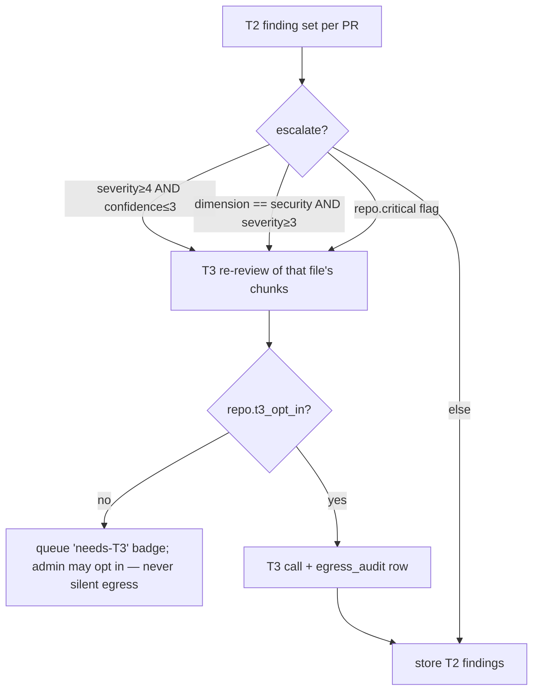

# Analysis Tiers — LLM Review Engine (packages/analysis) — v1.x wave 2

Traces: FR-ANALYSIS-1..8, FR-INSIGHTS-1, NFR-7/8/9, C2, D2. Rule (CLAUDE.md Law 8): all LLM
traffic goes through this gateway — lint forbids direct HTTP to LM Studio hosts or `@anthropic-ai/sdk`
imports outside `packages/analysis`.

## 1. Gateway interface (FR-ANALYSIS-1)

```ts
export type Tier = 'T2' | 'T3';
export interface CompleteOpts {
  tier: Tier; maxTokens: number;            // T2 MUST be 45000 (C2/NFR-8; enforced by wrapper, not callers)
  temperature?: number;                     // default 0.1 — findings, not prose
  expectJson: true;                         // all analysis calls are JSON-mode
  meta: { repoId: string; prNumber: number; dimension: Dimension; checklistVersion: string; initiator: string };
}
export interface CompleteResult { text: string; model: string; tokensIn: number; tokensOut: number;
  costUsd: number | null;                   // null for T2 (LAN), real for T3
  durationMs: number; }
export interface AnalysisGateway {
  complete(prompt: string, opts: CompleteOpts): Promise<CompleteResult>;  // routes by opts.tier
  health(tier: Tier): Promise<{ ok: boolean; model?: string }>;
}
```

Dispatcher rules (FR-ANALYSIS-1): default tier T2 for bulk/webhook-triggered review; T3 only
when `repo.t3_opt_in` (admin flag) or per-PR override — T3 without opt-in ⇒ **rejected**, not
downgraded silently (auditability). Scheduling per FR-ANALYSIS-8: repo policy `auto|manual|off`,
org-level concurrency cap on LAN hosts (workspace config), BullMQ queue `analysis.review`
(idempotency key `an:{repoId}:{pr}:{headSha}:{dimension}`; NFR-7: LAN host unreachable ⇒ park +
backoff retry, Tier-1 dashboards unaffected, UI banner "Tier-2 analysis paused — host unreachable").

## 2. Tier-2 — LM Studio (FR-ANALYSIS-2, NFR-8, C2)

```ts
interface T2Config {
  hosts: { baseUrl: string; modelSlot: string }[];   // OpenAI-compatible /v1/chat/completions, LAN
  maxTokens: 45000;                                  // literal type — headroom for thinking models
  warmup: { pingPrompt: 'ping'; timeoutMs: 15000; retries: 2 };
  crashRetry: { matches: ['model crashed', 'ECONNRESET', 'model_not_loaded']; attempts: 3; backoffMs: [5000, 15000, 60000] };
  concurrencyCap: number;                            // per host, workspace config (FR-ANALYSIS-8)
}
```

Wrapper behavior (every call, no exceptions): (1) if host cold or last call errored, send
warm-up ping and wait for completion before the real call; (2) on crash-match error: warm-up →
retry per backoff; (3) 45000 maxTokens always set; (4) **real usable output ≈10k tokens** on
qwen3.6-class models ⇒ chunking must keep projected output ≤10k (below).

### Chunking (FR-ANALYSIS-3)

Diff source = warehouse `pr_file` rows + on-demand REST `getPullRequestFiles` patches
(FORGE_PROVIDER.md — GraphQL has no patch text). Estimator: `tok(s) ≈ ceil(bytes/3.4)`;
projected output ≈ `min(10k, 0.35 × patchTokens + 800)` per chunk.

1. Split per file. Skip: `patchTruncated`, binary, generated (lockfiles, `*.min.*`, workspace
   globs) — record as `skipped` with reason (coverage honesty).
2. File whose patch fits budget (`promptTokens ≤ 24k` and projected output ≤ 10k) → one chunk;
   greedy-pack small files together per dimension.
3. Oversized file → split by hunk groups at hunk boundaries, never mid-hunk; each sub-chunk
   ≤ budget. Property: **every hunk in exactly one chunk** (FR-ANALYSIS-3 acceptance).
4. Every chunk prompt carries: PR title + description (truncated 1k tok), file path(s),
   language hint, dimension checklist.
5. **Map-reduce**: chunk calls emit findings (map); a final small call gets the deduped
   finding list + PR metadata and emits a PR-level verdict/summary (reduce). Reduce input is
   findings JSON, never re-pasted diff — bounded regardless of PR size.

## 3. Tier-3 — Claude API (FR-ANALYSIS-7, NFR-9)

- Client: `@anthropic-ai/sdk` (verify model ids/params against the claude-api skill reference
  at implementation time — Law 2). Same finding schema, whole-PR context within model limits
  (large PRs reuse the T2 chunker with a much bigger budget).
- **Egress minimization** (NFR-9): send diff hunks + PR title/description + dimension
  checklist + ≤40 lines of surrounding context per finding-bearing file, fetched via targeted
  `getFileContent` (FR-FORGE-6) only when the checklist requires it — **never whole files
  unless targeted-fetched, and every such fetch is itself logged**. No repo tree, no unrelated files.
- **Audit row per call** (NFR-9): `egress_audit(workspace_id, ts, repo_id, pr_number, dimension,
  model, bytes_sent, tokens_in, tokens_out, content_sha256, cost_usd, initiator, checklist_version)`
  — written before the response is processed; admin-queryable; feeds the Security Posture
  report (REPORTS.md).

## 4. Dimension checklists (FR-ANALYSIS-4) — ported from bpm-opencode-experts, versioned assets

Prompt template (per dimension, `checklists/{dim}.v{N}.md`): system framing ("senior reviewer,
diff-scoped, cite only evidence present in the diff; no speculation beyond provided lines") +
dimension checklist + REQUIRED JSON schema + the chunk.

| Dimension | Checklist focus (diff-scoped) |
|---|---|
| `code_health` | cyclomatic/nesting growth, duplication introduced, error handling (swallowed/empty catch, exception control-flow), dead/unreachable code added, misleading names/comments |
| `security` | OWASP-informed: injection (SQL/cmd/path/template), authz gaps (missing checks on new routes/queries), secrets/credentials in diff, crypto misuse (weak hash, static IV/salt, homemade crypto), unsafe deserialization, SSRF-able fetches |
| `performance` | N+1 query patterns, O(n²)+ loops over unbounded input, blocking-in-async (sync fs/crypto in handlers), unbounded Promise.all / missing pagination, hot-loop allocations |
| `test_coverage` | does the diff add/modify tests matching changed behavior; **risky-untested-change heuristic**: non-trivial logic change (branching/auth/money/parsing) with zero test-file changes in the PR ⇒ finding |

### REQUIRED finding JSON (FR-ANALYSIS-5; zod-validated; malformed ⇒ retry once w/ error appended ⇒ dead-letter with raw payload kept)

```ts
const Finding = z.object({
  dimension: z.enum(['code_health', 'security', 'performance', 'test_coverage']),
  severity: z.number().int().min(1).max(5),      // 5=critical … 1=info (maps to FR-ANALYSIS-5 scale)
  confidence: z.number().int().min(1).max(5),
  file: z.string(), line_range: z.tuple([z.number(), z.number()]),
  title: z.string().max(120),
  evidence_quote: z.string().max(600),           // verbatim from the diff — validator rejects non-substring quotes
  rationale: z.string().max(800),
  suggested_fix: z.string().max(800).nullable(),
});
// stored with: tier, model id, checklist_version, run id (FR-ANALYSIS-5)
```

## 5. Dedup, re-review, triage

- **Dedup** (FR-ANALYSIS-6): `dedup_key = sha256(dimension + '\0' + file + '\0' +
  normalize(evidence_quote))` where normalize = lowercase, collapse whitespace, strip line
  numbers/digits-only tokens; line-bucket (⌊start/10⌋) appended as tiebreak. Re-run on
  unchanged PR ⇒ update `last_seen` + `occurrence_count`, 0 new rows; a `resolved` finding
  whose key reappears **reopens** (status → open, audit row).
- **Re-review on PR update** (webhook `synchronize`): diff old vs new file list by
  (path, patch sha) — only changed/added files re-chunked; findings on files no longer in the
  diff auto-resolve with reason `outdated_diff`.
- **Triage** (FR-INSIGHTS-1): finding lifecycle `open → confirmed | dismissed(reason) →
  resolved | wont_fix`; every transition audited. Dismissals with reason `false_positive` feed
  metric `analysis_false_positive_rate{dimension, model, checklist_version}` — the tuning
  signal for checklist version bumps and T2 model selection.

## 6. Cost & routing policy (T2→T3 escalation)



T3 spend guarded by workspace monthly budget (config, USD); exceeding ⇒ escalations queue as
`needs-T3` instead of calling. Every T3 result stores `cost_usd`; per-repo cost rollup exposed
on the admin ops page (NFR-12).
