# Code Health Suite — Anti-Slop, Cleanliness, Logging (packages/security scanners) — wave W9

Traces: FR-CH-1..7, FR-REPORTS-8, D11, S-50..S-56. Rides the W8 framework end-to-end:
`Scanner` registry (SECURITY_SUITE.md §1), snapshot service + sandbox (§2), findings
store/dedup/triage (FR-ANALYSIS-5/6, FR-INSIGHTS-1), verify/challenger rails
(FR-ANALYSIS-9/10), budgets (FR-SEC-11). Rule content ported from
bpm-opencode-experts (`agents/shared/ANTI_SLOP_RULES.md`, `agents/code-review/
METHODOLOGY.md`, `references/code-health-checklist.md`, `agents/performance/
METHODOLOGY.md`) — productized, not reinvented.

## 0. Why (evidence basis — cite these in report footnotes)

| Claim | Number | Source |
|---|---|---|
| Copy/paste share of new code | 9.4% (2022) → 15.7% (H1 2026); moved/refactored 21% → 3.8%; block duplication +81%; error-masking constructs +47% | GitClear "AI Code Quality / Maintainability Gap" 2025-2026 (gitclear.com) |
| AI code failing security tests | 45% overall; log injection 88%, XSS 86% fail (CWE-117/79); larger models NOT safer | Veracode GenAI Code Security Report 2025 (veracode.com) |
| Hallucinated package names | 19.7% of samples; 205k unique fake names; 43% recur across re-runs (pre-registerable) | Spracklen et al., USENIX Security 2025 (arXiv:2406.10279) |
| Privilege-escalation paths / design flaws | +322% / +153% (Fortune-50 telemetry) | Apiiro, Dec 2024–Jun 2025 (vendor data) |
| AI adoption vs delivery | throughput ↑ but stability still ↓; "AI is an amplifier" | DORA 2025 (dora.dev/research/ai) |
| Secrets exposure in AI commits | 3.2% vs 1.5% human | CSA 2025/2026 |

Product stance follows METRICS.md §3: **signals, not grades** — findings route attention,
thresholds are tunable, trend > absolute value, and no per-developer slop leaderboards
(NON_GOALS N-9).

## 1. Rule inventory — 30 anti-slop rules, mapped to detection layers

Legend: **PACK** = deterministic (our semgrep rulepack / tool), **HYB** = pack locates +
T2 confirms, **LLM** = T2 checklist judgment (runs through the gateway with verify pass).

| Rule (bpm-opencode-experts id) | Layer | Where it lands |
|---|---|---|
| R-01 empty/swallowing catch · R-02 try/catch in loops · R-10 silent fallback returns · R-13 what-comments · R-14 step-narration blocks · R-16 emoji comments · R-27 stub-as-feature (`not implemented` throws, TODO bodies) · R-29 prose padding | **PACK** | FR-CH-1 rulepack → anti_slop deterministic layer |
| R-19 duplicated blocks | **PACK** (jscpd) | code_health_tools |
| R-21 hallucinated packages · R-23 credential literals | **PACK** | already shipped: FR-SEC-5 slopsquat · secrets scanner (W8) — anti_slop cross-links, never duplicates |
| R-25 phantom/unused imports | **PACK** (pack rule; full unused-export analysis needs dep install → backlog `dead_code`) | FR-CH-1 (partial) |
| R-03 exception control flow · R-04 serial awaits · R-15 stale JSDoc params · R-24 docstring inflation (doc/impl >3×, LDR) · R-26 unwired scaffolding · R-28 LLM output w/o validation · R-30 library-shaped reimplementation (silent vendor fork) | **HYB** | pack/AST locates candidates → T2 confirms with evidence quote |
| R-05 single-impl interfaces · R-06 delegation-only wrappers · R-07 single-use helpers · R-08 repository-on-CRUD · R-09 null checks on owned types · R-11 unspecified retry · R-12 orphan feature flags · R-17 speculative generalization · R-18 cargo-cult patterns · R-20 pattern inconsistency · R-22 architectural privilege escalation | **LLM** | `anti_slop.v1` T2 checklist (diff-scoped; snapshot mode samples worst files) |

**LDR (logic density ratio)** — reconciling the two source definitions: file-level
`LDR = logic_lines / (logic_lines + overhead_lines)` (overhead = imports, type-only
decls, docstrings/comments, blanks); **file LDR < 0.3 ⇒ structural-slop finding**;
per-exported-symbol **doc/impl > 3× ⇒ docstring-inflation finding** (R-24). Both
computed deterministically in the anti_slop scanner; thresholds workspace-tunable.

## 2. Scanner roster (registry entries — zero framework changes, FR-SEC-1 acceptance)

| key | inputs | triggers | requiredTools | dimension |
|---|---|---|---|---|
| `code_health_tools` | snapshot | weekly schedule, manual | lizard@1 (MIT), jscpd@4 (MIT) — standalone source parsers, run with no dependency install (sandbox stays `--network=none`) | `code_health` |
| `anti_slop` | diff + snapshot | pr_synced (diff), weekly (snapshot), manual | semgrep + rulepack `code-health.v{N}` | `slop` |
| `logging_hygiene` | diff + snapshot | pr_synced, weekly, manual | semgrep + same pack (logging rules) | `logging` |

Backlog delta (SECURITY_SUITE.md §7): `anti_slop` **promoted** to W9; new backlog row
`dead_code` (knip ISC / vulture MIT / staticcheck MIT — full unused-export analysis
needs installed dependencies, which conflicts with the no-network sandbox; ships when a
deps-cache volume design exists, same pattern as the vuln-DB volumes). Interprocedural/deep
taint beyond unused-export detection is a separate, selective deep tier — **Joern**
(Apache-2.0), never CodeQL (barred on non-OSS commercial use) — see SECURITY_SUITE.md §7
footnote.

### Thresholds (workspace defaults, `repo_scanner_config.config`; canon sources in §0/§4)

| Check | Default | Source |
|---|---|---|
| Cognitive complexity / function | ≤15 | SonarSource cognitive-complexity whitepaper |
| Cyclomatic complexity | >10 warn, >20 critical | lizard `--CCN 10`; experts checklist |
| Function length / file length | >50 lines / >300 lines | experts checklist (TS row); Code Climate file ≤250 as the strict preset |
| Nesting / args | >3 / >4 | Code Climate defaults |
| Duplication (jscpd `--min-lines 5 --min-tokens 50`) | ≥5% repo gate; any new duplicated block in a PR diff | GitClear 2025/2026 (trend is the headline metric) |
| File LDR / doc-impl ratio | <0.3 / >3× | ANTI_SLOP_RULES R-24 + auditor Phase 3 (reconciled §1) |

## 3. Logging hygiene (FR-CH-4) — net-new ruleset (no experts-repo equivalent)

Deterministic (in the FR-CH-1 pack): `console.log`/`print` in production paths (test/
script globs excluded); user-controlled input flowing into a log call without encoding
(log-injection taint, CWE-117 — Veracode: 88% AI fail rate); secret/PII-shaped values in
log arguments (field-name denylist mirrors SC-2's scrubber list — token, password,
authorization, ssn, email in payload contexts); local log-and-rethrow (`catch { log; throw }`).

T2 checklist `logging.v1` (OWASP Logging Cheat Sheet + Top-10 2025 A09 basis, each item
citing its OWASP id): level correctness (errors not logged as info; expected flows not
logged as error), context adequacy (bare `e.message`/`"error"` without operation context),
correlation-id propagation on request paths, security-event coverage (auth failures,
authz denials logged at all), cross-layer double logging. RepoPulse's own codebase
already follows the stricter version of these rules (NFR-12, SC-2) — the product now
checks monitored repos for the same discipline.

## 4. Clean-code doctrine encoded in `anti_slop.v1` checklist framing

The checklist system prompt carries the doctrine (so T2 judges with the right defaults,
matching the experts `code` skill): abstractions need ≥2 real implementations; three
similar lines beat a premature abstraction; deep modules > shallow wrappers (Ousterhout);
trust the framework — flag re-implementations of what a present dependency provides;
why-comments only; no defensive null checks on owned types; YAGNI on retries/flags/
config not traceable to a requirement. Verdicts require verbatim evidence quotes
(SC-13 substring rule) and ride the FR-ANALYSIS-9 verify pass — a judgment finding that
the second host refutes never surfaces.

## 5. Tier-1 debt signals (FR-CH-7 — packages/metrics, no scanner)

- **M13 rework-14d**: share of line changes touching lines authored <14 days prior
  (GitClear "mistake code" convention; M1's 21d rework definition unchanged — both in
  the catalog with heuristic notes). Grain: repo/file/window; snapshotted.
- **M14 revert rate**: `is_revert_heuristic` commits ÷ non-merge commits per window
  (column already exists for DORA CFR).
Both feed the Code Health tab header and the FR-CH-6 plan-catalog entries.

## 6. Surfaces & scoring (FR-CH-6)

- **Repo Code Health tab**: debt-signal header (M13/M14 sparklines), complexity
  distribution + worst-10 functions table (file:line → drill-down), duplication % trend
  (`ch_duplication_pct` snapshots), slop density by rule (findings/KLOC), logging
  posture, per-scanner status chips ("not enabled" state, never blank — NFR-15 pattern).
- **Health score**: `code_health` sub-score joins FR-INSIGHTS-2 (inputs: duplication
  ramp(3%, 15%), complexity-p90 ramp, slop density ramp, M13 ramp) — renormalized +
  basis-labeled like the security sub-score.
- **Code Health report** (FR-REPORTS-8): sections per §above + open plan items;
  thresholds + heuristic bases footnoted (REPORTS.md §5 discipline); GitClear-style
  trend framing ("duplication 11.2% ▲ from 8.1% — above your 5% gate").
- **Plan catalog v2** (IMPROVEMENT_PLANS.md): `duplication-over-ceiling` (verify:
  `ch_duplication_pct ≤ target` for 30d), `complexity-worst-functions` (verify: worst-fn
  count drops), `slop-density-high` (verify: density ≤ target), `logging-hygiene-adoption`
  (verify: logging findings resolved + no new for 30d).

## 7. Testing (extends TESTING.md §10 rules — no live tools/LLMs in CI)

Seeded fixture trees per scanner under `packages/security/fixtures/code-health/`:
threshold-boundary functions (CC 10/11, 15/16 cognitive, 50/51 lines), duplicated block
pairs (jscpd min-lines edge), each PACK rule's triggering + non-triggering case, LDR
boundary files (0.29/0.31), logging fixtures (console.log in handler vs test file, taint
case, log-and-rethrow). Golden finding-set snapshots per scanner; dedupe test between
scanner rules and `code_health.v2` T2 findings (FR-CH-5); posture-metric rows asserted
in metric_snapshots; checklist runs mocked at the gateway with `initiator='scanner:*'`.

Licensing: lizard MIT · jscpd MIT · semgrep engine LGPL-2.1 (subprocess, unchanged from
W8) · rulepack is OURS (no Semgrep-registry rules — license gate per DESIGN_REVIEW G-18)
· knip ISC / vulture MIT / staticcheck MIT reserved for the `dead_code` backlog entry
(Joern Apache-2.0 reserved for its interprocedural-taint deep tier if promoted; CodeQL
excluded — barred on non-OSS commercial use).

## 8. Rule lifecycle & intake (FR-CH-8/9) — 30 rules is the seed, not the cap

The R-01..R-30 taxonomy is the launch corpus. Growth is governed, not ad hoc — an
unvetted rule is a false-positive machine, and FP noise is the #1 trust killer (RISKS
R-4 applies to rules exactly as it does to LLM findings).

### 8.1 Rule schema (every rule, any layer)

```ts
interface HealthRule {
  id: string;                        // '{domain}.{slug}' e.g. 'slop.empty-catch' (source R-xx recorded in provenance)
  domain: 'slop'|'logging'|'perf'|'correctness'|'framework';
  layer: 'pack'|'hybrid'|'llm';      // §1 legend
  languages: string[] | ['*'];
  severity: 1|2|3|4|5;
  status: 'proposed'|'candidate'|'active'|'deprecated';
  provenance: { source: 'experts:R-xx'|'field_lesson'|'external:{repo}'|'llm_draft';
                license: string;     // REQUIRED — imports deny-by-default unless MIT/Apache-2.0/BSD/ours
                author: string; date: string };
  engineRule?: string;               // semgrep YAML path (pack/hybrid)
  checklistItem?: string;            // checklist asset ref (llm/hybrid)
  fixtures: { trigger: string[]; clean: string[] };  // BOTH required — a rule without fixtures cannot merge
}
```

Workspace-level state lives in `rule_registry` (DATABASE.md D11 delta): per-rule status
override + computed `fp_rate` (from `dismissed(false_positive)` dispositions — the same
tuning metric the checklists already feed).

### 8.2 Lifecycle — shadow mode is the safety valve

```mermaid
stateDiagram-v2
    [*] --> proposed: intake (§8.3) — fixtures + license or it doesn't exist
    proposed --> candidate: admin accepts to shadow
    candidate --> active: promotion gate — ≥20 findings / ≥30d / FP<20% (admin action)
    candidate --> deprecated: FP evidence bad / superseded
    active --> deprecated: trailing FP>50% auto-flags → admin confirms
    note right of candidate: SHADOW — runs on real scans;\nfindings experimental=true;\nEXCLUDED from scores, banners,\nplans, reports
```



- **proposed**: sits in the intake review queue (admin workbench); has fixtures + license
  provenance or it doesn't exist.
- **candidate / shadow mode**: the rule RUNS on real scans but its findings are stamped
  `experimental: true` — visible in a dedicated Explorer facet, **excluded from health
  scores, org banners, plan generation, and reports**. Shadow findings accrue FP
  dispositions like any finding.
- **promotion gate** (admin action, data-informed): ≥20 findings over ≥30 days with
  FP rate < 20% (workspace-tunable). The workbench shows the evidence; a human promotes.
- **demotion**: any active rule whose trailing FP rate exceeds 50% is auto-flagged
  `demotion_candidate` and surfaces on the workbench — admin confirms deprecation.
  Deprecated rules keep their historical findings (audit) but never run again.

### 8.3 Intake sources (FR-CH-9) — how the system finds new rules

1. **Field-lesson intake** (the experts-repo B-2 pattern, productized): (a) a "propose
   rule from this" action on any finding or dismissed-FP cluster; (b) a scheduled T2
   pass that clusters FP dismissals and recurring judgment-findings per rule-shaped
   pattern, and **drafts a semgrep rule + both fixtures** (`provenance.source =
   'llm_draft'`). Drafts always land as `proposed` — the LLM never activates a rule.
2. **External pack sync**: configured git repos of rules (reuses the FR-SEC-6 db-sync
   mechanism verbatim — pinned ref, checksum, read-only volume). Import is
   **license-gated deny-by-default**: each rule's license must be on the allowlist
   (MIT / Apache-2.0 / BSD / ours); Semgrep-registry-licensed rules are refused
   (G-18). Imports land as `proposed`, run shadow first — external packs get no trust
   shortcut.
3. **Research intake** (manual/human): new studies, advisories, or team lessons entered
   via the workbench form; same schema, same gate. (An automated web-research agent is
   deliberately NOT in scope — C6 egress discipline; if ever added it would be T3
   opt-in + egress-audited like everything else.)

## 9. Rulepack architecture — domains × languages (FR-CH-9)

```
packages/security/rulepacks/
  code-health.v{N}/
    slop/{generic,ts,py,go,java}/...yaml      # R-xx ports + growth
    logging/{generic,ts,py,go}/...yaml         # §3 + per-framework logger idioms
    perf/{ts,py,go,java,rb}/...yaml            # §9.1 — YES, semgrep does perf
    correctness/{ts,py,go}/...yaml
    framework/{react,fastify,drizzle,django,rails}/...yaml
```

Semgrep's engine covers 30+ languages with the same YAML format, taint mode included —
one format, per-language variants of each rule where idioms differ. **Engine note:
"semgrep-compatible" is the contract** — Opengrep (LGPL fork) runs the identical rule
files, so the SaaS-flip engine swap (DESIGN_REVIEW G-18) is a binary swap, not a rule
rewrite. The adapter (§10) names the binary; rules never do.

### 9.1 Performance pack — pattern-shaped perf IS semgrep territory

Cross-function algorithmic analysis stays LLM-tier, but the highest-yield perf defects
are local patterns, per language:

| Rule (per-language variants) | Pattern sketch |
|---|---|
| `perf.orm-call-in-loop` (N+1) | prisma/drizzle/knex/sqlalchemy/activerecord call inside for/map/forEach |
| `perf.await-in-loop` | `await` in loop body without Promise.all/allSettled (R-04 port) |
| `perf.sync-io-in-async` | `fs.*Sync`/`execSync`/blocking sleep inside async fn / route handler |
| `perf.json-deep-clone` | `JSON.parse(JSON.stringify(x))` |
| `perf.try-catch-in-loop` | R-02 port (5-20× JIT penalty) |
| `perf.regex-compile-in-loop` | `new RegExp`/`re.compile` inside loop |
| `perf.string-concat-in-loop` | `+=` string build in py/java loops |
| `perf.unbounded-promise-all` | `Promise.all(bigArray.map(...))` with no chunking |

Findings take dimension `performance` — same Explorer, triage, verify pass, and plan
integration as everything else. This complements (not replaces) the `performance.v2`
T2 checklist: patterns deterministic, algorithms/judgment LLM.

## 10. Tool adapter registry (FR-CH-10) — what else we support

One level below the Scanner registry, `code_health_tools` gets a **ToolAdapter**
contract so adding a tool = one adapter + fixtures, zero scanner changes:

```ts
interface ToolAdapter {
  key: string; version: string; license: string;    // pinned + checksummed in the sandbox image (SC-28)
  detect(s: SnapshotHandle): boolean;                 // language/file auto-enable (extensions + SBOM)
  command(ctx: ScannerContext): string[];             // MUST run standalone: no network, no dependency install
  parse(stdout: string): ScannerFinding[];            // rule ids 'tool.{key}.{rule}'
}
```

**The admission filter is the sandbox**: `--network=none`, no `npm install`/`pip
install`. Tools must parse raw source standalone.

| Tool | Target | Domain | License | Status |
|---|---|---|---|---|
| lizard | polyglot complexity | code_health | MIT | **W9** |
| jscpd | polyglot duplication | code_health | MIT | **W9** |
| semgrep/opengrep + our packs | 30+ languages | slop/logging/perf/correctness | LGPL-2.1 (subprocess) | **W8/W9** |
| ruff | Python (800+ rules, standalone binary) | code_health/correctness | MIT | **W9 adapter** |
| Biome | JS/TS lint (standalone, no node_modules) | code_health/correctness | MIT/Apache-2.0 | **W9 adapter** |
| actionlint | GitHub Actions workflows | correctness/ci | MIT | backlog |
| hadolint | Dockerfiles | correctness/container | GPL-3.0 (subprocess-only¹) | backlog |
| shellcheck | shell scripts | correctness | GPL-3.0 (subprocess-only¹) | backlog |
| sqlfluff | SQL | code_health | MIT | backlog |
| vale | prose/docs (R-29 companion) | slop (docs) | MIT | backlog |
| gocyclo | Go complexity | code_health | BSD-3 | backlog |
| staticcheck / knip / vulture | dead code | dead_code | MIT/ISC/MIT | backlog (needs deps-cache volume) |
| Joern | interprocedural/deep taint (selective, high-value targets) | dead_code (deep tier) | Apache-2.0 | backlog — per-engagement not per-run (RAM-hungry); CodeQL excluded (non-OSS commercial-use license bar) |

¹ GPL is triggered by *distribution*, not server-side subprocess execution — running
hadolint/shellcheck in our sandbox is fine for internal AND SaaS as long as we never
ship modified binaries; noted for the G-18 ledger.

Adapter findings dedupe against pack rules covering the same defect (ruff/Biome overlap
with our slop pack is expected — the dedup key wins, lowest-noise source is kept per
rule mapping). Language routing: `detect()` runs on snapshot extensions + SBOM; a repo
with no Python never runs ruff.
