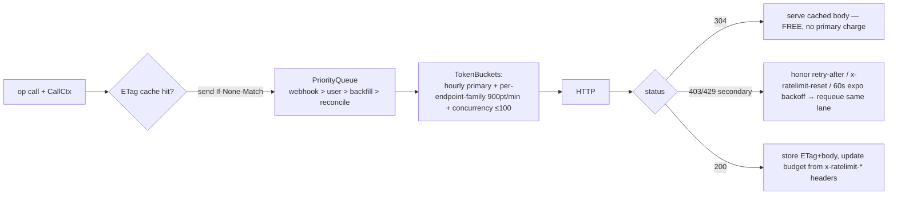

# ForgeProvider — Port/Adapter Contract (packages/forge)

Traces: FR-FORGE-1..7, FR-INGEST-5, NFR-1/2, C1. Research basis: `docs/research/github-api.md`
(§1 rate limits, §2 ETag, §3 endpoint catalog, §5 auth, §6 GraphQL split, §7 Gitea).
Rule (CLAUDE.md Law 7): every forge byte flows through `BudgetedClient`; no raw fetch/octokit elsewhere.

## 1. Normalized domain types

```ts
export type ForgeCursor = string;                 // opaque; adapter-encoded (page/GraphQL cursor/updated_at)
export interface Page<T> { items: T[]; nextCursor?: ForgeCursor; }

export interface ForgeRepo {
  externalId: string; name: string; fullName: string; defaultBranch: string;
  isPrivate: boolean; isArchived: boolean; pushedAt: string | null; htmlUrl: string;
}
export interface ForgeCommit {
  sha: string; authorLogin: string | null; authorEmail: string; authoredAt: string;
  committedAt: string; message: string; parentShas: string[];   // >1 parent ⇒ merge commit (METRICS.md excludes)
  stats?: { additions: number; deletions: number };             // only from getCommitFiles / GraphQL
}
export interface ForgeDiffFile {
  path: string; previousPath?: string;                          // rename tracking
  status: 'added' | 'modified' | 'removed' | 'renamed';
  additions: number; deletions: number;
  patch?: string;                                               // unified hunks; ABSENT for huge files (research §3)
  patchTruncated: boolean;                                      // true when forge omitted/clipped patch
}
export interface ForgePR {
  number: number; externalId: string; title: string; body: string | null;
  authorLogin: string; isBot: boolean; isDraft: boolean;
  state: 'open' | 'closed' | 'merged';
  createdAt: string; updatedAt: string; mergedAt: string | null; closedAt: string | null;
  mergedByLogin: string | null; baseRef: string; headSha: string;
  additions?: number; deletions?: number; changedFiles?: number; // absent on GitHub REST list items (research §3)
}
export interface ForgeReview {
  externalId: string; prNumber: number; reviewerLogin: string;
  state: 'APPROVED' | 'CHANGES_REQUESTED' | 'COMMENTED' | 'DISMISSED';
  submittedAt: string;
}
export interface ForgeCheckRun {
  externalId: string; headSha: string; name: string; workflowName?: string;
  status: 'queued' | 'in_progress' | 'completed';
  conclusion: 'success' | 'failure' | 'cancelled' | 'skipped' | 'timed_out' | 'neutral' | null;
  startedAt: string | null; completedAt: string | null; isRerunOf?: string; // rerun linkage → FR-METRICS-9 flakiness
}
export interface ForgeRelease { externalId: string; tagName: string; name: string | null;
  isDraft: boolean; isPrerelease: boolean; publishedAt: string | null; }
export interface ForgeDeployment { externalId: string; sha: string; environment: string;
  createdAt: string; latestStatus: 'success' | 'failure' | 'error' | 'inactive' | 'pending' | null; }
export interface ForgeIssue { externalId: string; number: number; title: string; authorLogin: string;
  state: 'open' | 'closed'; createdAt: string; closedAt: string | null; isPullRequest: boolean; }
export interface ForgeFileContent { path: string; ref: string; sizeBytes: number;
  content: string | null; truncated: boolean; }                 // null+truncated when >1MB (research §3 contents)
```

## 2. Provider interface (FR-FORGE-1)

```ts
export interface ForgeCapabilities {
  supportsGraphQLBackfill: boolean;   // GitHub true / Gitea false
  supportsDeployments: boolean;       // Gitea likely false → DORA falls back to releases (FR-METRICS-12)
  supportsCheckRuns: boolean;         // Gitea: commit statuses only, version-dependent Actions API
  supportsStatsEndpoints: boolean;    // GitHub 202-warmup stats; Gitea none
  supportsRawDiff: boolean;           // GitHub 406s >300 files/20k lines — adapters may say false outright
  reportsTotalCounts: boolean;        // Gitea x-total-count true / GitHub false
  hasRateLimits: boolean;             // Gitea self-hosted false → budgeter becomes pass-through
  maxPerPage: number;                 // GitHub 100 / Gitea MAX_RESPONSE_ITEMS (50 default)
}

export interface SinceQuery { since?: string; cursor?: ForgeCursor; perPage?: number; }
export type Lane = 'webhook' | 'user' | 'backfill' | 'reconcile';    // priority, high→low
export interface CallCtx { lane: Lane; repoId?: string; etagKey?: string; } // every op takes one

export interface ForgeProvider {
  readonly kind: 'github' | 'gitea';
  readonly capabilities: ForgeCapabilities;

  listRepos(ctx: CallCtx, cursor?: ForgeCursor): Promise<Page<ForgeRepo>>;
  getRepo(ctx: CallCtx, fullName: string): Promise<ForgeRepo>;
  listCommits(ctx: CallCtx, repo: string, q: SinceQuery): Promise<Page<ForgeCommit>>;      // FR-INGEST-2/6
  getCommitFiles(ctx: CallCtx, repo: string, sha: string, cursor?: ForgeCursor)
    : Promise<Page<ForgeDiffFile> & { stats: { additions: number; deletions: number } }>;  // paginate ≤3,000 files
  listPullRequests(ctx: CallCtx, repo: string, q: SinceQuery): Promise<Page<ForgePR>>;     // sort=updated for cursors
  getPullRequest(ctx: CallCtx, repo: string, n: number): Promise<ForgePR>;                 // fills additions/deletions
  getPullRequestFiles(ctx: CallCtx, repo: string, n: number, cursor?: ForgeCursor)
    : Promise<Page<ForgeDiffFile>>;                                                        // NEVER raw diff (406 risk)
  listReviews(ctx: CallCtx, repo: string, n: number): Promise<ForgeReview[]>;
  listCheckRuns(ctx: CallCtx, repo: string, q: SinceQuery & { headSha?: string }): Promise<Page<ForgeCheckRun>>;
  listReleases(ctx: CallCtx, repo: string, cursor?: ForgeCursor): Promise<Page<ForgeRelease>>;
  listDeployments(ctx: CallCtx, repo: string, cursor?: ForgeCursor): Promise<Page<ForgeDeployment>>;
  listIssues(ctx: CallCtx, repo: string, q: SinceQuery): Promise<Page<ForgeIssue>>;
  getFileContent(ctx: CallCtx, repo: string, path: string, ref: string): Promise<ForgeFileContent>; // FR-FORGE-6 only
  registerWebhook(ctx: CallCtx, repo: string, url: string, secret: string, events: string[]): Promise<string>;
  verifyWebhook(rawBody: Buffer, signatureHeader: string, secret: string): boolean;        // timingSafeEqual, sync
}
```

Ingest imports only this interface (FR-FORGE-1 acceptance). Optional ops guarded by
capability flags; callers must branch, never try/catch feature-detect.

## 3. BudgetedClient (FR-FORGE-3/4, NFR-1)



- **Buckets.** (a) Primary hourly: seeded from `x-ratelimit-remaining/reset` headers per
  installation — never guessed (research §1); configurable floor (SRS §1.1 Budget): below
  floor, `backfill`/`reconcile` lanes park until reset, `webhook`/`user` may drain a reserve.
  (b) Secondary per **endpoint family** (`commits`, `pulls`, `pull_files`, `checks`, `contents`,
  `issues`, `releases`, `graphql`): ≤900 pts/min REST family (throttle ~10 req/s), 2,000/min
  GraphQL, writes cost 5 pts and are serialized ≥1s apart. (c) Global semaphore ≤100 concurrent.
  (d) GraphQL primary is a **separate bucket** from REST (research §1) — tracked independently.
- **ETag cache** (FR-FORGE-4): table `forge_etag(workspace_id, installation_id, endpoint_key,
  etag, body_digest, cached_body, fetched_at)`; `endpoint_key = hash(method,path,params)`.
  304 ⇒ zero primary charge; secondary-family bucket still ticks (a request was sent).
- **Retry policy.** Secondary 403/429: `retry-after` else wait to `x-ratelimit-reset` else
  ≥60s exponential (research §1 mitigation — ban risk). 5xx: 3 retries jittered. 401 on App
  token: refresh installation token (1h life; proactive refresh at 50min) and retry once.
- **Instrumentation** (NFR-12): counters `forge_requests_total{family,lane,status}`,
  `forge_304_total`, `forge_points_spent{bucket}`, gauges `forge_budget_remaining`,
  `forge_queue_depth{lane}`, histogram `forge_request_seconds`.

## 4. GitHubProvider notes (FR-FORGE-2/5)

- **Auth**: `GitHubAuth = { kind: 'app', appId, privateKey, installationId } | { kind: 'pat', token }`.
  App = primary (cap 12,500/hr, +50/repo & /user beyond 20); PAT = dev fallback (5,000/hr).
  App JWT ≤10min → installation token (1h). User OAuth token is auth-module concern (D6), not ingest.
- **GraphQL backfill** (research §6): `listPullRequests` in `backfill` lane uses one query —
  `pullRequests(first:50, orderBy:UPDATED_AT)` + nested `reviews(first:50)`, `files(first:100)
  {path additions deletions changeType}`, `mergedBy`, `timelineItems` ≈ 2 pts vs ~150 REST calls.
  Keep node count ≤500k, `first` ≤100. W0 ticket: introspect that `PullRequestChangedFile`
  truly lacks `patch` (research §6 UNVERIFIED).
- **REST mandatory** for: patch text (`/pulls/{n}/files`, ≤3,000 files, per-file patch may be
  omitted → set `patchTruncated`), per-commit files (`/commits/{sha}`, 300/page → 3,000),
  contents, Actions runs (`created` sliced monthly — 1,000-result cap), check-runs per SHA.
- **Stats endpoints**: optimization only — handle 202-warmup (retry ~2s×5) and hard-degrade
  (`code_frequency` 422s ≥10k commits; `contributors` zeroed ≥10k) by falling back to
  per-commit REST in the low-priority lane (research §3, §8 option A/B).
- **Never**: raw-diff media type (406 >300 files/20k lines), tarball/zipball/clone (FR-FORGE-6
  lint gate), Events API (300-event/30-day window — unusable), Search API for backfill (30/min, 1k cap).
- `verifyWebhook`: `X-Hub-Signature-256` = HMAC-SHA256(raw body); `crypto.timingSafeEqual`; ignore legacy SHA1.
- **Code-scanning alerts** (W18-24): optional `listCodeScanningAlerts(ctx, repo, cursor?)`, guarded by
  the optional capability `supportsCodeScanningAlerts` (absent = false; GitHub true, GitLab/Gitea
  absent). `GET /repos/{o}/{r}/code-scanning/alerts?state=open&per_page=100`, Link-header paging,
  `checks` secondary bucket. 403 (App lacks "Code scanning alerts: Read" / `security_events`) and
  404 (code scanning off) REJECT as `ForgeHttpError` — never an empty page. Read-only; no write
  endpoint exists in the adapter. Consumer: SECURITY_SUITE.md §8.

## 5. GiteaProvider notes (FR-FORGE-7, v1.x)

- Swagger `/api/v1`; token/OAuth2 bearer; pagination `page`/`limit` + `x-total-count` →
  encode `ForgeCursor` as page number and use total for true % complete (INGESTION.md).
- Capabilities: `{ supportsGraphQLBackfill:false, supportsDeployments:false (releases/webhooks
  drive DORA deploy signal), supportsCheckRuns:false→commit statuses (Actions API UNVERIFIED per
  version), supportsStatsEndpoints:false, supportsRawDiff:false, reportsTotalCounts:true,
  hasRateLimits:false (budgeter → pass-through with a polite self-imposed req/s cap), maxPerPage:50 }`.
- Backfill = pure REST pagination; commit detail includes files, so `getCommitFiles` is 1 call.
- `verifyWebhook`: header `X-Gitea-Signature` (exact semantics UNVERIFIED — contract test
  against our Gitea 1.x instance before ship).
- Same contract-test suite (recorded fixtures) must pass for both adapters (FR-FORGE-7 acceptance).
