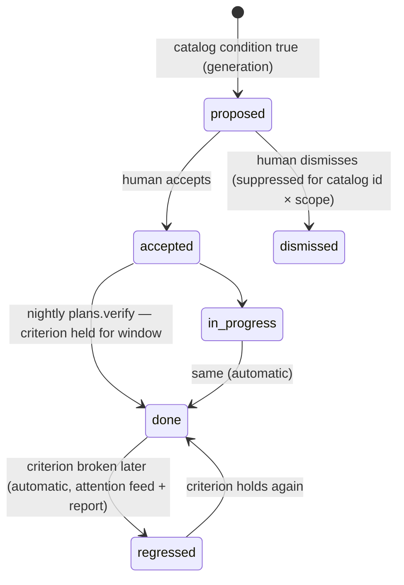

# Improvement Plans — Catalog, Agreements, Intents (packages/insights + reports/web) — D9

Traces: FR-PLANS-1..6, FR-ANALYSIS-9/10, FR-INSIGHTS-6, S-40..S-44, NON_GOALS N-4/N-9.
Research basis + pattern sources: docs/work/UX_AGENTS_IMPROVEMENT_PLANS.md §C (LinearB,
Swarmia, CodeScene, DX, Sleuth citations) and the bpm-opencode-experts FIX_VERIFY_LOOP
"verify criterion" discipline. Tables: DATABASE.md §D9/D10 additions.

**Prime rule (anti-hallucination by construction): plan items come ONLY from the
deterministic catalog. LLM passes order, narrate, and summarize — they never add,
remove, or reword a recommendation's substance.** A plan must be fully functional and
trustworthy on a Tier-1-only install with zero LLM calls.

## 1. Recommendation catalog (FR-PLANS-1)

Versioned asset `packages/insights/src/plans/catalog.v{N}.ts` — machine-readable like the
metric catalog (FR-METRICS-15). Entry shape:

```ts
interface CatalogEntry {
  id: string;                       // stable, e.g. 'review-coverage-low'
  title: string;                    // recommendation template (params interpolated)
  condition: MetricCondition;       // evaluated over snapshots/facts, window-param'd
  evidenceQuery: EvidenceRef;       // what the UI links to (offender list, matrix, finding set)
  verifyCriterion: VerifyCriterion; // {metric_key, op, target, window} | {finding_ids_resolved}
  effort: 'S' | 'M' | 'L';
  rankWeight: number;               // deterministic base ordering
}
```

### Seed catalog v1 (13 entries)

<!-- W5-06: the heading said 12 while the table listed 13. `act-band-cluster` was
added later as the D12 sibling of `sev-findings-cluster` and the count was never
updated. Corrected here rather than in code: the catalog implements all 13. -->

| id | Condition (defaults; workspace-tunable) | Recommendation (template) | Verify criterion |
|---|---|---|---|
| review-coverage-low | M5 < 0.8 | Adopt review SLA; rebalance via reviewer-load matrix | M5 ≥ 0.8 for 30d |
| first-review-slow | M4 open→firstReview p90 > 24h | Review-window agreement + WIP limit | p90 ≤ 24h for 30d |
| unreviewed-merges | M6 > 0.05 | no-unreviewed-merge agreement (exception list attached) | M6 ≤ 0.05 for 30d |
| oversized-prs | M7 XL share > 0.15 | PR-size agreement (≤500 lines); split guidance | XL share ≤ 0.15 for 30d |
| stale-queue | M8 count > 10 | Weekly stale-PR triage ritual | M8 ≤ 5 for 14d |
| hotspot-bus-factor | file in M2 top-10 ∧ M3 busFactor = 1 | Pairing/doc action on {file}; set `refactor` intent | busFactor ≥ 2 (365d recompute) OR hotspot < 0.5 |
| flaky-workflow | M9 flakiness rank-1 > 0.1 | Quarantine + fix top flaky workflow {name} | flakiness ≤ 0.05 for 30d |
| ci-slow | M9 duration p90 > 2× repo 90d median | CI duration investigation | p90 ≤ 1.2× median for 30d |
| cfr-high | M12 CFR > 0.15 | Deploy-window review; expand revert drill-down | CFR ≤ 0.1 for 90d |
| release-stale | M11 days-since > 60 | Release-cadence review | days-since ≤ 30 |
| sev-findings-cluster | ≥3 open sev≥4 findings in one module | Remediation item linking the finding set | finding set resolved |
| kev-or-chain-open | any KEV / chain / compound finding open | Immediate remediation item (rank pinned #1) | finding(s) resolved |
| act-band-cluster | ≥3 open `act`-band findings in one module (D12 sibling of sev-findings-cluster) | Remediation item linking the finding set, ranked by summed effective_risk | finding set resolved or repriced below act |

Conditions marked with agreements (`unreviewed-merges`, `oversized-prs`, …) cross-link:
an active agreement's violations feed the same item (`source='agreement'`).

## 2. Generation & lifecycle (FR-PLANS-2)

```
report generated | "Create plan" (Plans page)
  → evaluate catalog vN over scope (repo_ids × window)  [pure SQL/snapshots]
  → rank: rankWeight × effective_risk of the breaching finding set (D12, RISK_MODEL.md;
    metric-only conditions keep severity-of-condition-breach); KEV/chain pinned first
  → plan_items rows (status=proposed, evidence links resolved)
  → optional T2 narrate pass (pass_kind='plan'): orders ties, writes "why now"
    paragraphs + plan summary — input is the item list JSON, never raw data
```



Every transition audited (plan_item_events). Team-scoped only — items never name a
person (N-9). Dismissed items don't regenerate while the same catalog id + scope stays
dismissed (suppression mirror of FP memory R-B4). Sequence diagram: ARCHITECTURE.md §4g.

## 3. Auto-verification (FR-PLANS-3) — the differentiator

Nightly job `plans.verify` (after `metrics.snapshot`): for each accepted/in_progress item,
evaluate `verify_criterion` off snapshots (or finding-set status). Criterion held for its
window ⇒ `done` (audit row, org-tile delta). Previously-done criterion broken ⇒
**`regressed`** (reopened, surfaced in the attention feed + next report). No LLM involved.

## 4. Working agreements (FR-PLANS-4) & artifact intents (FR-PLANS-5)

- **Agreements**: admin config over existing metrics (kinds in DATABASE.md). Surface =
  threshold + trend chip + **exception list** (the actual offending PRs, trailing 14d,
  drill-down links) — artifacts to discuss, never a leaderboard (N-9, R-5). Digest card on
  Org Overview; outbound channels stay out (N-4).
- **Intents** on file/dir: `refactor` (warn when hotspot score hasn't improved in
  `warn_after_months` — one snapshot query), `supervise` (alert on any hotspot/churn
  decline), `acknowledged` (suppress from hotspot leaderboard, never from data; badge
  shows suppression count for honesty). Render on file drill-down + hotspot list.

## 5. Surfaces (FR-PLANS-6)

Rail item **Plans**: plan list w/ progress bars ("3/7 done · 1 regressed"), item cards
(evidence links, effort, accept/dismiss), catalog-version stamp. Report integration:
every report closes with the scope's open plan items + movement since the previous
same-scope report (computable from plan_item_events between the two snapshotAt pins).
Org Overview tile: active plan progress + worst regression.

## 6. Testing hooks

Catalog entries are pure functions — fixture warehouse vectors per entry (condition
true/false at boundary, evidence query resolves, verify criterion flips on a crafted
snapshot series). Golden test: fixture report scope generates the expected item set at
catalog v1 (snapshot-tested). Auto-verify: crafted snapshots flip done → regressed with
audit rows. E2E (W5): generate plan from report → accept item → seed improved snapshots →
nightly job flips done → regenerate report shows movement. Narrate pass mocked at the
gateway (TESTING.md §8 rules apply; `initiator='plans'`).
