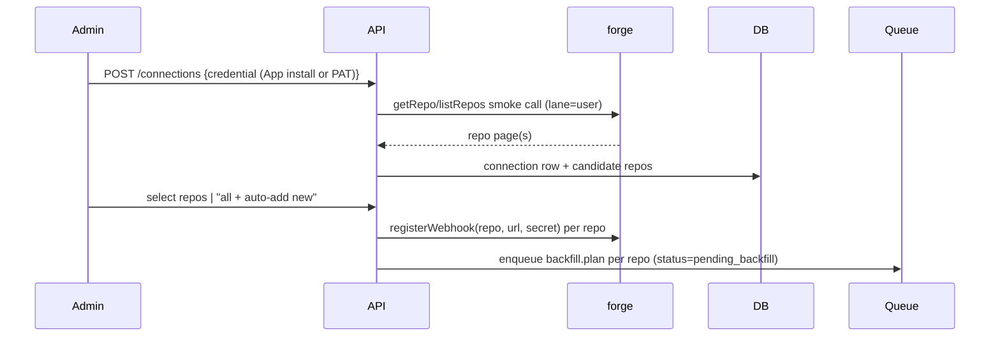
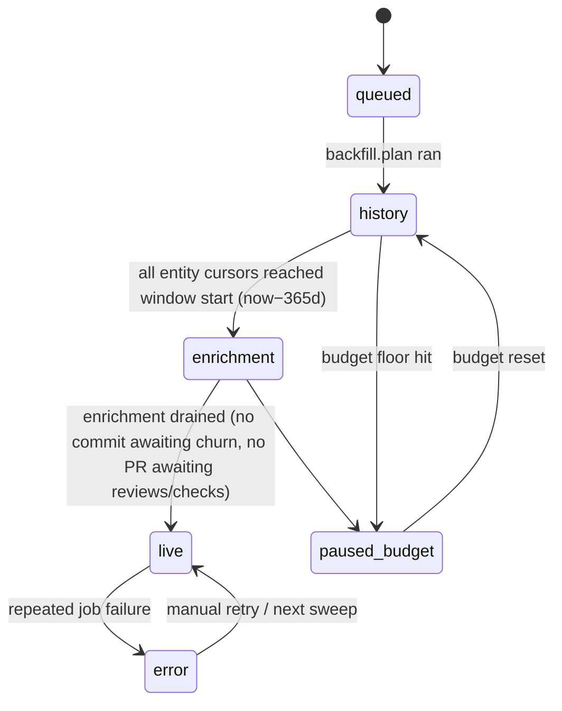

# Ingestion — Connect, Backfill, Webhooks, Reconciliation (packages/ingest)

Traces: FR-INGEST-1..9, FR-FORGE-3/4, NFR-1/2/10/11/12, C1. Depends on FORGE_PROVIDER.md
(BudgetedClient lanes, capability flags). Design rule (research §4): **webhooks are a hint;
cursors + ETag polling are the source of truth.**

## 1. Connect flow (FR-INGEST-1)



Validation: credential must list ≥1 repo and (App mode) expose the installation; failures
return actionable error (bad scope vs bad token). `auto_add_new=true` connections pick up new
repos from `repository` webhook events + the nightly sweep. Credentials stored per FR-AUTH-5.

## 2. Per-repo sync state machine (FR-INGEST-8)



- **history** = metadata backfill (PR/commit/issue/release/deployment lists — cheap, GraphQL
  where `supportsGraphQLBackfill`). **enrichment** = every PER-PARENT DETAIL FETCH: per-commit
  file churn (research §8 option A) and stats-endpoint fallbacks, per-PR reviews, and
  per-head-SHA check runs — low-priority, drained by leftover budget.
  > **Amended 2026-08-13 (founder).** Enrichment was originally "per-commit file churn" alone,
  > and `checks` was listed in the history entity order below. That was inconsistent: history
  > entities are walked page-by-page at repo scope, but check runs are keyed on a head SHA and
  > reviews on a PR number, so neither can go through the paginated walk — `processBackfillJob`
  > accepts only `PaginatedEntity` for exactly that reason. All three nested fetches now share
  > the enrichment lane, which already had the right priority and retry policy. Reviews had no
  > home in the design at all before this, which is why `upsertReviews` shipped with no caller.
- Dashboard is usable from `enrichment` onward; Tier-1 metrics that need file churn label
  themselves partial until enrichment completes (FR-WEB-8).

## 3. Backfill planner (FR-INGEST-2/3/4, NFR-2)

- **Window**: now−365d. **Repo order**: `pushedAt` desc (recently-active first). **Entity
  order per repo**: PRs → commits → issues → releases/deployments (FR-INGEST-4). `checks` moved
  to the enrichment lane on 2026-08-13 (see §2) — it is fetched per head SHA, not walked.
- **Recent-first within entity**: list `sort=updated desc` and walk backwards in time, so the
  dashboard's default 30d window fills first and % complete is honest for what users see.
- **Cursors** (FR-INGEST-3/6): table
  `sync_cursor(workspace_id, repo_id, entity_type, cursor, high_watermark timestamptz, phase, updated_at)`
  — `cursor` = opaque `ForgeCursor` checkpoint mid-backfill; `high_watermark` = newest
  `updated_at` fully ingested, used by delta pulls. Checkpoint written after **every page**
  inside the same transaction as the page's upserts ⇒ crash-resume never re-does or skips a
  page; upserts are idempotent on natural keys (`repo_id + sha` / `+ pr_number` / `+ external_id`).
- **Budget yielding**: each job processes ≤N pages (default 20) then re-enqueues itself with
  its cursor; if `BudgetedClient` reports floor-hit, the job re-enqueues with
  `delay = ms_until_reset` and flips repo to `paused_budget`. No job ever busy-waits on budget.
- Capacity check (research §8): option-B repo ≈ 250 REST + 20 GraphQL pts ⇒ ~20 repos/hr on a
  5,000/hr token; 50-repo org < 24h with enrichment trailing (NFR-2). Secondary limit governs
  burst: ≤10 req/s per endpoint family (FORGE_PROVIDER.md §3).

## 4. Webhook pipeline (FR-INGEST-5, NFR-10)

```ts
// POST /webhooks/github — must answer <10s (research §4): verify, persist, 202, return.
interface WebhookDelivery { deliveryId: string; event: string; action?: string;
  repoFullName: string; receivedAt: string; payloadDigest: string; }
```

1. `verifyWebhook(rawBody, sig, secret)` → invalid/absent ⇒ **401**, nothing enqueued.
2. Dedupe: `INSERT ... ON CONFLICT (delivery_id) DO NOTHING` into `webhook_delivery`;
   conflict ⇒ 200 no-op (GitHub redeliveries, FR-INGEST-6 idempotency).
3. Enqueue typed delta job (lane=`webhook`), respond 202 immediately.
4. Delta jobs pull **by cursor, not payload**: e.g. `pull_request` event ⇒
   `listPullRequests(since=high_watermark)` + reviews for touched PRs — the payload is only a
   doorbell, so dropped/mangled payloads self-heal. `push` events per repo **coalesce** (BullMQ
   jobId `push:{repoId}`, debounce 30s) into one commits-since-cursor call (research §8 steady state).
   Cache-bust dashboard queries on completion ⇒ ≤60s freshness (NFR-10).

Events subscribed: `push, pull_request, pull_request_review, pull_request_review_comment,
workflow_run, check_suite, deployment_status, release, issues, repository` (research §4).

## 5. Nightly reconciliation sweep (FR-INGEST-7)

Lane=`reconcile`, 02:00 local, per connection. For each repo, per entity type: conditional
`If-None-Match` list request on page 1 sorted by `updated`. **304 ⇒ free** (research §2) ⇒
unchanged repos cost ~0 primary budget. 200 ⇒ walk pages until `updated_at ≤ high_watermark`,
upserting (repairs missed webhooks, force-pushes, deleted PRs — deletions detected by
re-listing open sets and tomb-stoning rows absent from forge). Also: re-register missing
webhooks, pick up new repos for `auto_add_new`, requeue any repo stuck in `error`.
Gitea (`hasRateLimits:false`, `reportsTotalCounts:true`): sweep compares `x-total-count`
against warehouse counts as the cheap check instead of ETags.

## 6. Queue topology (BullMQ, NFR-11)

| Queue | Jobs (payload) | Idempotency key (jobId) | Retry |
|---|---|---|---|
| `ingest.backfill` | `plan {repoId}`, `entity {repoId, entityType, cursor}` | `bf:{repoId}:{entityType}` | 5×, expo 30s→30m |
| `ingest.delta` | `{repoId, entityType, deliveryId}` | `dl:{deliveryId}:{entityType}` / `push:{repoId}` | 3×, expo 10s |
| `ingest.enrich` | `commitFiles {repoId, sha}`, `prDetail {repoId, prNumber, headSha}` | `en:{repoId}:{sha}` / `en:{repoId}:{prNumber}:pr` | 3×, expo 1m |
| `ingest.reconcile` | `{repoId}` nightly cron | `rc:{repoId}:{yyyymmdd}` | 2× |
| `metrics.snapshot` | nightly, see METRICS.md §4 | `snap:{repoId}:{yyyymmdd}` | 3× |

- Concurrency: workers sized so BudgetedClient's semaphore is the real limiter; queue-level
  priority mirrors lanes (delta > user-triggered > backfill > enrich > reconcile).
- **DLQ** (NFR-11): after max attempts, job + last error copied to `ingest.dlq` and a
  `job_failure` row; surfaced on the admin ops page with replay button. Poison payloads never
  block the queue; partial backfill is a valid resting state (cursors mark exactly what's done).
- **Graceful shutdown**: `worker.close()` waits for in-flight page transactions; SIGTERM stops
  intake first, then drains ≤30s; anything longer resumes from cursor on restart (FR-INGEST-3).

## 7. Sync status model (FR-INGEST-8 → FR-WEB-8)

```ts
interface RepoSyncStatus {
  repoId: string;
  phase: 'queued' | 'history' | 'enrichment' | 'live' | 'paused_budget' | 'paused' | 'error';
  percentComplete: number;        // GitHub: time-coverage = (now − oldest_ingested_updated_at)/365d
                                  // per entity, min across entities; Gitea: exact via x-total-count
  entities: Record<string, { cursorAt: string | null; done: boolean }>;
  budget: { remaining: number; limit: number; resetAt: string; spent24h: number };
  lagSeconds: number | null;      // now − newest high_watermark; the NFR-10 gauge
  lastError: { at: string; message: string; jobId: string } | null;
  lastSyncedAt: string | null;
}
```

Served from warehouse only (FR-API-2); org-level banner aggregates worst phase + total budget
spend. Pause/remove (FR-INGEST-9, v1.x): pause = stop scheduling (state `paused`); remove =
deregister webhook + optional cascade delete of warehoused rows.

## 8. Failure handling summary

| Failure | Behavior |
|---|---|
| Worker crash mid-backfill | resume from per-page cursor; idempotent upserts ⇒ no dupes (FR-INGEST-3) |
| Budget exhausted | jobs park with delay-to-reset; UI shows `paused_budget` (NFR-1) |
| Secondary-limit 403 | BudgetedClient backs off per retry-after; job unaware (FORGE_PROVIDER.md §3) |
| Webhook missed/dropped | nightly sweep repairs via cursors + ETag (FR-INGEST-7) |
| Poison payload | DLQ + admin ops page (NFR-11) |
| Stats endpoint 202/422 | retry-then-fallback to per-commit REST in enrich lane (research §3) |
