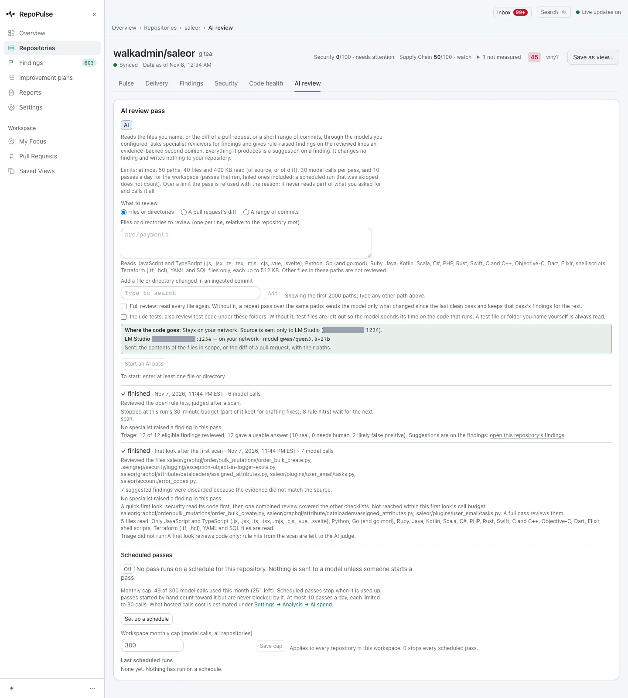
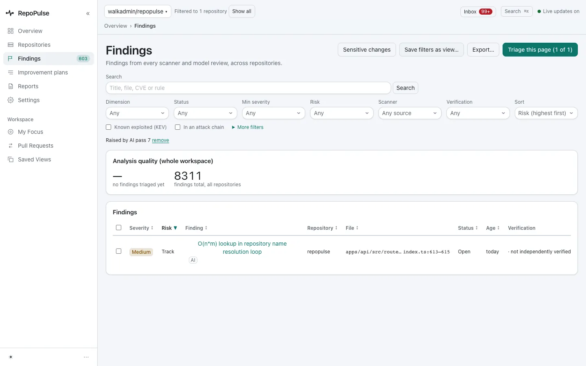
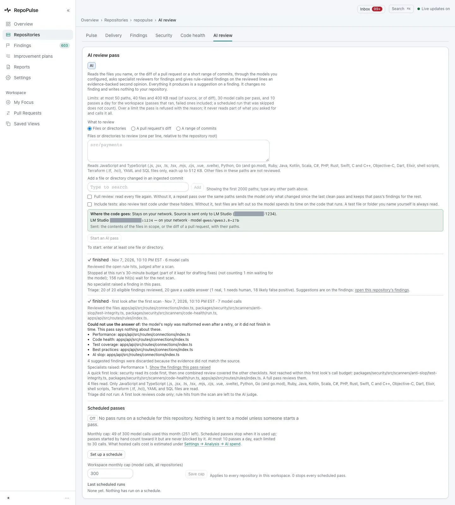

# Let a local model review your code

After the first scan, a local model takes a quick first look at the code that matters, and a judge reviews the rule hits. Each pass reads only what it needs, says exactly what it read and what it left, and a repeat pass sends only what changed.

**For:** Developer, Security engineer, Engineering lead · **4 steps** · [All tours](README.md)

> Real screens from a RepoPulse test install built from the current main branch (0.2.1 in development). It tracks copies of three open-source projects on a local Gitea: gin (Go), saleor (Python) and RepoPulse's own code (TypeScript), with the qwen3.8-27b model running in LM Studio on the same network.

## 1. A first look and a judge, after the first scan

A repository's **AI review** tab lists every pass. On saleor, the **first look** took 7 model calls and about 6 minutes: security read its code first, then one combined review covered the other checklists. It names the 5 files it read and the ones its call budget did not reach, and says that 7 suggestions were discarded because their evidence did not match the source. The **judge** reviewed 12 rule hits: 10 real, 2 likely false positives.

## 2. Go straight to what a pass found

**Show the findings this pass raised** opens the findings list filtered to that pass. On RepoPulse's own code the first look raised one: an O(n·m) lookup in the repository-name loop of a route, marked AI.

## 3. Passes say what they could not do

When a pass hits a limit it says so. On RepoPulse's own code the judge stopped at its 30-minute budget with 156 rule hits left for the next scan, and the first look lists the answers it could not use and the files it did not reach. Nothing is reported as reviewed that was not.

## 4. Start a pass that only re-reads what changed

Start a pass on files, a pull request's diff or a range of commits. A repeat pass over the same paths sends the model only what changed since the last clean pass and keeps that pass's findings for the rest; tick **Full review** to read everything again. Test files are left out unless you tick **Include tests**, and the form says exactly where the code goes: here, only to LM Studio on your network.

---

AI suggestions never change a finding by themselves: the model can confirm, doubt or propose, and a person decides.

---

Next tour: [Install and set up RepoPulse](setup.md) · [All tours](README.md)
