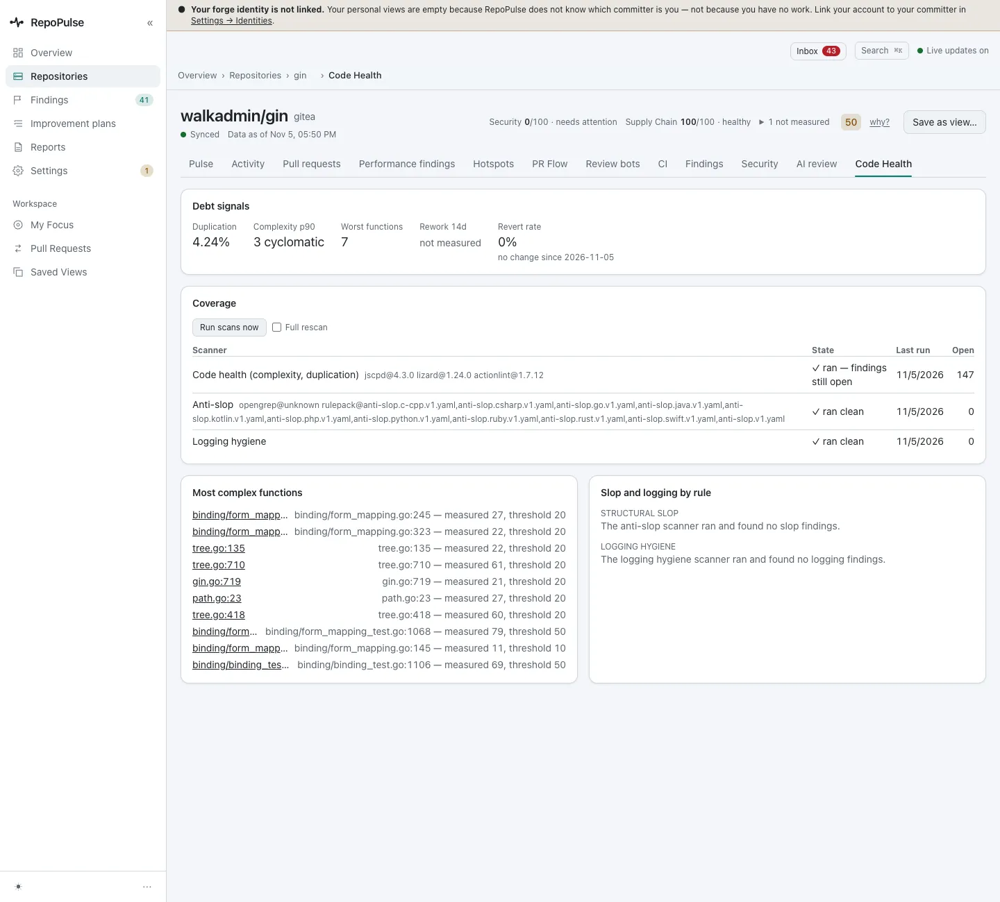
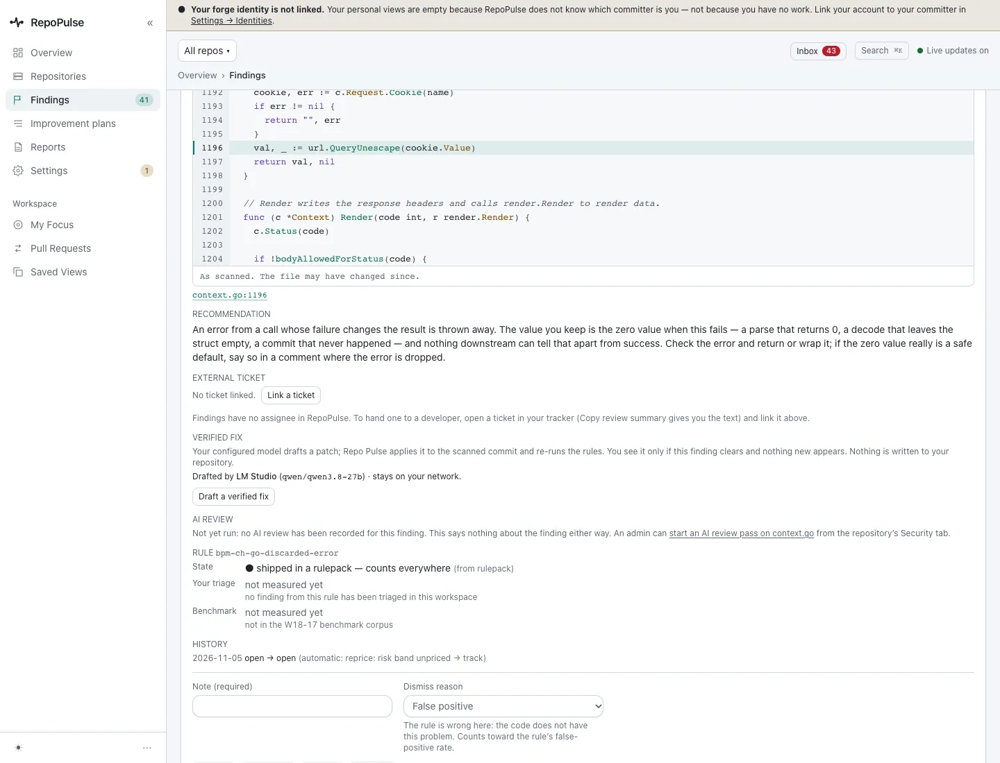
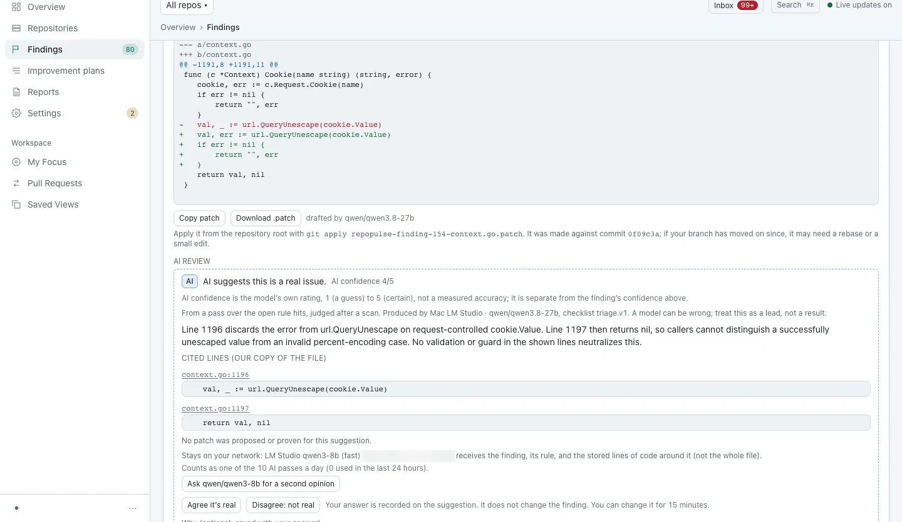
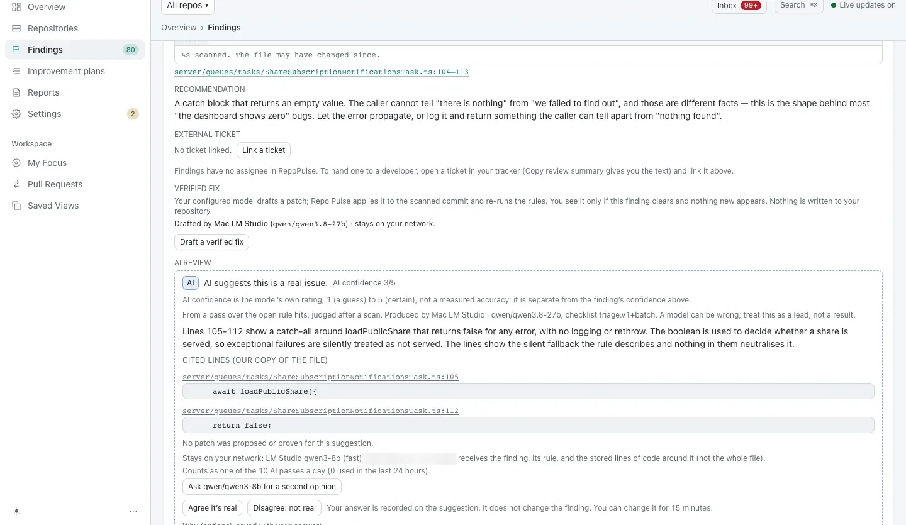
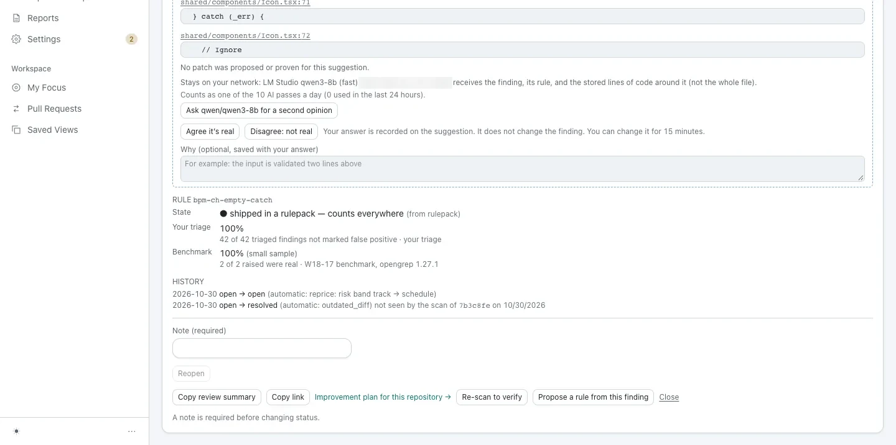

# Fix the mistakes AI coding tools make

AI-slop rules look for the shapes generated code gets wrong: errors thrown away, catch blocks that hide failures, code that only looks finished. The flow is the same as every finding, from the line to a verified fix to closed.

**For:** Developer · **6 steps** · [All tours](README.md)

> Real screens from a fresh RepoPulse 0.2.0 install that scanned copies of six public open-source projects (axum, gin, mastodon-ios, nowinandroid, outline and saleor) on a local Gitea over https, with models running in LM Studio on the same network.

## 1. Start from Code Health

gin's Code Health tab: 4.24% duplication, a p90 complexity of 3, a worst-functions count of 7, and which scanners ran.

## 2. An error thrown away

`context.go:1196` in gin: `val, _ := url.QueryUnescape(cookie.Value)`. A bad cookie value comes back as an empty string with no error, which callers cannot tell from an empty cookie.

## 3. The model's verdict

The model judges whether it is real and why: here, that callers cannot tell a successful unescape from a failed one, and nothing in the lines shown guards it.

_Screen from the pre-0.2.0 walkthrough (0.9.17). The 0.2.0 capture is waiting on the local model's AI review and will replace it._

## 4. The verified diff

The drafted patch returns the error instead of dropping it. It was applied to the scanned commit and re-scanned before it appeared: the finding clears and nothing new fires. It is marked not tested, because RepoPulse does not build or run your code.

_Screen from the pre-0.2.0 walkthrough (0.9.17). The 0.2.0 capture is waiting on the local model's AI review and will replace it._

## 5. A judgement call, explained

Some findings are judgement calls, like a catch that returns false around a network load. The model says how sure it is and which lines it relied on, and passes what it cannot decide to a person.

_Screen from the pre-0.2.0 walkthrough (0.9.17). The 0.2.0 capture is waiting on the local model's AI review and will replace it._

## 6. Closed, with the history to prove it

When the code no longer has the problem, the next scan resolves the finding on its own and records which commit's scan no longer saw it. An empty catch with a comment explaining why is not a finding.

_Screen from the pre-0.2.0 walkthrough (0.9.17). The 0.2.0 capture is waiting on the local model's AI review and will replace it._

---

Next tour: [Review and apply verified fixes](fixes.md) · [All tours](README.md)
