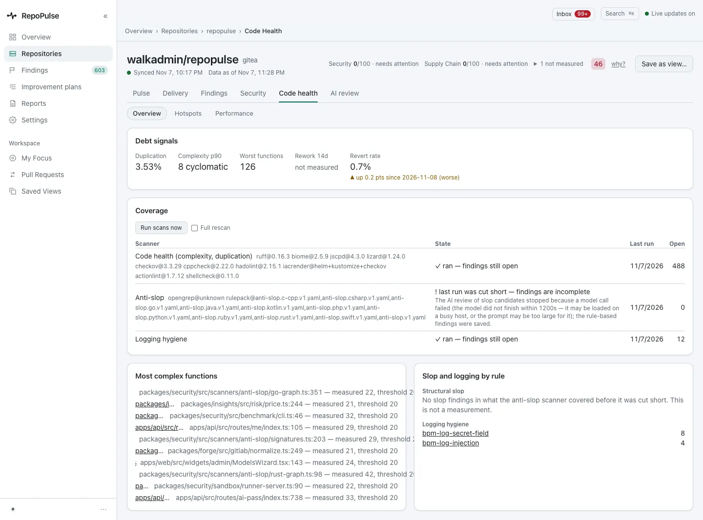
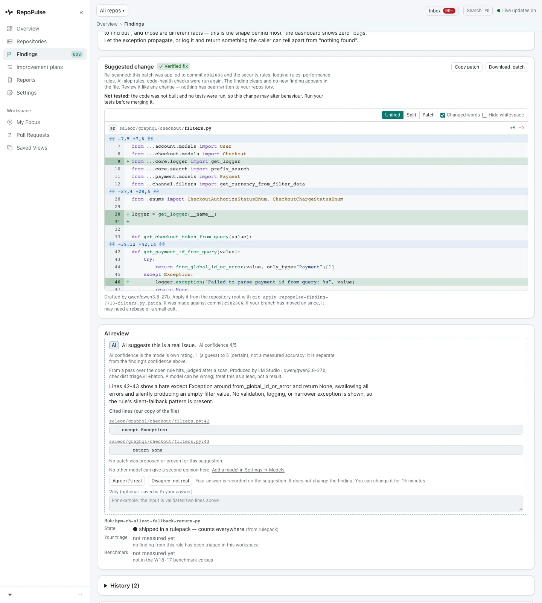

# Fix the mistakes AI coding tools make

AI-slop rules look for the shapes generated code gets wrong: errors thrown away, catch blocks that hide failures, comments that restate the code. The flow is the same as every finding, from the line to a verified fix to closed.

**For:** Developer · **3 steps** · [All tours](README.md)

> Real screens from a RepoPulse test install built from the current main branch (0.2.1 in development). It tracks copies of three open-source projects on a local Gitea: gin (Go), saleor (Python) and RepoPulse's own code (TypeScript), with the qwen3.8-27b model running in LM Studio on the same network.

## 1. Start from Code health

**Code health** has three sub-tabs: Overview, Hotspots and Performance. RepoPulse's own code: 3.53% duplication, a p90 complexity of 8, 126 worst functions and a 0.7% revert rate. Each scanner is listed with its tools and result, and the most complex functions are named. Tests, fixtures, generated and vendored code are left out of these numbers.

## 2. A failure hidden inside a loop

In saleor, `graphql/context.py:56` wraps each item in `try ... except Exception: continue`, so a failure is silently skipped. The model agrees it is real (confidence 4 of 5) and cites the two lines that show it.

## 3. The verified diff

For a swallowed exception in `saleor/graphql/checkout/filters.py`, the model drafted a fix that logs the error instead of hiding it. RepoPulse applied it to the scanned commit and re-ran every rule: the finding clears and nothing new fires. It is marked not tested, because RepoPulse does not build or run your code.

---

When the code no longer has the problem, the next scan resolves the finding on its own. An empty catch with a comment explaining why is not a finding.

---

Next tour: [Review and apply verified fixes](fixes.md) · [All tours](README.md)
