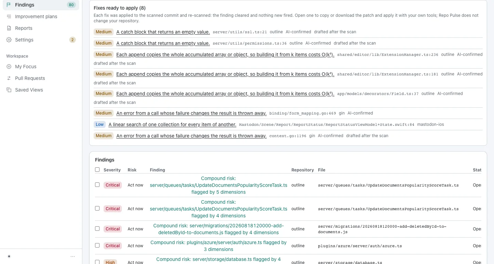
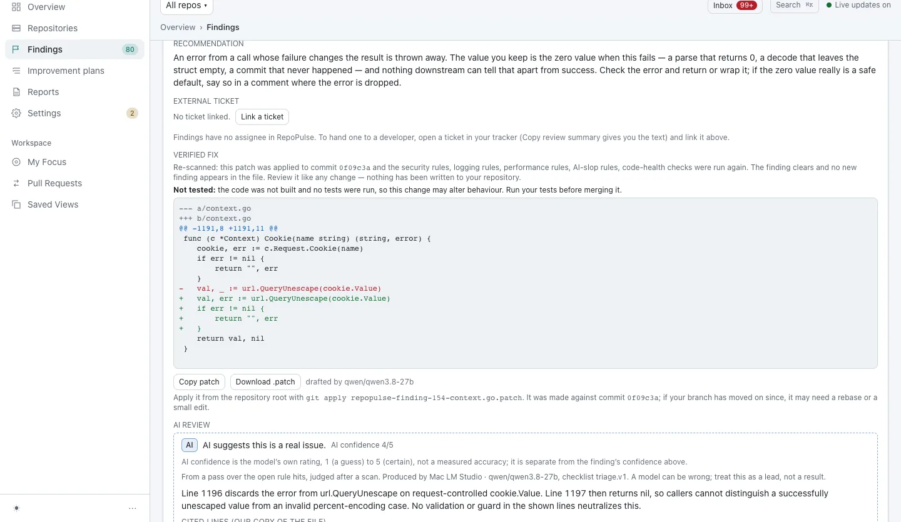
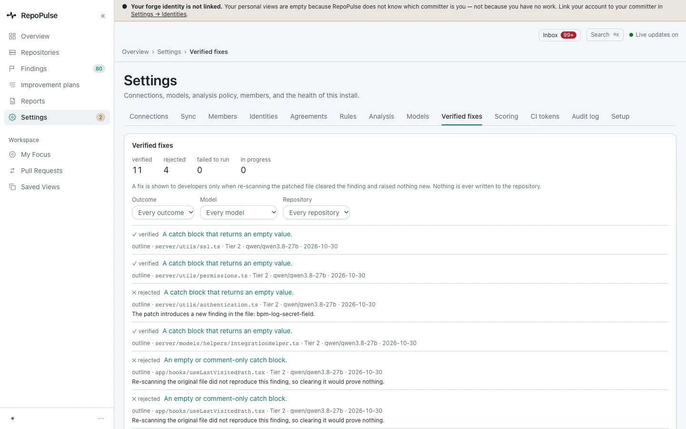
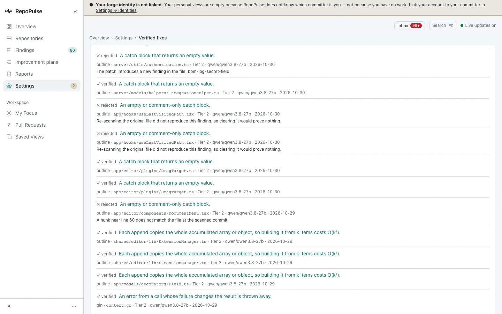
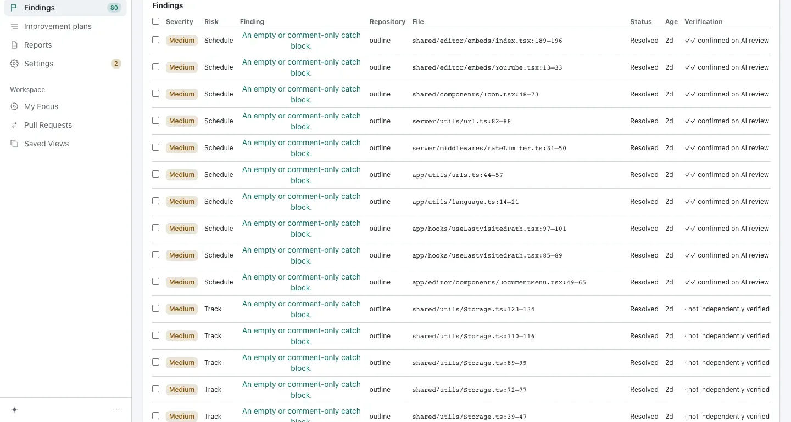

# Review and apply verified fixes

A model drafts the patch; RepoPulse applies it to the scanned commit and re-runs every rule. You only see it if the finding clears and nothing new appears. Patches that fail are refused, with the reason, and nothing is ever written to your repository.

**For:** Developer, Security engineer, Engineering lead · **5 steps** · [All tours](README.md)

> Real screens from a fresh RepoPulse 0.2.0 install that scanned copies of six public open-source projects (axum, gin, mastodon-ios, nowinandroid, outline and saleor) on a local Gitea over https, with models running in LM Studio on the same network.

## 1. Fixes ready to apply

Every findings page opens with the fixes that passed, each marked AI-confirmed. Open one to copy or download its patch.

_Screen from the pre-0.2.0 walkthrough (0.9.17). The 0.2.0 capture is waiting on the local model's AI review and will replace it._

## 2. Read the diff before you apply it

Each fix says what was re-run (security, logging, performance, AI-slop and code-health rules), the commit it was made against, and that it was not built or tested. Copy it, or download it and run `git apply`.

_Screen from the pre-0.2.0 walkthrough (0.9.17). The 0.2.0 capture is waiting on the local model's AI review and will replace it._

## 3. See every attempt, not just the wins

**Settings → Verified fixes** keeps a log of every draft, verified or rejected, filterable by outcome, model and repository.

_Screen from the pre-0.2.0 walkthrough (0.9.17). The 0.2.0 capture is waiting on the local model's AI review and will replace it._

## 4. Refused, with the reason

A rejected patch says why: it introduced a new finding, it did not match the file at the scanned commit, or it targeted a finding the original file did not reproduce, so clearing it would prove nothing.

_Screen from the pre-0.2.0 walkthrough (0.9.17). The 0.2.0 capture is waiting on the local model's AI review and will replace it._

## 5. Closed when the code changes

Findings close when a later scan no longer sees them; each row still shows whether a model had confirmed it.

_Screen from the pre-0.2.0 walkthrough (0.9.17). The 0.2.0 capture is waiting on the local model's AI review and will replace it._

---

Next tour: [Track code health and the improvement plan](health.md) · [All tours](README.md)
