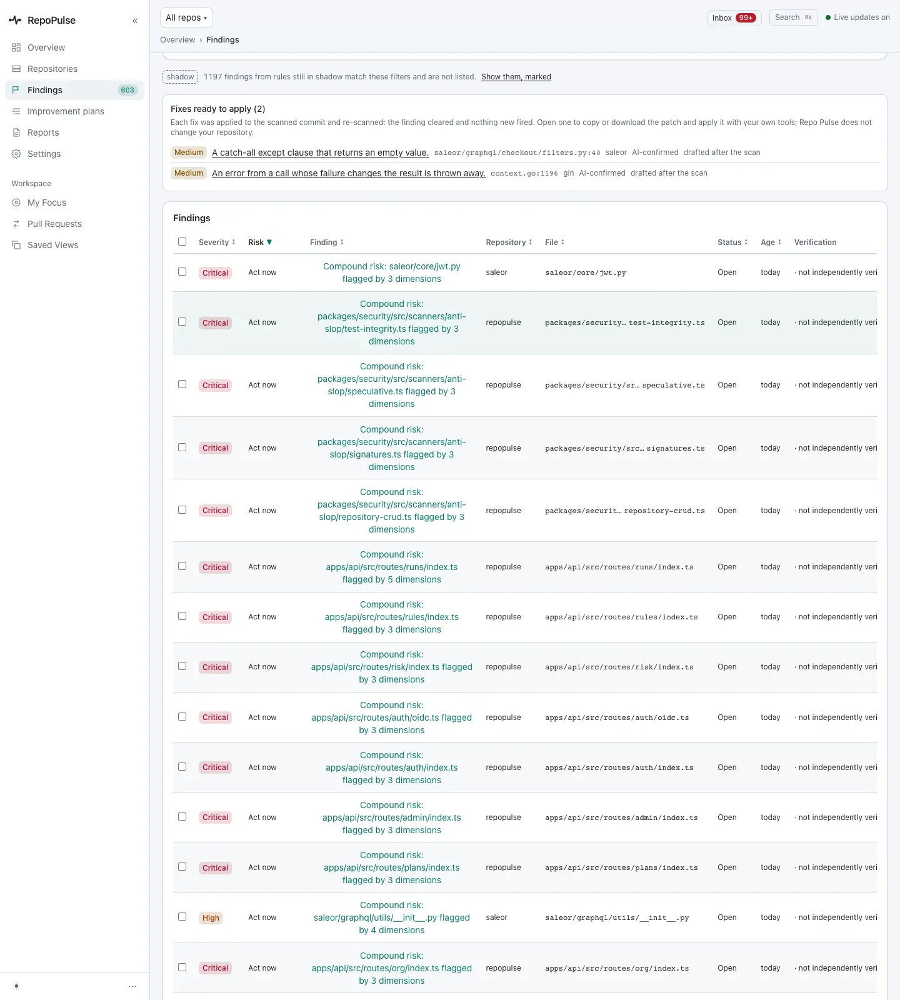
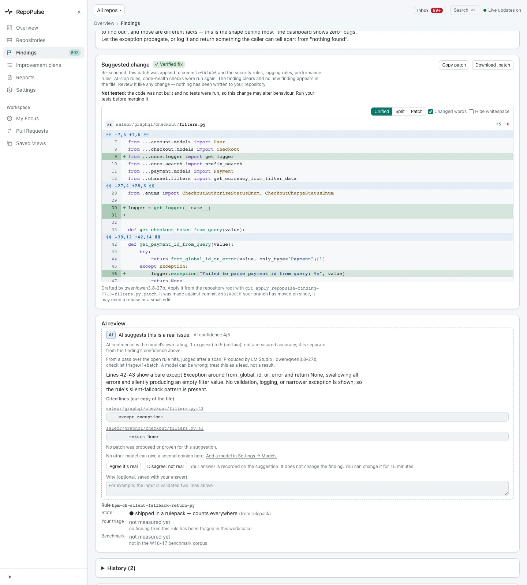
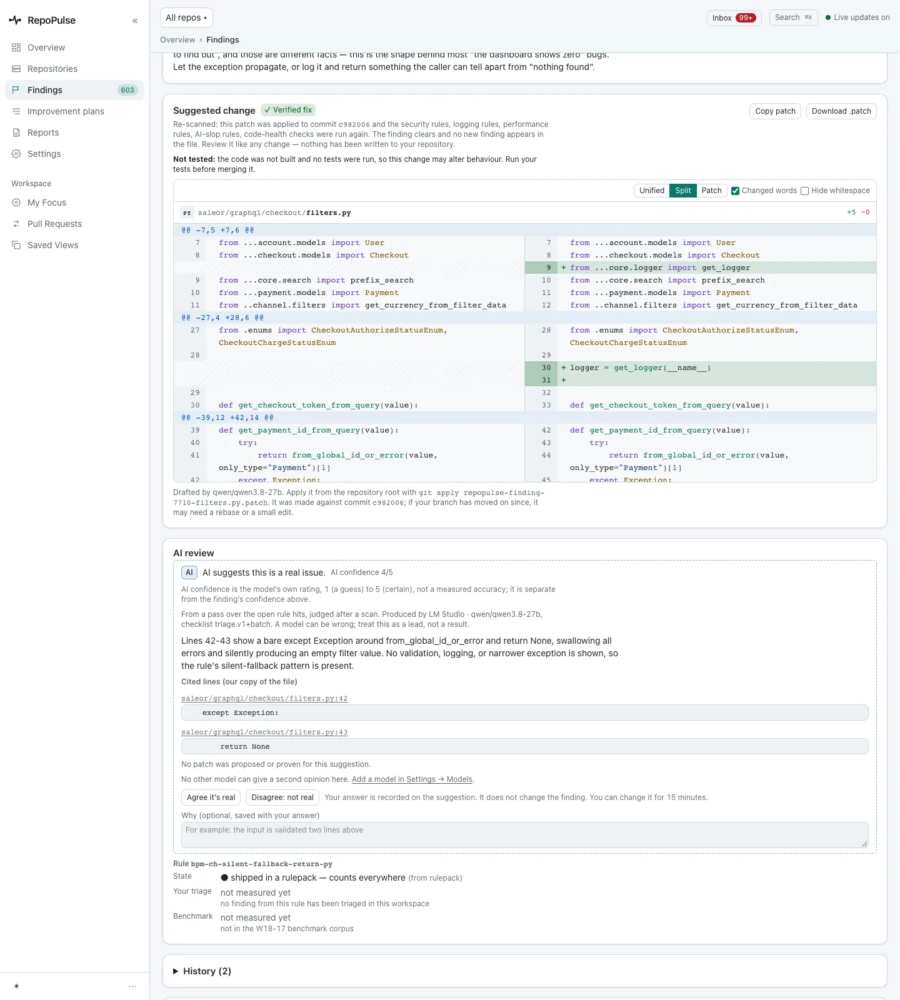
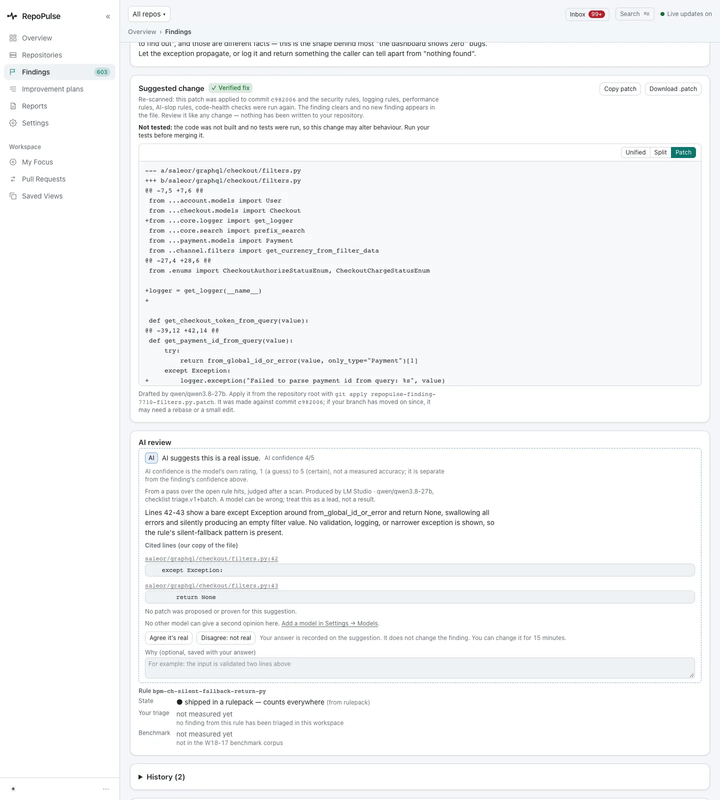
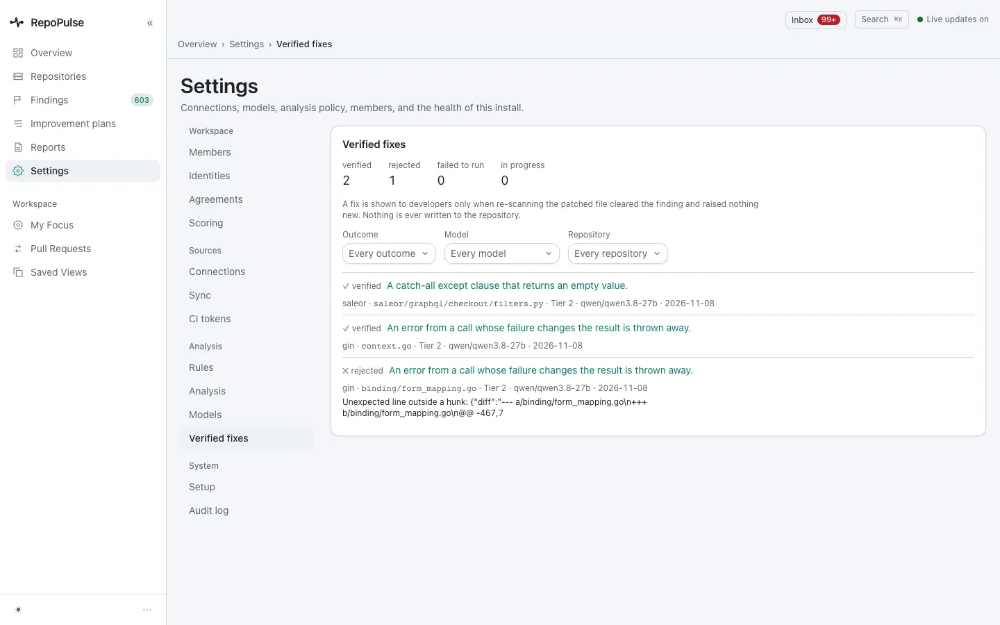
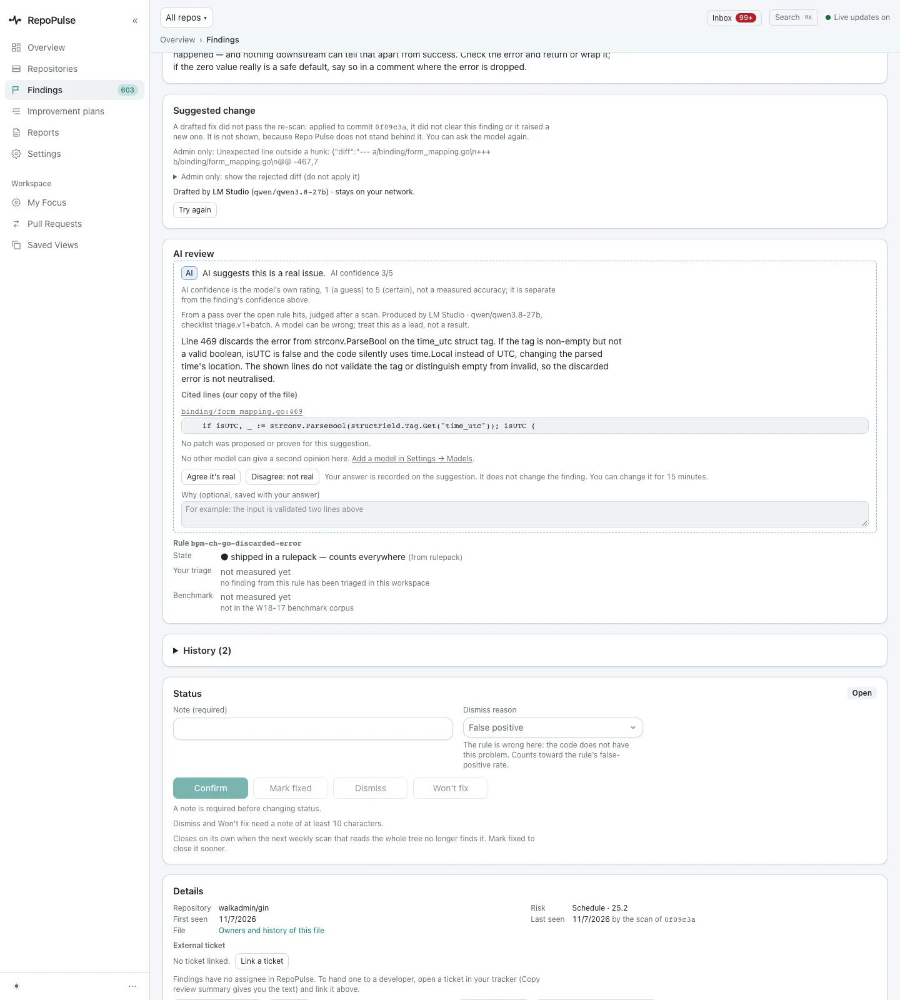

# Review and apply verified fixes

A model drafts the patch; RepoPulse applies it to the scanned commit and re-runs every rule. You only see it if the finding clears and nothing new appears. Patches that fail are refused, with the reason, and nothing is ever written to your repository.

**For:** Developer, Security engineer, Engineering lead · **6 steps** · [All tours](README.md)

> Real screens from a RepoPulse test install built from the current main branch (0.2.1 in development). It tracks copies of three open-source projects on a local Gitea: gin (Go), saleor (Python) and RepoPulse's own code (TypeScript), with the qwen3.8-27b model running in LM Studio on the same network.

## 1. Fixes ready to apply

The findings list opens with the fixes that passed: here 2, one in saleor and one in gin (`context.go:1196`, an error thrown away), each AI-confirmed. Open one to read its patch.

## 2. Read the diff: Unified

The **Suggested change** card says what was re-run (security, logging, performance, AI-slop and code-health rules), the commit it was applied to, and that the code was not built or tested. The unified view shows the 5 added lines: a logger import, a logger, and a log call in the `except`.

## 3. Or side by side

**Split** puts the old and new file side by side, with changed words highlighted; whitespace can be hidden too. RepoPulse remembers which view you chose, and falls back to unified on a phone.

## 4. Or the raw patch

**Patch** shows the file you would apply. Copy it, or download it and run `git apply`. There is no apply button: RepoPulse never writes to your repository.

## 5. See every attempt, not just the wins

**Settings → Verified fixes** keeps a log of every draft: here 2 verified and 1 rejected, filterable by outcome, model and repository, each with the reason it passed or failed.

## 6. Refused, with the reason

A rejected patch is never shown as a fix. On gin's `binding/form_mapping.go:469` the drafted diff did not apply cleanly, so the card says the fix did not pass the re-scan and RepoPulse does not stand behind it. An admin can look at the rejected diff, and anyone can ask the model again.

---

Next tour: [Track code health and the improvement plan](health.md) · [All tours](README.md)
