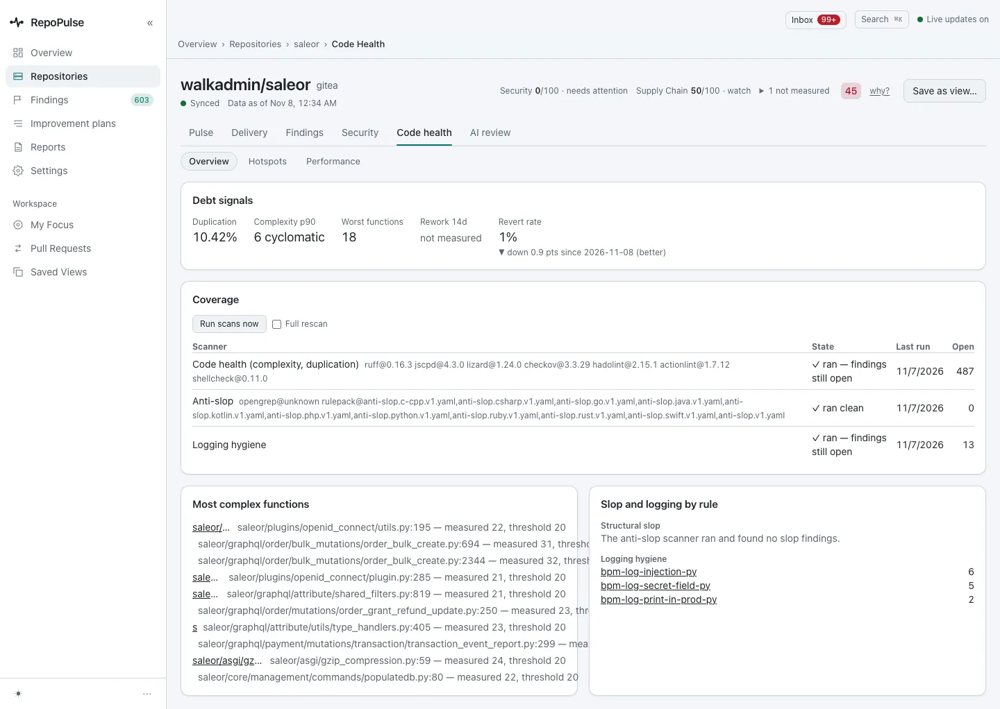
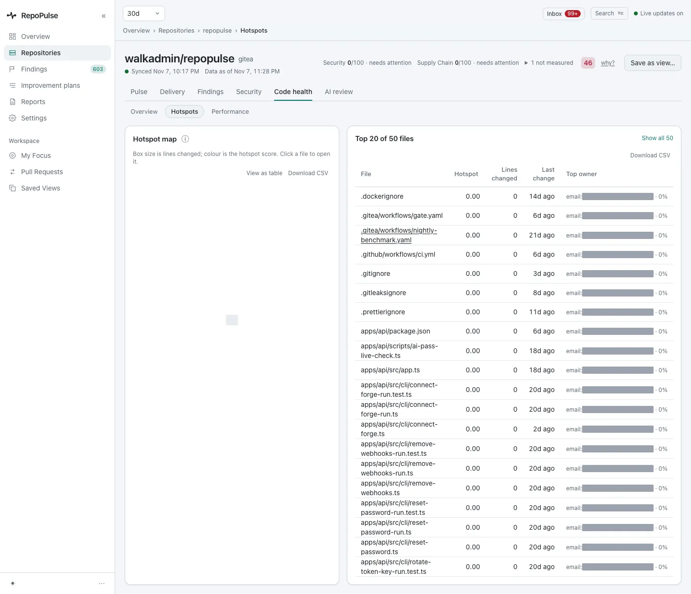
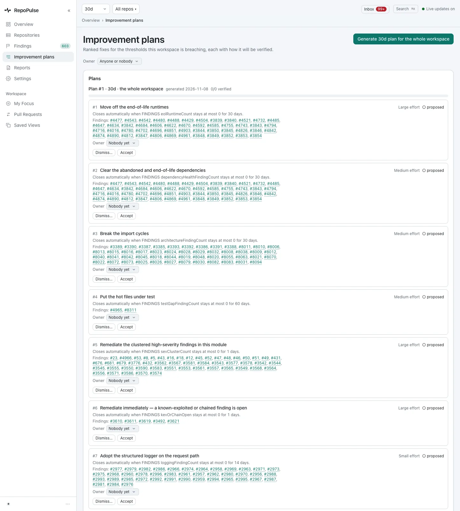

# Track code health and the improvement plan

Code health tracks the slow-moving debt signals per repository; the improvement plan turns breached thresholds into a short ranked list, and closes each item on its own when its number moves.

**For:** Engineering lead · **3 steps** · [All tours](README.md)

> Real screens from a RepoPulse test install built from the current main branch (0.2.1 in development). It tracks copies of three open-source projects on a local Gitea: gin (Go), saleor (Python) and RepoPulse's own code (TypeScript), with the qwen3.8-27b model running in LM Studio on the same network.

## 1. Read a repository's debt signals

saleor: 10.42% duplication, a p90 complexity of 6, 18 worst functions and a 1% revert rate, down 0.9 points. Below, each scanner's tools and open count, the most complex functions by name, and logging findings by rule.

## 2. See where code changes most

**Hotspots** ranks files by how much they change and who owns them. These copies were pushed with shallow history, so every score here is 0; on a live forge the map shows where change and complexity meet.

## 3. Turn it into a plan

**Improvement plans** turns the breached thresholds into a ranked list: here seven items for the whole workspace, from moving off end-of-life runtimes to adopting the structured logger on the request path. Each says how big it is, which findings it covers and exactly when it closes itself. Accept, dismiss or assign an owner.

---

Next tour: [Decide which rules count](rules.md) · [All tours](README.md)
