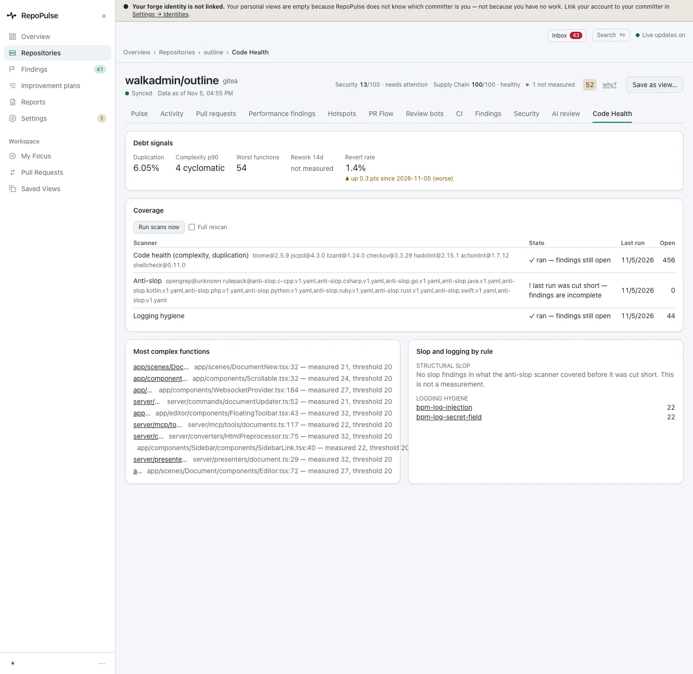
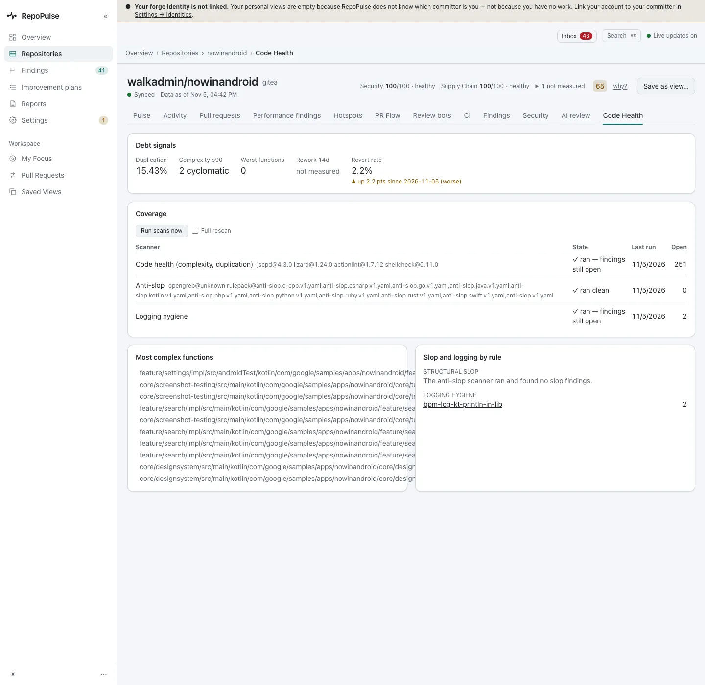

# Track code health and the improvement plan

Code Health tracks the slow-moving debt signals per repository; the improvement plan turns breached thresholds into a short ranked list, and closes each item on its own when its number moves.

**For:** Engineering lead · **3 steps** · [All tours](README.md)

> Real screens from a fresh RepoPulse 0.2.0 install that scanned copies of six public open-source projects (axum, gin, mastodon-ios, nowinandroid, outline and saleor) on a local Gitea over https, with models running in LM Studio on the same network.

## 1. Read a repository's debt signals

outline: 6.05% duplication, a p90 complexity of 4, a worst-functions count of 54, and a revert rate of 1.4%. Below, each scanner's last run and open count, and the most complex functions by name.

## 2. Compare across languages

The same view works for every language. nowinandroid (Kotlin): 15.43% duplication, a p90 complexity of 2, and a revert rate of 2.2%.

## 3. Turn it into a plan

Improvement plans ranks fixes for the thresholds being breached. outline's plan proposes adopting a review SLA, and says exactly when the item closes itself. Accept, dismiss or assign an owner.

---

Hotspots (where code changes most) and PR flow (where reviews stall) need forge history: these test copies were pushed with shallow history and no pull requests, so those pages are empty here and are not shown.

---

Next tour: [Decide which rules count](rules.md) · [All tours](README.md)
