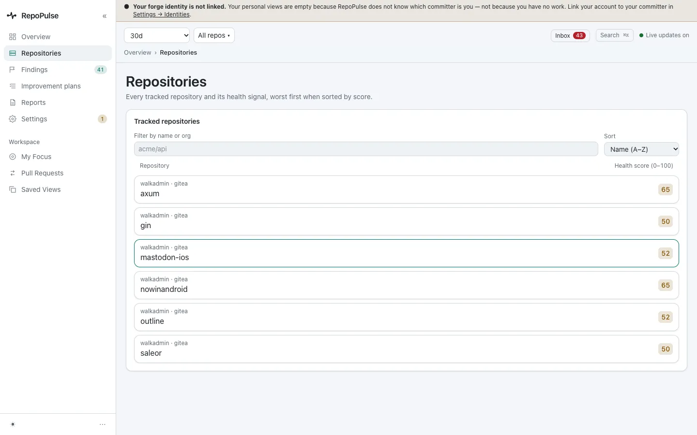
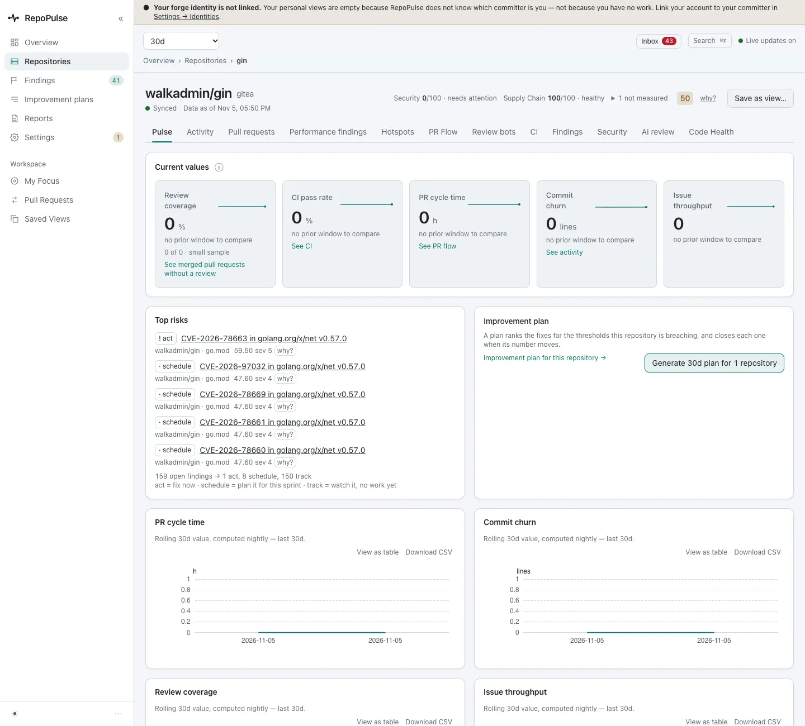
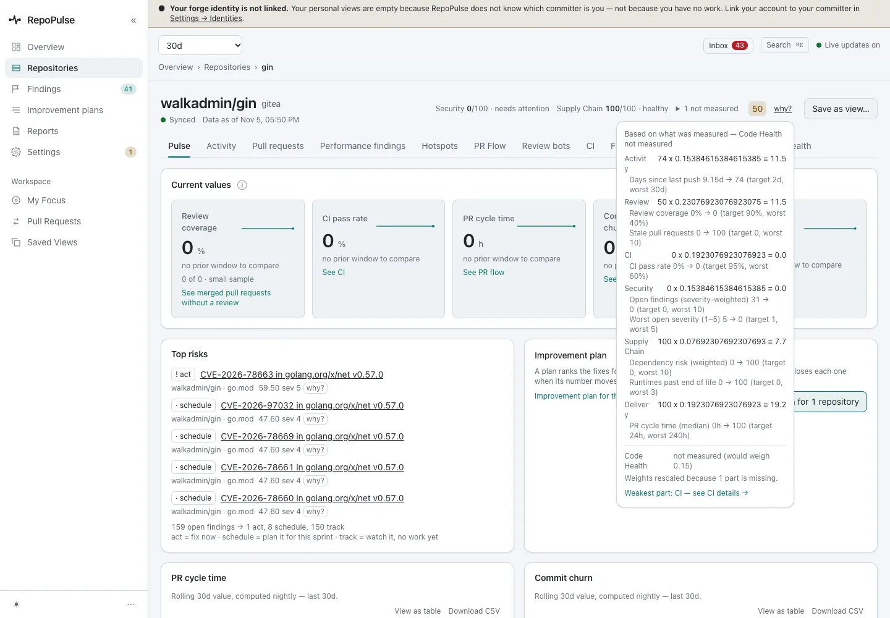
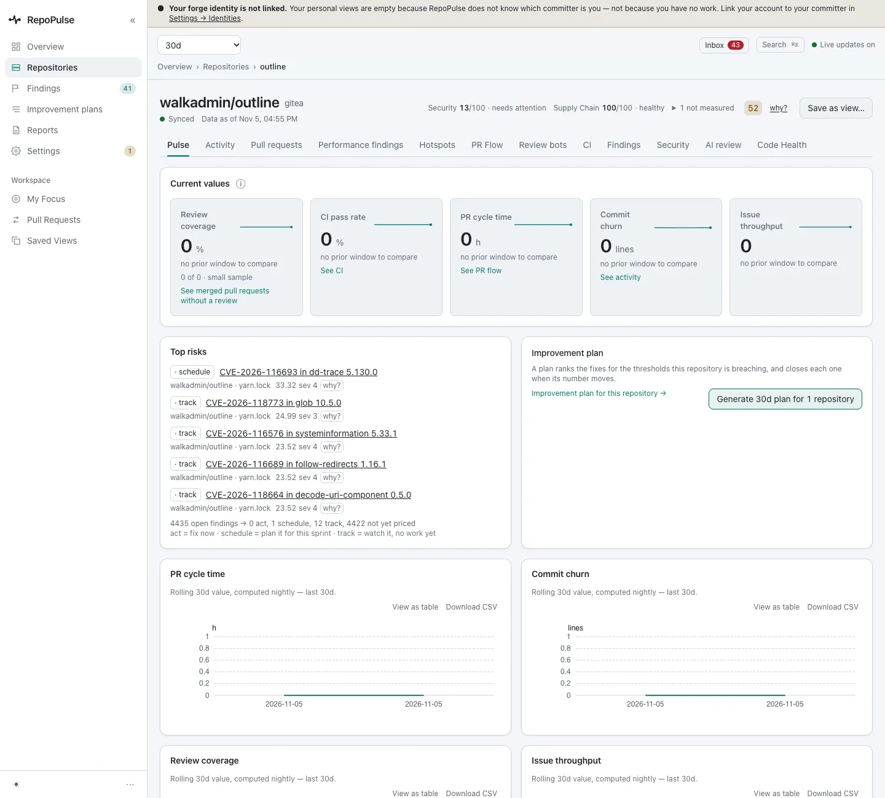
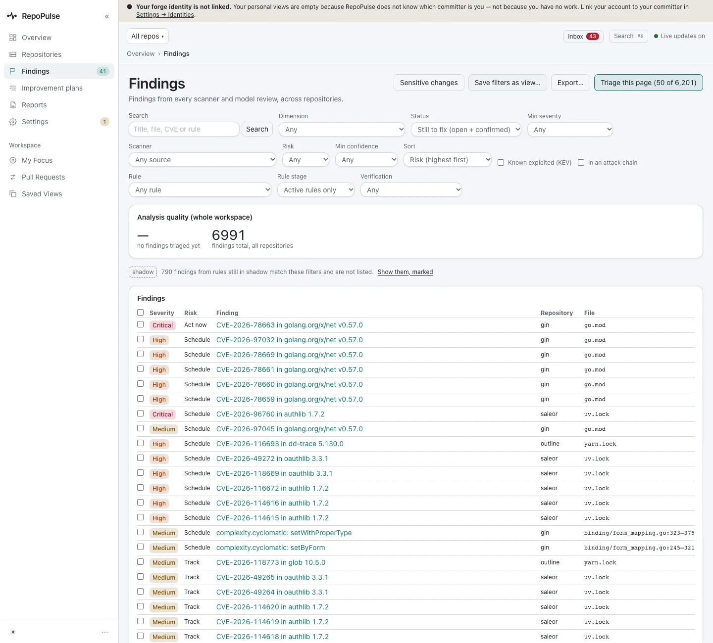

# See where every repository stands

Start from the list of repositories, open one to see its health score, ask why it has that score, and see the risks that rank first across every repository.

**For:** Engineering lead, Manager or exec · **5 steps** · [All tours](README.md)

> Real screens from a fresh RepoPulse 0.2.0 install that scanned copies of six public open-source projects (axum, gin, mastodon-ios, nowinandroid, outline and saleor) on a local Gitea over https, with models running in LM Studio on the same network.

## 1. Every repository, one health score

Repositories lists each tracked repository with a health score out of 100. On this install: axum 65, nowinandroid 65, mastodon-ios 52, outline 52, gin 50 and saleor 50.

## 2. Open a repository's pulse

gin scores 50: Security 0/100 with 8 open, Supply Chain 100/100. Top risks lists its CVEs in risk order, led by CVE-2026-78663 in golang.org/x/net at risk 59.5, and the footer counts 159 open findings: 1 to act on now, 8 to schedule, 150 to track. The delivery tiles read 0 because these copies have no pull requests or CI history; on a live forge they fill in.

## 3. Ask why the score is what it is

**why?** opens the breakdown: each part's value, its weight and its share of the score, with the parts that have no data left out and the rest re-weighted. Nothing in the score is hidden.

## 4. See what ranks first

In outline, Security is 13/100 with 13 open, and the top risk is now a CVE, CVE-2026-116693 in dd-trace 5.130.0 at risk 33.3. Clusters of code-health findings no longer jump ahead of security. A 30-day improvement plan is one click away.

## 5. Every finding, across every repository

Findings puts all of them in one list, sorted by risk: 6,201 on this install. Rules still on trial stay out of the list (790 shadow findings, shown on request).

---

Next tour: [Triage security findings: CVEs, code flaws and secrets](security.md) · [All tours](README.md)
