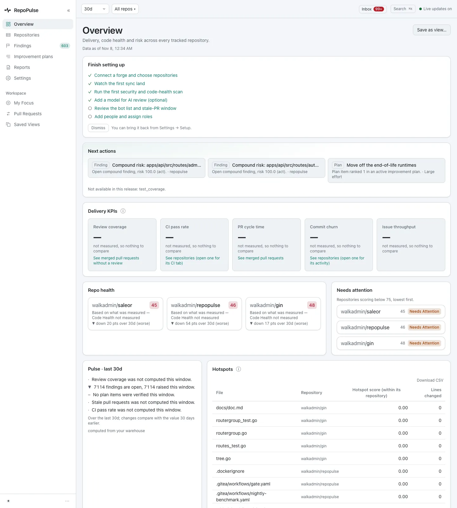
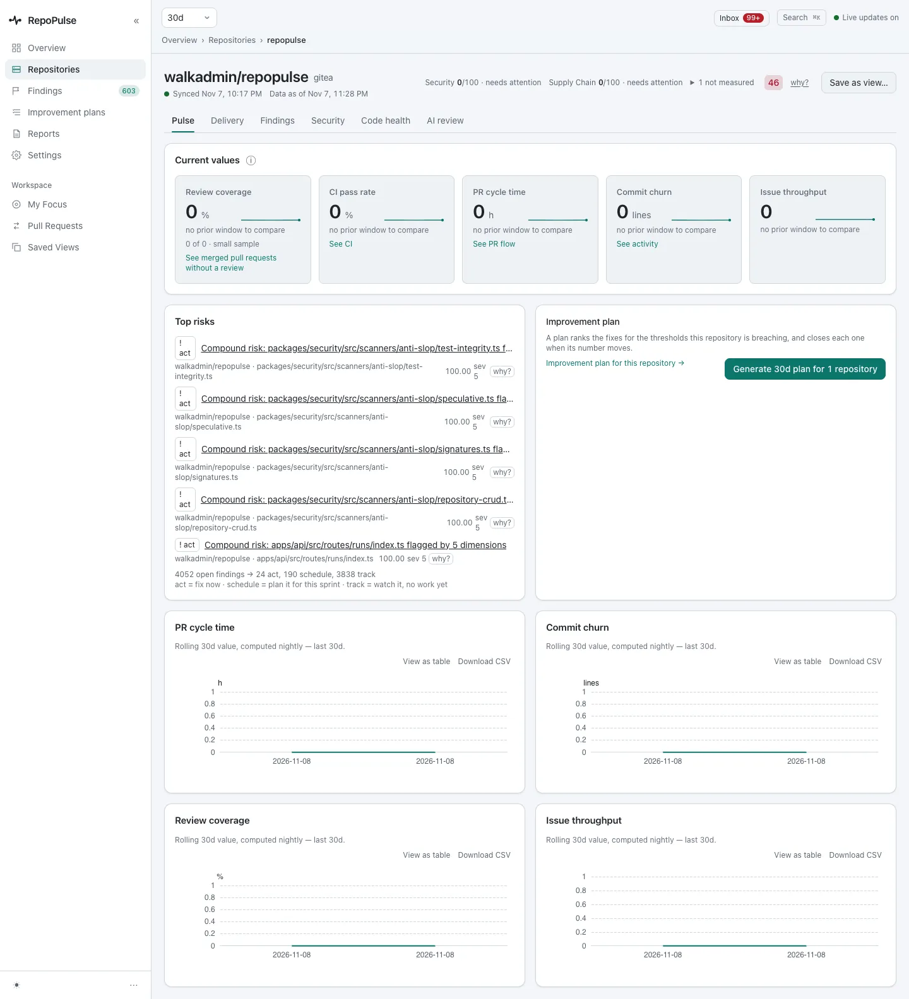
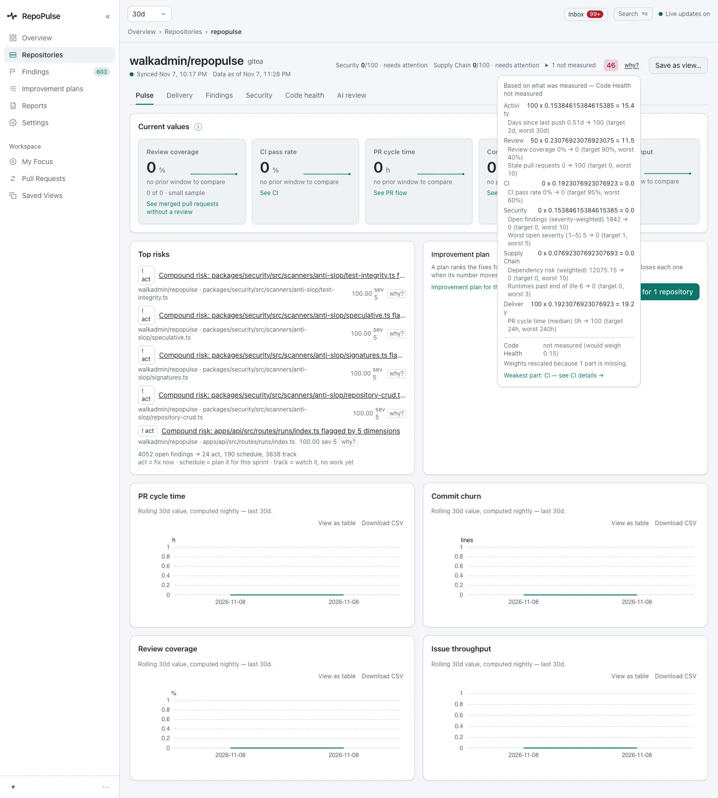
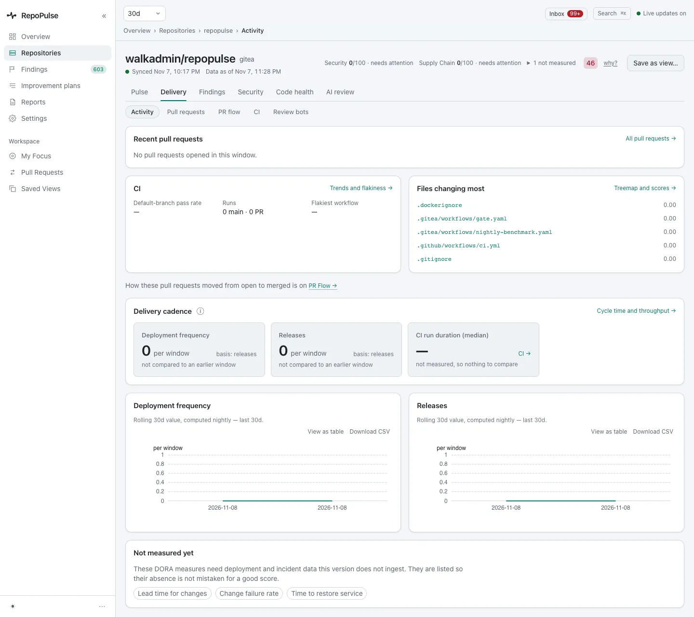
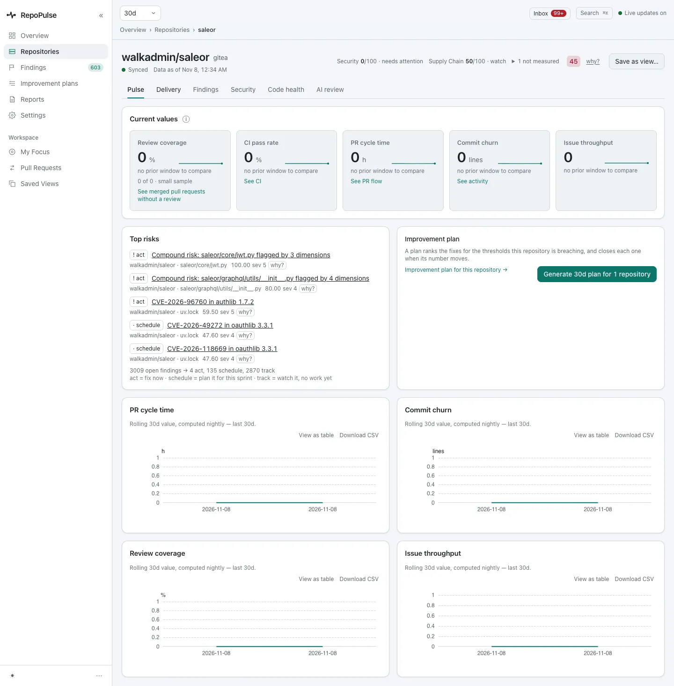
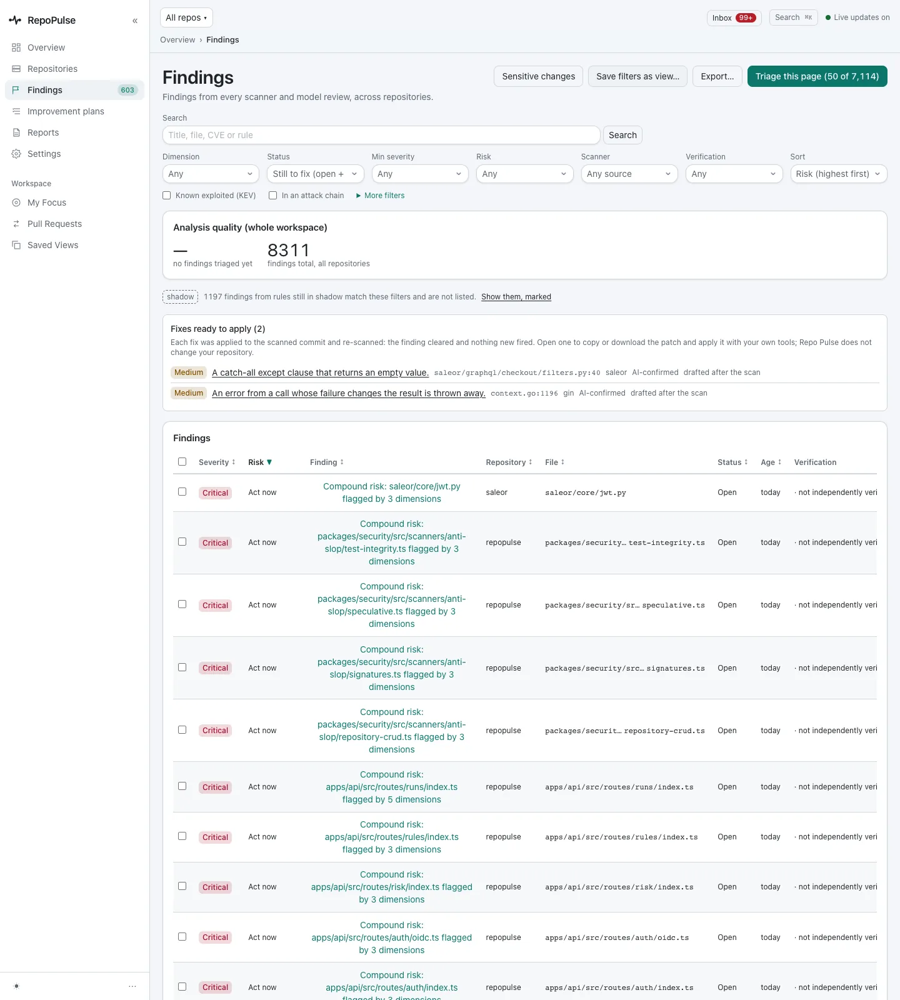
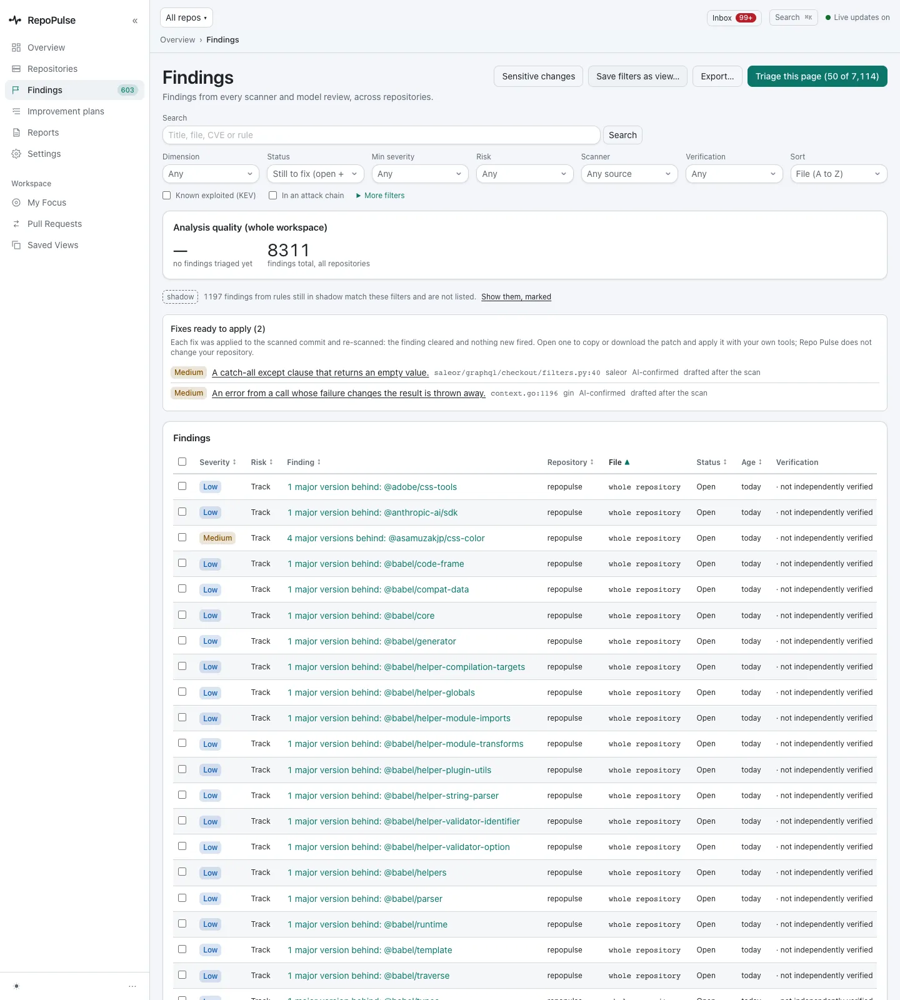

# See where every repository stands

Start from the overview, open a repository to see its health score, ask why it has that score, and work through every finding in one sortable list.

**For:** Engineering lead, Manager or exec · **7 steps** · [All tours](README.md)

> Real screens from a RepoPulse test install built from the current main branch (0.2.1 in development). It tracks copies of three open-source projects on a local Gitea: gin (Go), saleor (Python) and RepoPulse's own code (TypeScript), with the qwen3.8-27b model running in LM Studio on the same network.

## 1. Start from the overview

The overview leads with what to do next: two compound-risk findings and the first item of the improvement plan, "Move off the end-of-life runtimes". Below are delivery KPIs, each repository's health (saleor 45, RepoPulse 46, gin 48, each with its 30-day change), the repositories that need attention, and hotspots.

## 2. Open a repository's pulse

A repository has six tabs: **Pulse, Delivery, Findings, Security, Code health and AI review**. RepoPulse's own code scores 46: Security 0/100 with 278 open, Supply Chain 0/100. Top risks are files flagged by three to five kinds of check at once, and the footer splits the 4,052 open findings into 24 to act on now, 190 to schedule and 3,838 to track. The delivery tiles read 0 because these copies have no pull requests or CI history.

## 3. Ask why the score is what it is

**why?** shows each part's value, weight and share of the score: Activity 100, Review 50, CI 0, Security 0, Supply Chain 0 (6 runtimes past end of life), Delivery 100. Code Health has no data, so it is left out and the rest are re-weighted, and the weakest part, CI, is named.

## 4. Delivery in one tab

**Delivery** holds Activity, Pull requests, PR flow, CI and Review bots as sub-tabs, at the same links as before. Each card says what it measures and why it is empty here: these copies have no pull requests, CI runs or releases. On a live forge they fill in.

## 5. Compare another repository

saleor scores 45: Security 0/100 with 29 open, Supply Chain 50/100. Its top risk is `saleor/core/jwt.py`, flagged by three kinds of check, and its 3,009 open findings split into 4 to act on now, 135 to schedule and 2,870 to track.

## 6. Every finding, across every repository

**Findings** lists every finding from every scanner and model review, sorted by risk: 7,114 open here. Filters sit in one grid above the table, the 2 fixes ready to apply come first, and 1,197 findings from rules still on trial are held back, shown on request and marked.

## 7. Sort by any column

Every column header sorts, both ways: severity, risk, finding, repository, file, status and age. Here the list is sorted by file, so repository-wide findings such as outdated dependencies come first and a file's findings sit together. The sort is kept in the link, so a shared link opens the same view.

---

Next tour: [Triage security findings: CVEs, code flaws and secrets](security.md) · [All tours](README.md)
