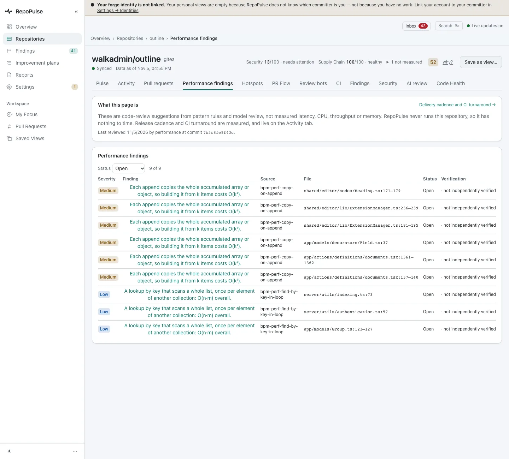
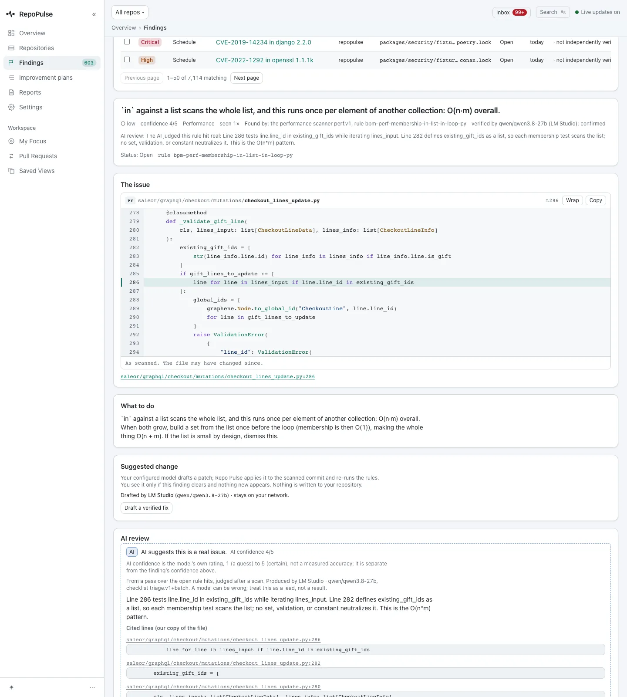
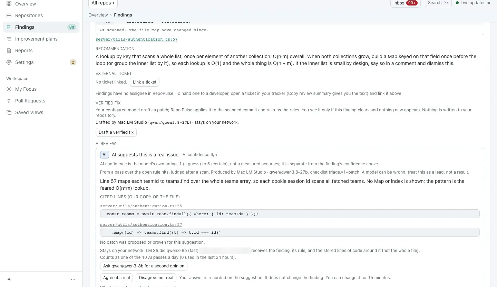
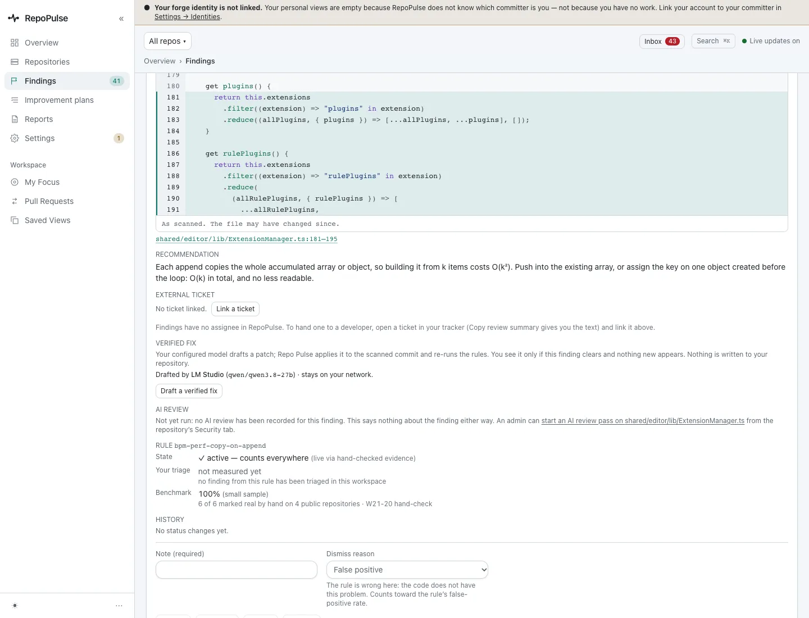
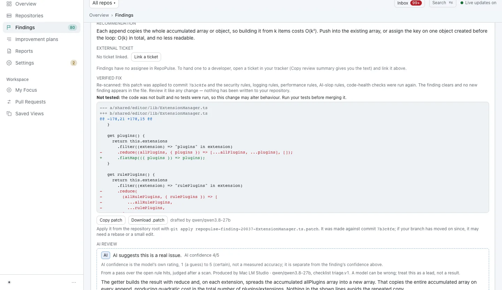

# Fix code that gets slower as data grows

Performance findings are code shapes that cost more as data grows: a lookup that scans a whole list, an array copied on every append. Each one points at the line, says why it grows, and where possible comes with a patch that has been re-scanned before you see it.

**For:** Developer · **5 steps** · [All tours](README.md)

> Real screens from a fresh RepoPulse 0.2.0 install that scanned copies of six public open-source projects (axum, gin, mastodon-ios, nowinandroid, outline and saleor) on a local Gitea over https, with models running in LM Studio on the same network.

## 1. Open the performance findings

outline's Performance findings tab: 9 open, each from a named rule, with 298 more from shadow rules kept out of the list. The page says what these are: code-review findings, not measured latency.

## 2. See where in the code

`server/utils/authentication.ts:57` looks up a team by key inside a loop over the team IDs, so every ID scans every team: O(n·m). The recommendation: build a Map keyed on the ID once, before the loop.

## 3. Read why the model agrees

The model judges whether it is real, cites the lines it relied on, and says what it did not see, such as no Map or index anywhere in the lines shown.

_Screen from the pre-0.2.0 walkthrough (0.9.17). The 0.2.0 capture is waiting on the local model's AI review and will replace it._

## 4. A finding with a fix waiting

In `shared/editor/lib/ExtensionManager.ts` (lines 181 to 195) a getter copies the accumulated array into a new one on every extension, so building it from k items costs O(k²).

## 5. Review the verified patch

The model drafts a patch. RepoPulse applies it to the scanned commit, re-runs every rule, and only shows it if the finding clears with nothing new. It says plainly that the code was not built and no tests ran. Copy it or download the .patch.

_Screen from the pre-0.2.0 walkthrough (0.9.17). The 0.2.0 capture is waiting on the local model's AI review and will replace it._

---

After you apply it, the next scan of your branch closes the finding on its own.

---

Next tour: [Fix the mistakes AI coding tools make](ai-slop.md) · [All tours](README.md)
