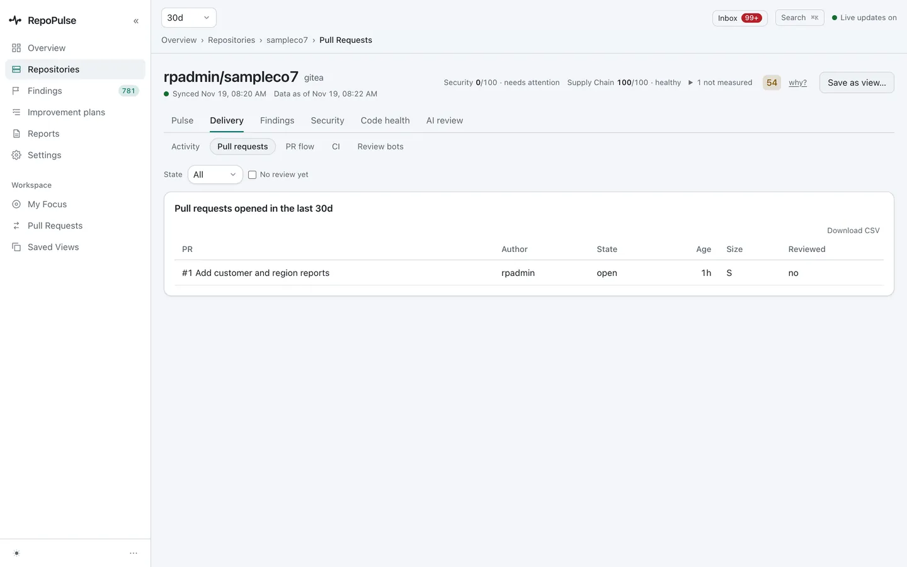
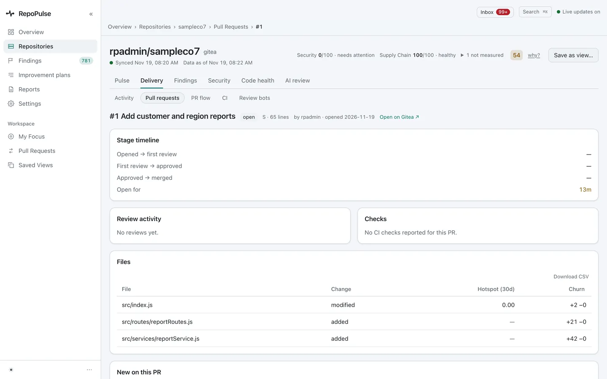
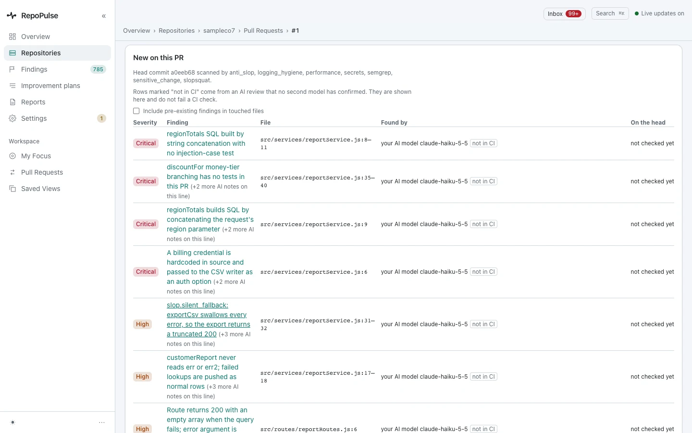
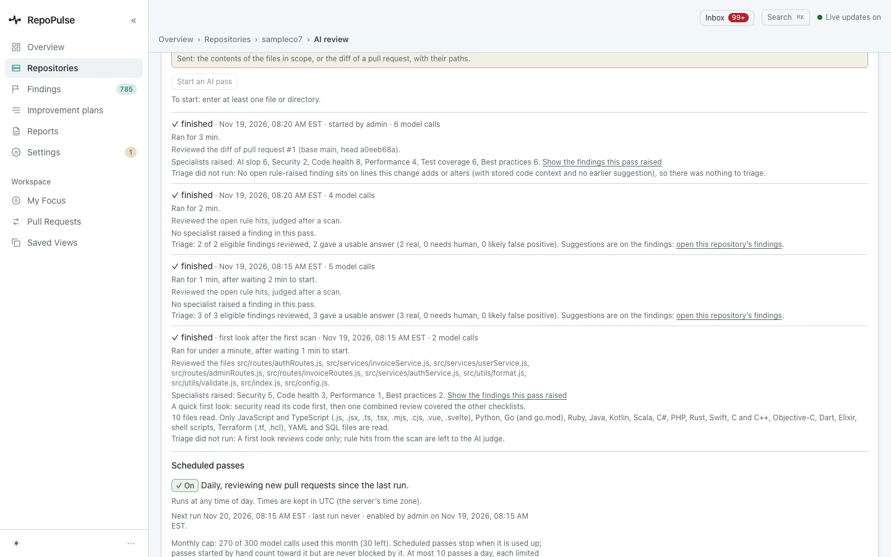
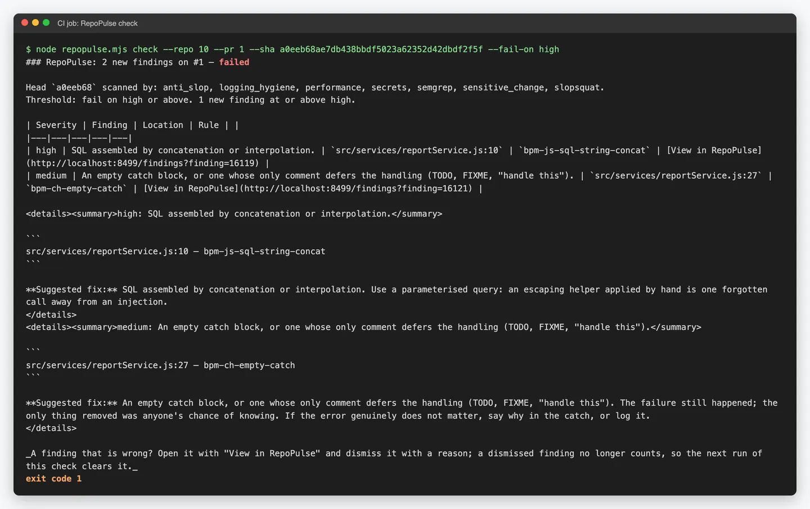
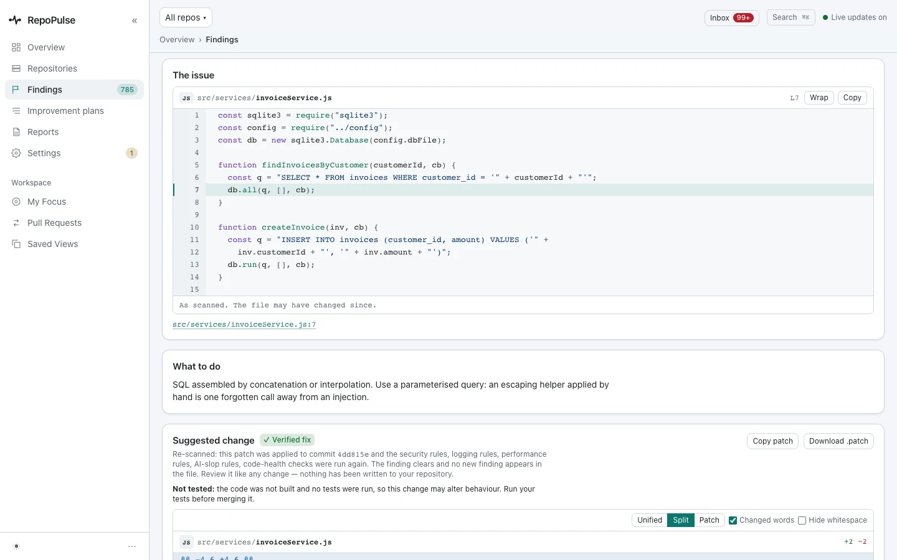
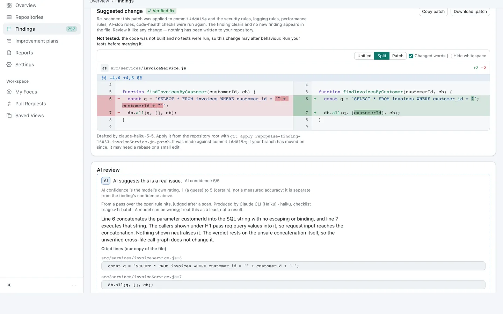
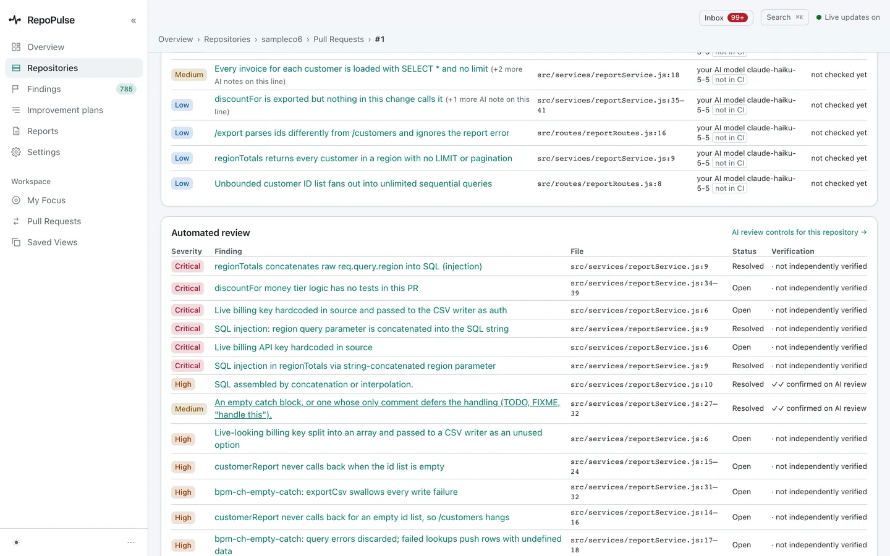

# Catch problems on a pull request before it merges

RepoPulse scans every push to a pull request, lists only what the change introduced, and lets your pipeline ask for the answer. An AI review reads the diff and adds what rules cannot see. When a later push fixes a problem, its finding closes by itself.

**For:** Developer, Security engineer, Engineering lead · **8 steps** · [All tours](README.md)

> Real screens from a RepoPulse test install built from the main branch on 2026-11-19. It tracks SampleCo, a small demo app with planted problems, on a local Gitea, with a pull request that adds two report routes. The AI steps use a small hosted model through the Claude Code CLI option; the rule-based steps use no model.

## 1. Find the pull request

A repository's **Delivery → Pull requests** lists what was opened in the window, with author, age, size and whether it has been reviewed. Here one is open: #1, "Add customer and region reports", size S.

## 2. See its size and files

The pull request page shows the stage timeline, review activity and CI checks reported by the forge, then the files the change touches. This one is **S · 65 lines**: one file modified and two added.

## 3. Read what the change introduced

**New on this PR** lists only findings the pull request introduced, and says which scanners have read the head commit: seven here. Rows marked **not in CI** come from the AI review and have not been confirmed by a second model, so they are shown and do not fail a build. Notes from several review areas on the same line fold into one row: "+2 more AI notes on this line".

## 4. See what the AI review read

The **AI review** tab lists every pass with what it read and what it raised. At the top, the review of this pull request: it read the diff only (base main, head `a0eeb68`), took 6 model calls and raised notes in six areas, from AI slop to test coverage. Below it, the judge's two passes over the rule hits and the first look after the first scan.

## 5. Let the pipeline fail the build

A pipeline asks RepoPulse with one command and a read-only token. `--fail-on high` fails on any new finding at high or above: here 2 new findings from rules, one of them high, and **exit code 1**. The output is Markdown a pipeline can post, with a link to each finding. Unconfirmed AI notes are not counted unless you pass `--include-unconfirmed-ai`.

## 6. Open a finding: the line and what to do

A finding opens on the code as it was scanned, with the line marked. This is the same kind of problem on the main branch: SQL built by concatenation in `invoiceService.js`. **What to do** says how to fix it in one plain paragraph.

## 7. Take the verified fix, with a second opinion

Where it can be proven, the finding comes with a patch: here +2 −2, a parameter instead of concatenation. **Verified fix** means the patch was applied to a copy and the rules ran again: the finding clears and no new one appears. It also says what was not done: the code was not built and no tests were run. Below it, the AI judge says this is a real issue, confidence 5/5, and quotes the two lines it relied on. Copy the patch or download it; RepoPulse never writes to your repository.

## 8. Push a fix and watch findings close

A second push to the same pull request uses a parameter in the query and handles the error. On the next scan the two rule findings show **Resolved**, each confirmed by the AI review, and the AI's own SQL injection notes are resolved too. What the push did not fix stays **Open**, such as the hardcoded billing key. Nobody closed anything by hand. This screen is from a second copy of the same demo repository.

---

The AI review needs a model; everything else on this page is rule-based. With a local model nothing leaves your network and a review of a pull request this size took 47 minutes; with a small hosted model it took under three. Both are measured in [INSTALL.md](../INSTALL.md).

---

Next tour: [Install and set up RepoPulse](setup.md) · [All tours](README.md)
