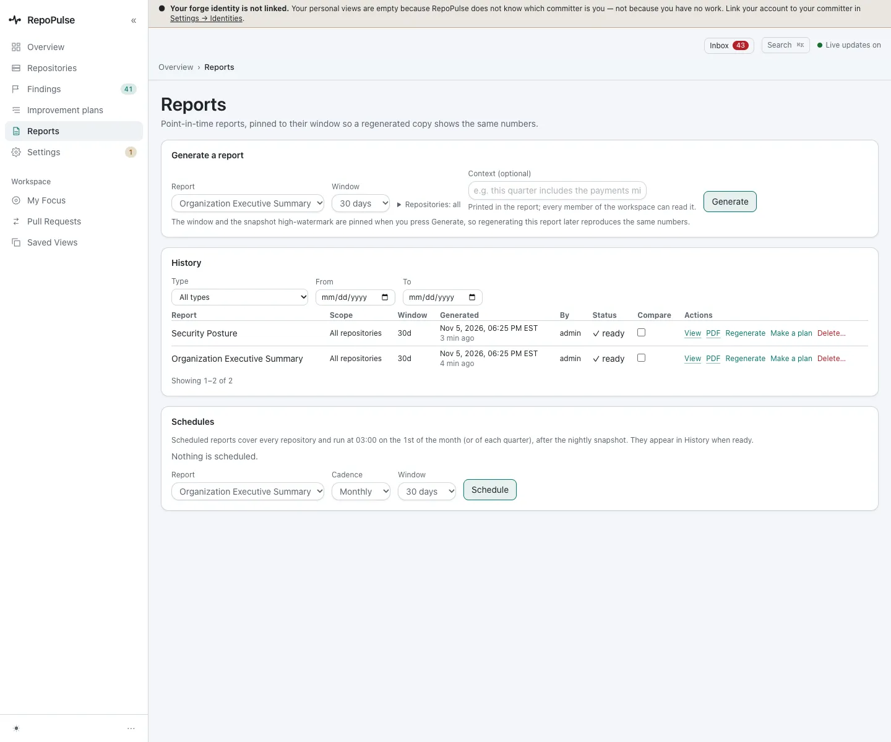
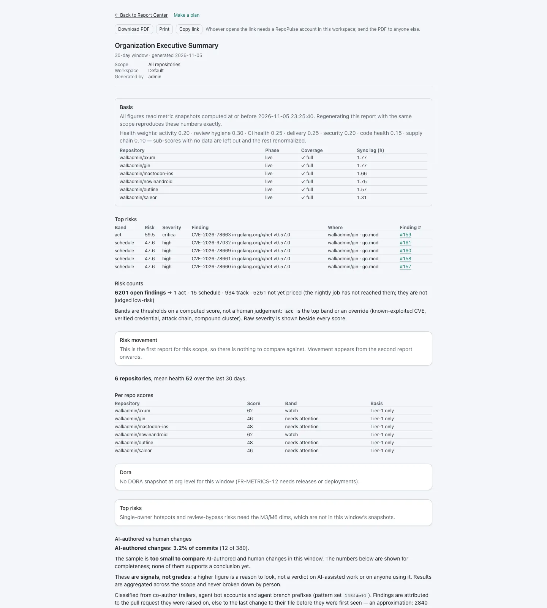
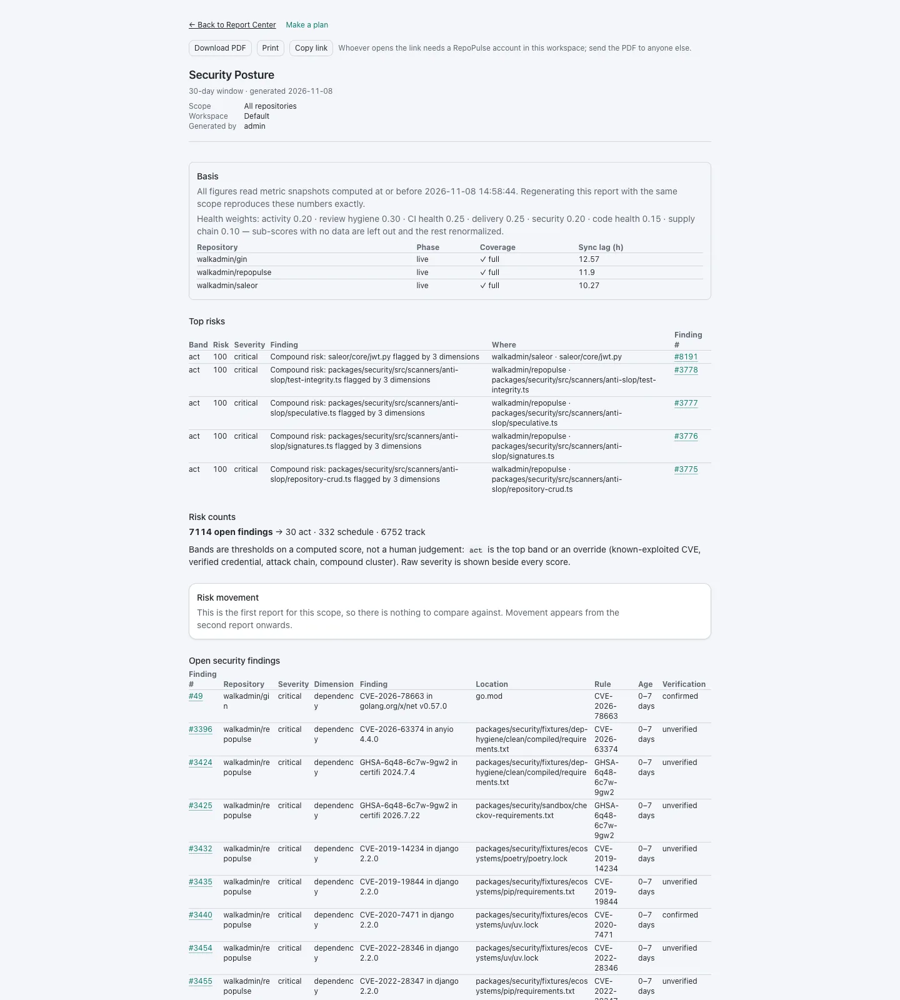

# Share status as reports and PDFs

Reports are pinned to their window, so regenerating one with the same scope reproduces the same numbers. Each has a print view and a PDF to send to anyone; the link only works for people with an account.

**For:** Manager or exec, Security engineer · **3 steps** · [All tours](README.md)

> Real screens from a fresh RepoPulse 0.2.0 install that scanned copies of six public open-source projects (axum, gin, mastodon-ios, nowinandroid, outline and saleor) on a local Gitea over https, with models running in LM Studio on the same network.

## 1. Generate a report

**Reports**: pick a type and a 30-day window and generate. Two are in the history here, an Organization Executive Summary and a Security Posture report, each with View, PDF, Regenerate and Make a plan. Reports can also be scheduled monthly or quarterly.

## 2. Read the executive summary

The summary starts with its basis: the snapshot time, the health weights, and the six repositories with their coverage. Then the top risks. It shows organization-level figures, with no per-person data.

## 3. Hand over the security posture

The Security Posture report has the same basis and lists the top risks, with links back to each finding. Download PDF gives a file to send to anyone outside the workspace.

---

Trends need more than one window: this install is days old, so its tiles say "no prior window to compare". On a running install the reports and the overview show the change against the previous window.

---

Next tour: [Install and set up RepoPulse](setup.md) · [All tours](README.md)
