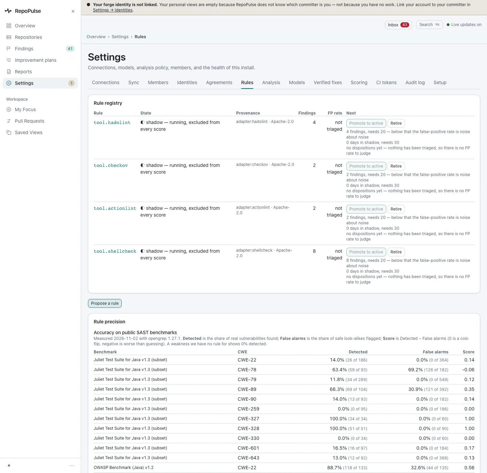
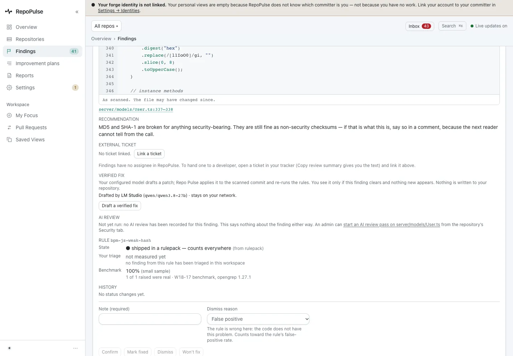
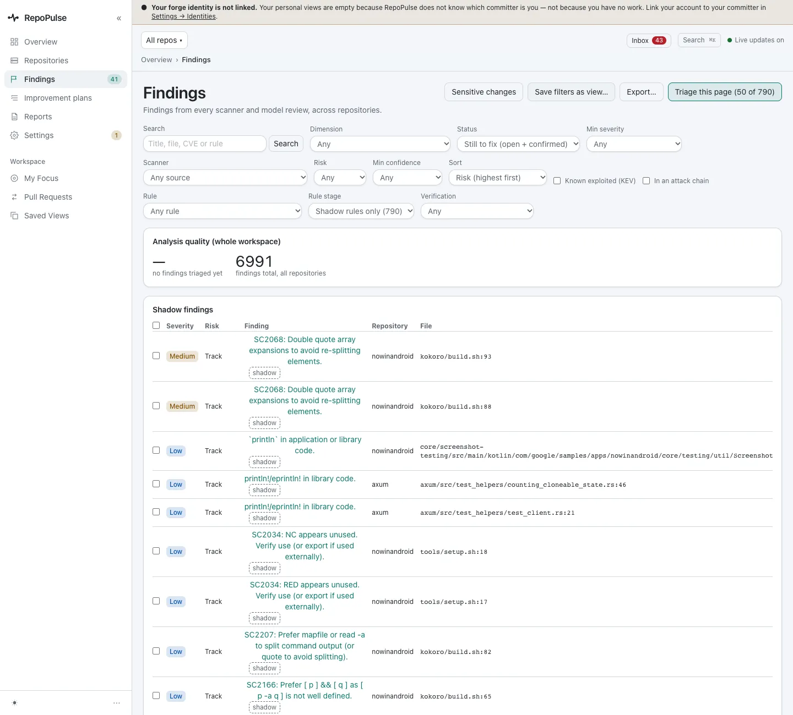

# Decide which rules count

Every rule shows how it was measured and whether it counts. New rules run in shadow first, excluded from every score, until they have enough findings and days to judge. Rules proposed from AI triage wait for your approval.

**For:** Engineering lead · **3 steps** · [All tours](README.md)

> Real screens from a fresh RepoPulse 0.2.0 install that scanned copies of six public open-source projects (axum, gin, mastodon-ios, nowinandroid, outline and saleor) on a local Gitea over https, with models running in LM Studio on the same network.

## 1. The rule registry

**Settings → Rules** lists each rule's state, where it came from, its findings and its false-positive rate. Shadow rules (64 on this install) each say what they still need before they can be promoted: 20 findings and 30 days. Rules drafted from AI triage appear here as proposed, and do not run until you accept them.

## 2. Precision on every finding

Each finding shows its rule's record. bpm-js-weak-hash is shipped in a rule pack and counts everywhere; the block says how much triage and benchmark evidence stands behind it, and labels a small sample as such.

## 3. Look at what shadow rules found

Shadow findings are hidden by default. Filter Rule stage to shadow rules to review them: 790 on this install, kept out of every score until their rule is promoted.

---

Next tour: [Share status as reports and PDFs](reports.md) · [All tours](README.md)
