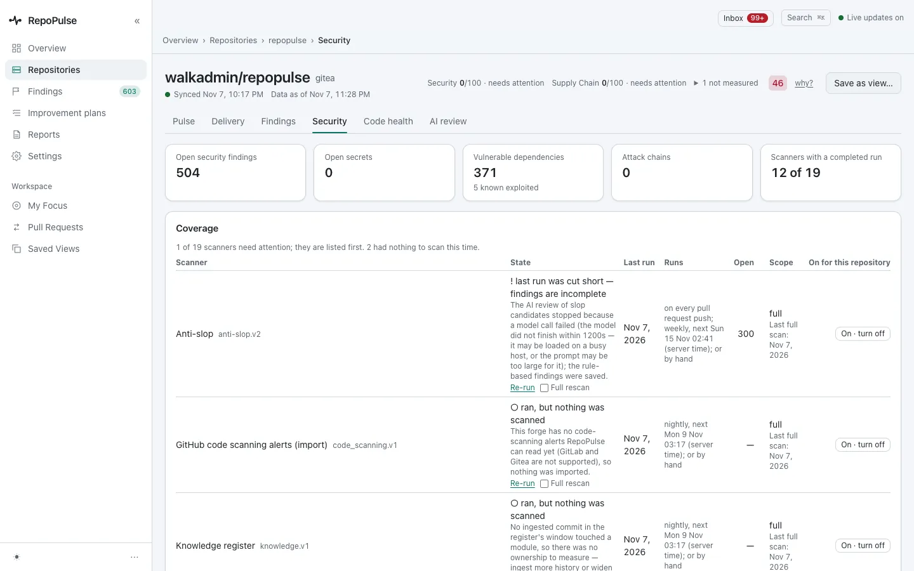
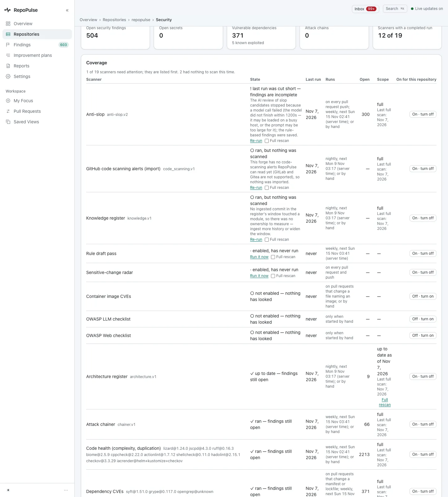
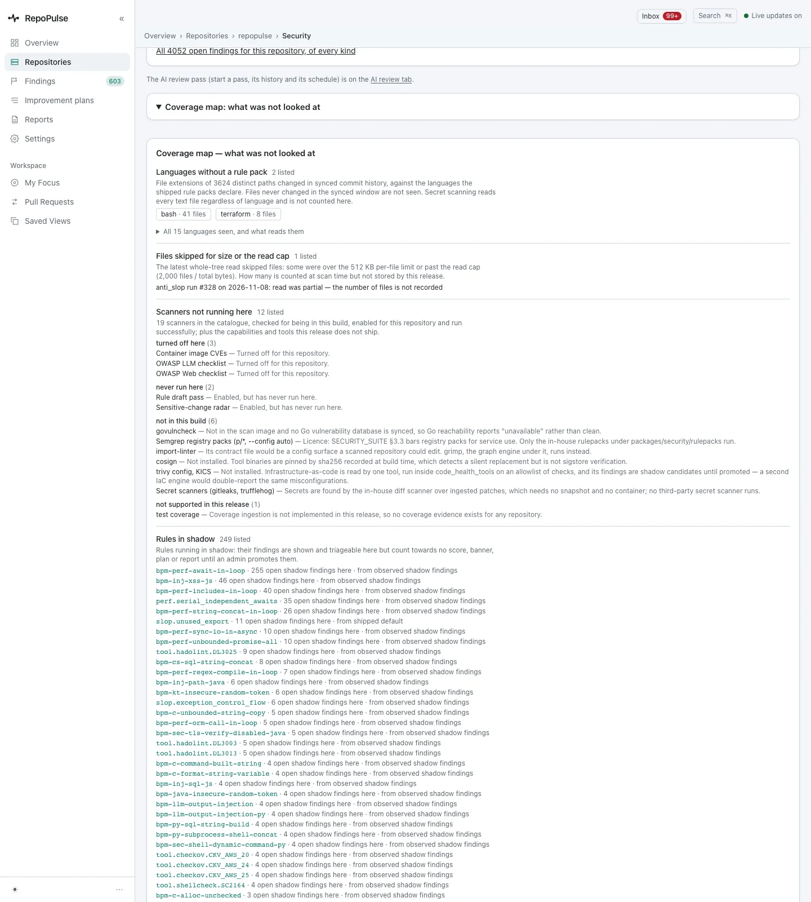
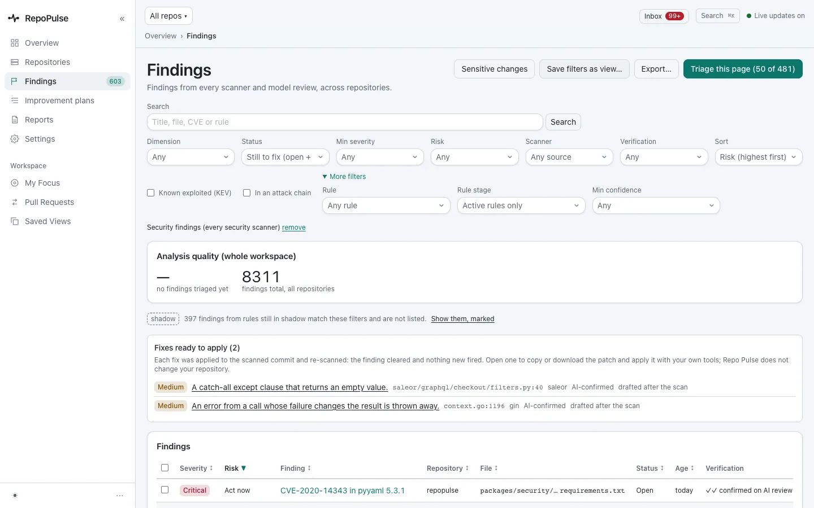
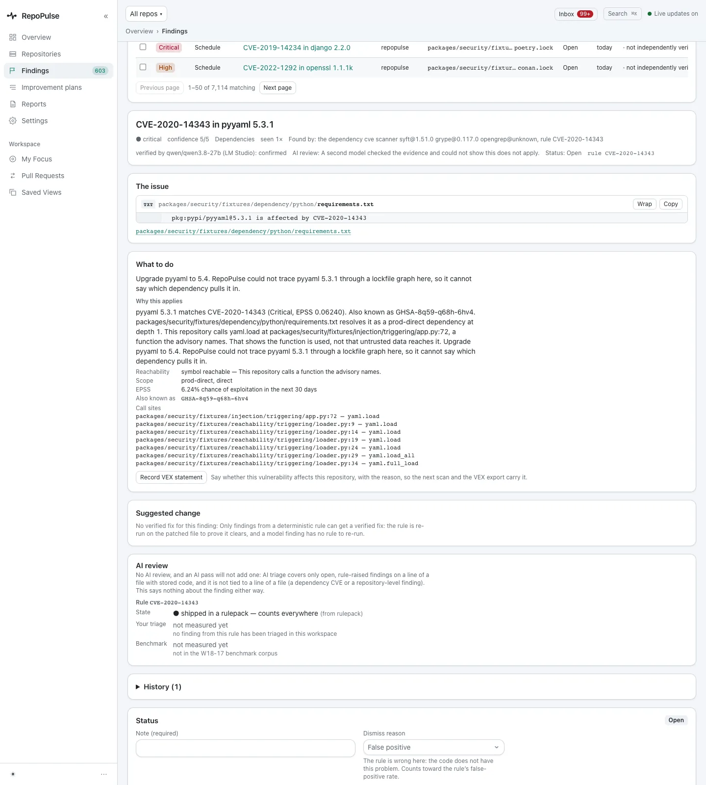
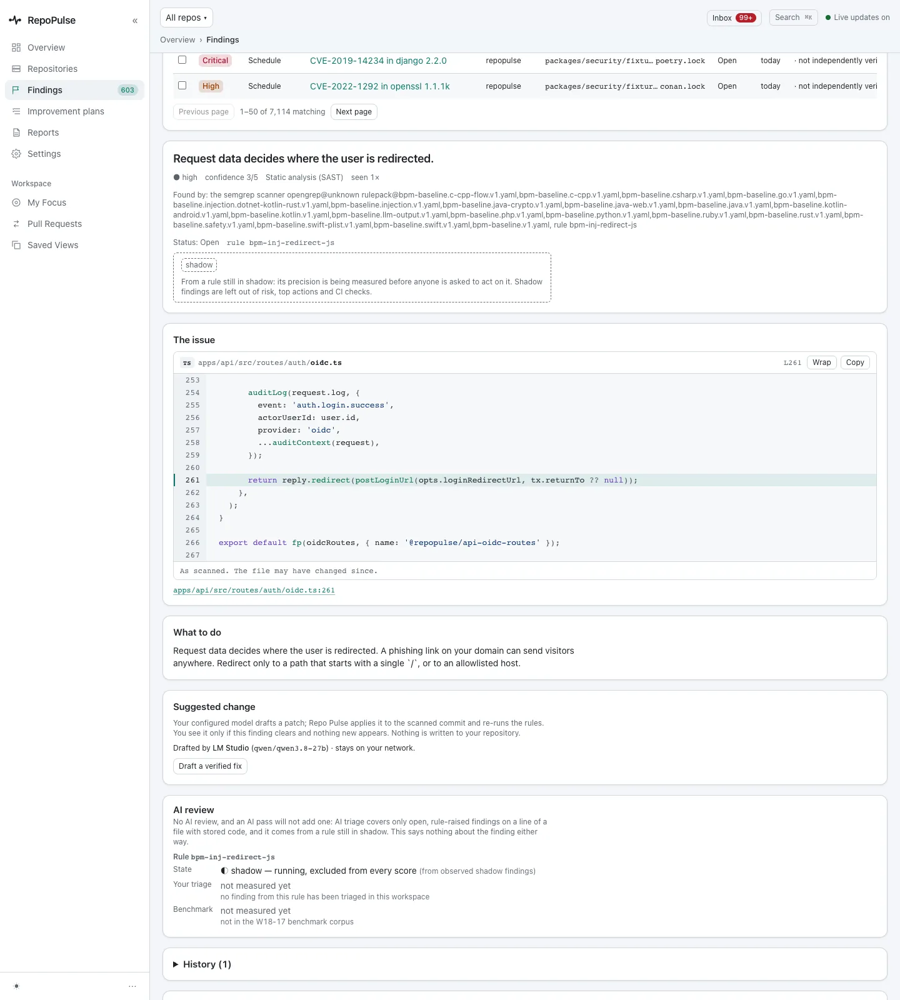
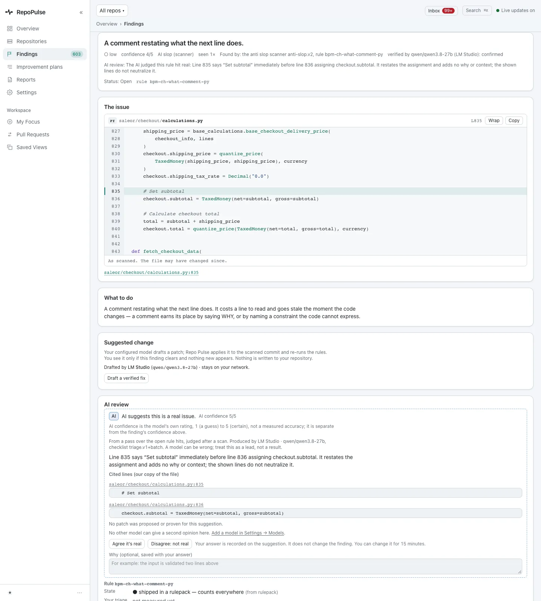
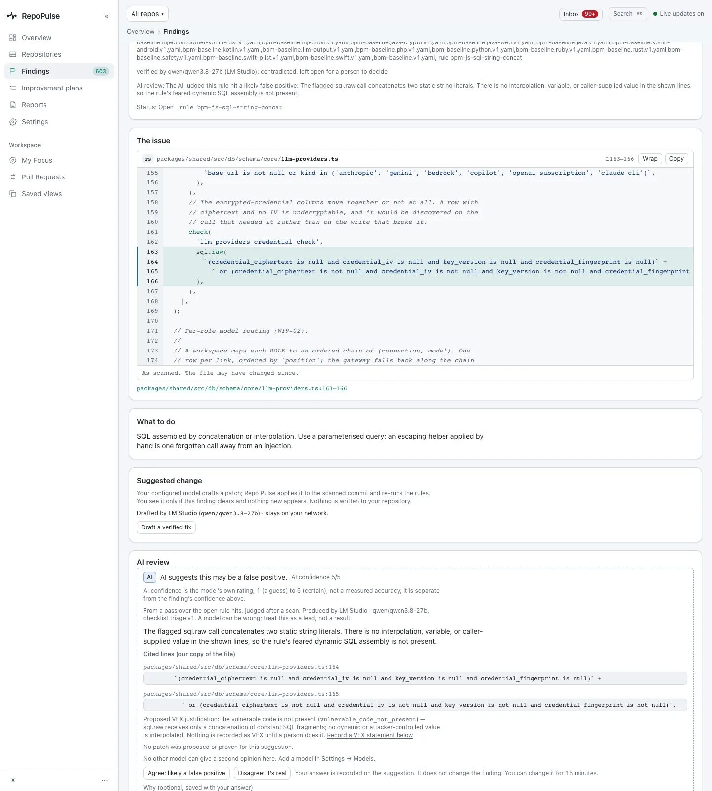
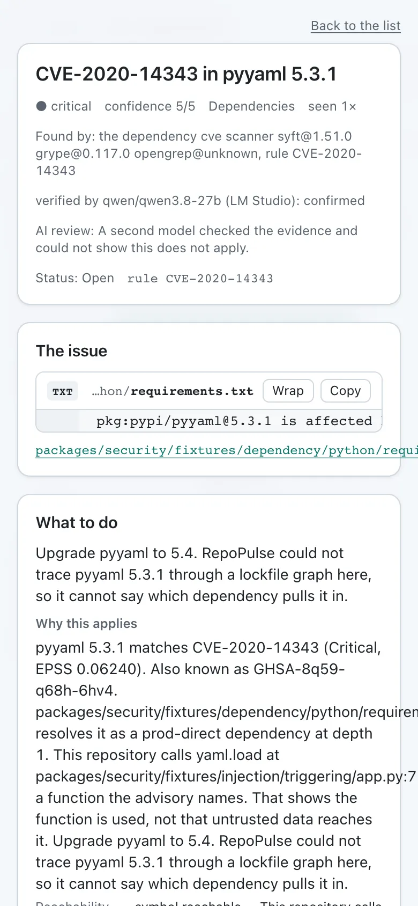

# Triage security findings: CVEs, code flaws and secrets

Security findings are ranked by real risk, not just severity: whether the vulnerable code is actually reached, how likely exploitation is, and what a model made of the code. Each one opens to its evidence, its fix and a way to record that it does not apply.

**For:** Security engineer, Developer · **9 steps** · [All tours](README.md)

> Real screens from a RepoPulse test install built from the current main branch (0.2.1 in development). It tracks copies of three open-source projects on a local Gitea: gin (Go), saleor (Python) and RepoPulse's own code (TypeScript), with the qwen3.8-27b model running in LM Studio on the same network.

## 1. Start from the summary

A repository's **Security** tab opens on a summary row. For RepoPulse's own code: 504 open security findings, 0 secrets, 371 vulnerable dependencies (5 known exploited), 0 attack chains, and 12 of 19 scanners with a completed run. Below, each scanner's state, last run and schedule, with a Re-run link.

## 2. Spot a scanner that needs attention

Scanners with a problem are listed first. Here the anti-slop run was cut short because a model call did not finish within 1,200 seconds, so its findings may be incomplete, and the row says so. "Ran, but nothing was scanned" says why, which is not the same as finding nothing.

## 3. See what was not covered

The **Coverage map** is folded until you need it. It lists languages without a rule pack (bash and terraform here), files skipped for size or the read cap, and the 12 scanners not running here, each with its reason: turned off, never run, not in this build, or not supported.

## 4. Narrow the list

Filtered to security findings: 481 open, 397 more from rules on trial not listed. Filters sit in one grid, with **Known exploited (KEV)** and **In an attack chain** one click away; **More filters** adds rule, rule stage and minimum confidence. The top row is already marked confirmed on AI review.

## 5. Open the finding: evidence, fix and why it applies

A finding is one column of cards. CVE-2020-14343 in pyyaml 5.3.1 (from RepoPulse's own security test fixtures): **What to do** is upgrade pyyaml to 5.4, and **Why this applies** gives a 6.24% chance of exploitation in the next 30 days (EPSS) and **symbol reachable**: the code calls `yaml.load`, `load_all` and `full_load`, the functions the advisory names, and each call site is listed. **Record VEX statement** saves why a CVE does not affect you.

## 6. A code flaw, at the line

SAST findings open on the code. In `apps/api/src/routes/auth/oidc.ts:261` request data decides where the user is redirected after sign-in (rule bpm-inj-redirect-js). The fix: redirect only to a single-`/` path or an allowlisted host. This rule is still on trial, and the dashed box says its precision is being measured.

## 7. Read the AI verdict and its evidence

A local model judges whether a finding is real, gives its own confidence out of 5 and quotes the lines it relied on. Here, in saleor, it agrees that a `# Set subtotal` comment only restates the next line, citing both lines. You can agree or disagree; your answer is recorded beside the model's and does not change the finding by itself.

## 8. Get a proposed VEX justification

When the model thinks a finding does not apply, it says so and proposes the VEX justification. Here a SQL-concatenation hit joins two constant strings, so it proposes `vulnerable_code_not_present`. The finding stays open, and nothing is recorded until a person does it.

## 9. Triage from a phone

The same finding on a phone: the cards stack in one column, from the evidence down to the status form.

---

Secrets in diffs and history and installed malicious packages are scanned the same way and appear in the same ranked list; none were found in these projects, so there is no screen for them here.

---

Next tour: [Fix code that gets slower as data grows](performance.md) · [All tours](README.md)
