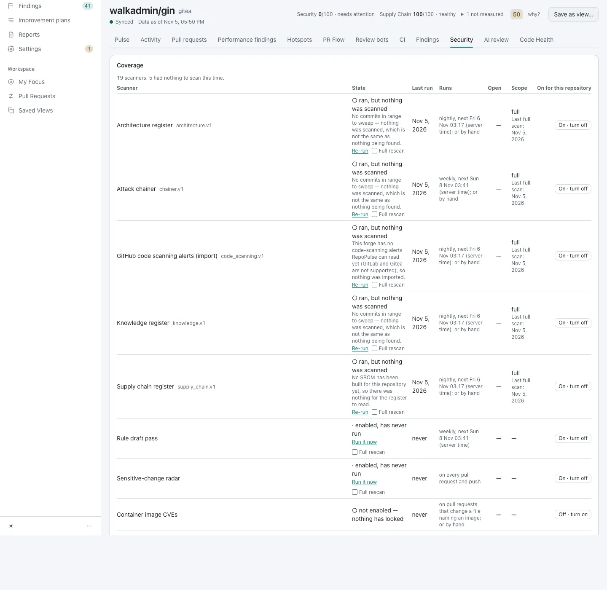
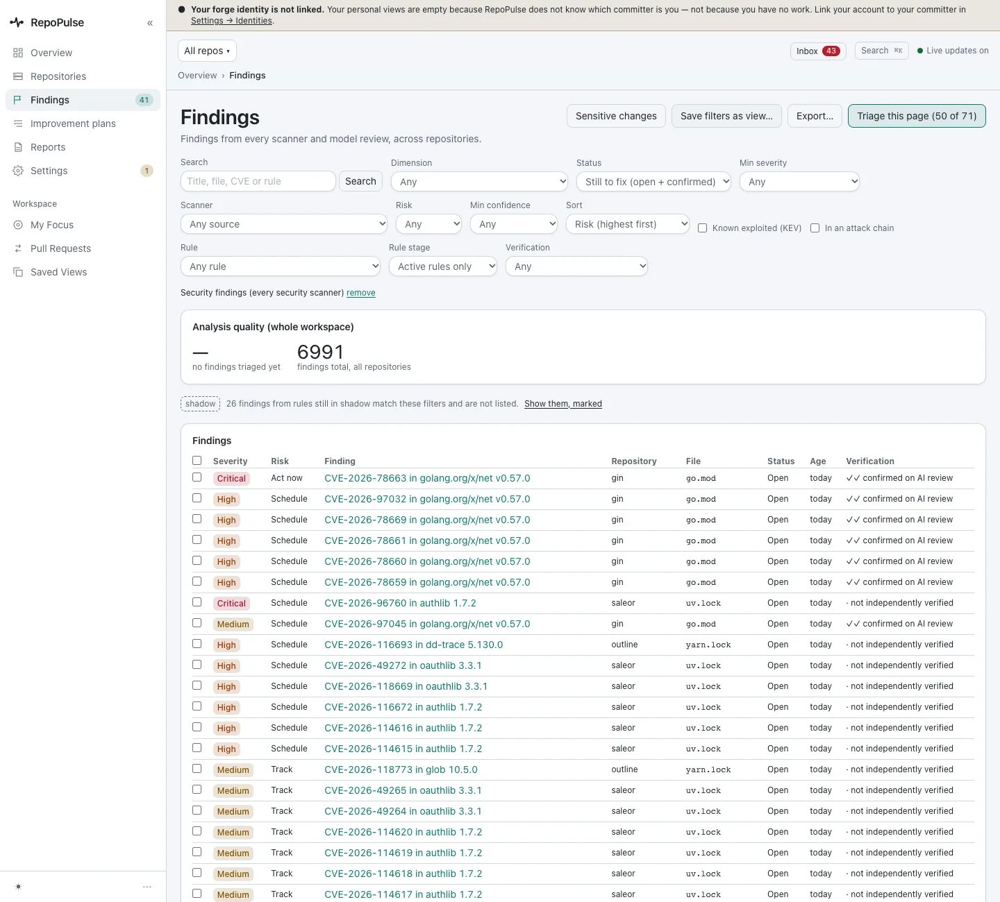
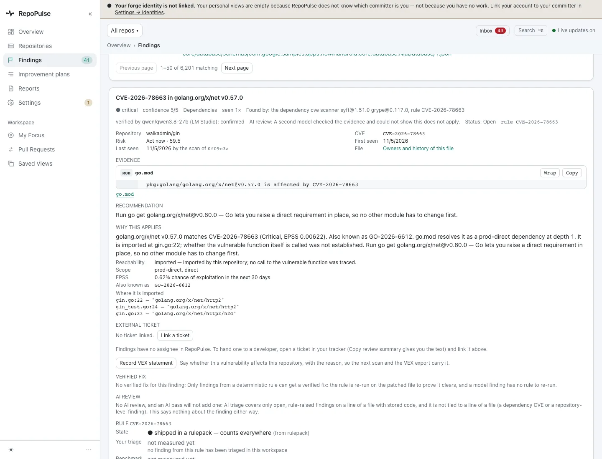
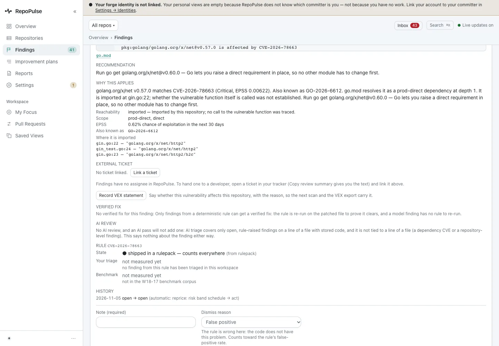
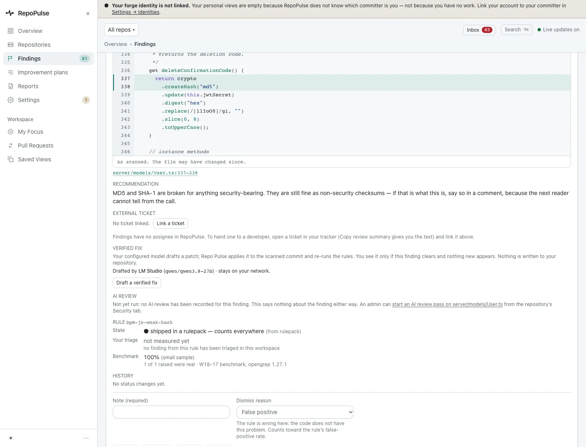
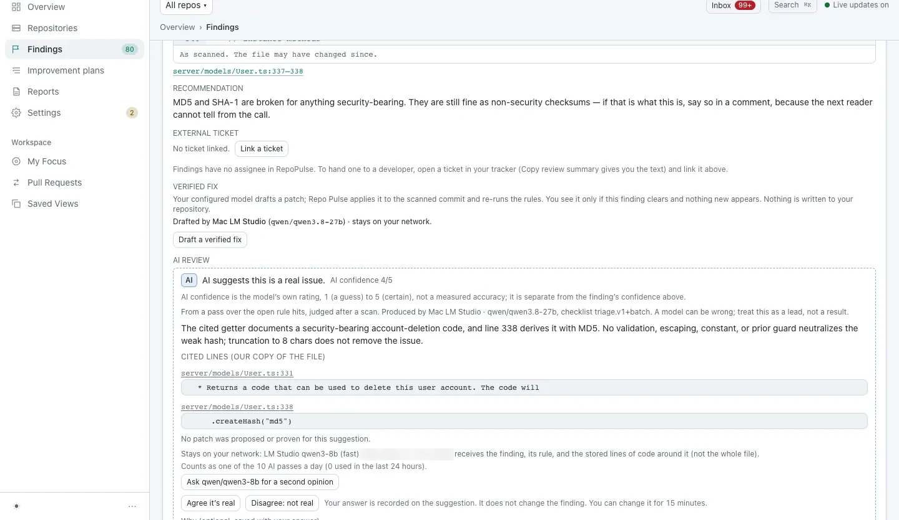
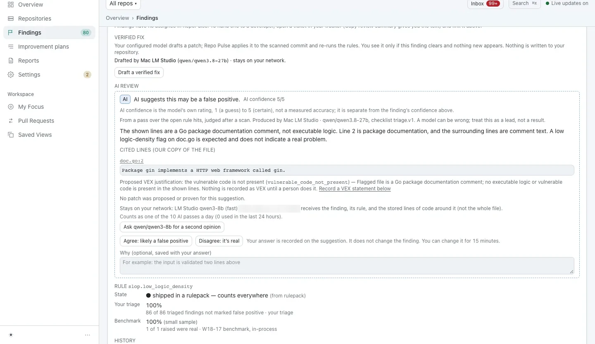
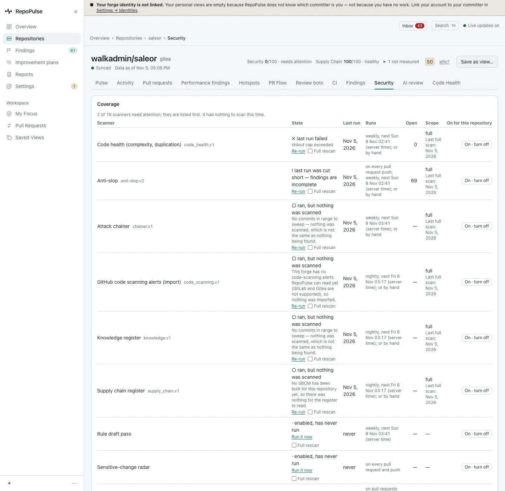

# Triage security findings: CVEs, code flaws and secrets

Security findings are ranked by real risk, not just severity: whether the vulnerable package is actually imported, how likely exploitation is, and what a model made of the code. Each one opens to its evidence, its fix and a way to record that it does not apply.

**For:** Security engineer, Developer · **8 steps** · [All tours](README.md)

> Real screens from a fresh RepoPulse 0.2.0 install that scanned copies of six public open-source projects (axum, gin, mastodon-ios, nowinandroid, outline and saleor) on a local Gitea over https, with models running in LM Studio on the same network.

## 1. Check what was scanned

A repository's Security tab lists all 19 scanners, when each last ran and when it runs next. On gin, 5 had nothing to scan and say so, which is not the same as finding nothing.

## 2. Work the ranked list

Filtered to security findings, 71 are open across the workspace (26 more from shadow rules are not listed). The critical gin CVE ranks first.

## 3. Open the finding: evidence, fix and why it applies

CVE-2026-78663 in golang.org/x/net v0.57.0. **Why this applies** says it is a direct production dependency, imported in three places, with a 0.62% chance of exploitation in the next 30 days (EPSS). It also says what was not established: whether the vulnerable function itself is called.

## 4. Record a VEX statement, or fix it

If a CVE does not affect you, **Record VEX statement** saves that and the reason, and the next scan and the VEX export carry it. This CVE gets no drafted patch, and the page says why: a verified fix needs a rule it can re-run on the patched file. The recommendation is already a one-line upgrade, `go get golang.org/x/net@v0.60.0`.

## 5. A code flaw, at the line

SAST findings open on the code. Here, outline derives an account-deletion code from `createHash("md5")` at `server/models/User.ts:337` (rule bpm-js-weak-hash). The recommendation explains when MD5 is fine and when it is not.

## 6. Read the AI verdict and its evidence

A local model judges whether the finding is real, gives a confidence out of 5 and quotes the lines it relied on. You can agree, disagree, or ask a second model; your answer is recorded beside the model's, and does not change the finding by itself.

_Screen from the pre-0.2.0 walkthrough (0.9.17). The 0.2.0 capture is waiting on the local model's AI review and will replace it._

## 7. Get a proposed VEX justification

When the model thinks a finding does not apply, it proposes the VEX justification, such as `vulnerable_code_not_present` for a flag on package documentation. Nothing is recorded until a person does it.

_Screen from the pre-0.2.0 walkthrough (0.9.17). The 0.2.0 capture is waiting on the local model's AI review and will replace it._

## 8. Spot a scanner that needs attention

On saleor (Security 0/100, 35 open), the scanners with problems are listed first: the code-health run failed and the anti-slop run was cut short, so its findings may be incomplete. Each has a Re-run link.

---

Secrets in diffs and history and installed malicious packages are scanned the same way and appear in the same ranked list; none were found in these six projects, so there is no screen for them here.

---

Next tour: [Fix code that gets slower as data grows](performance.md) · [All tours](README.md)
