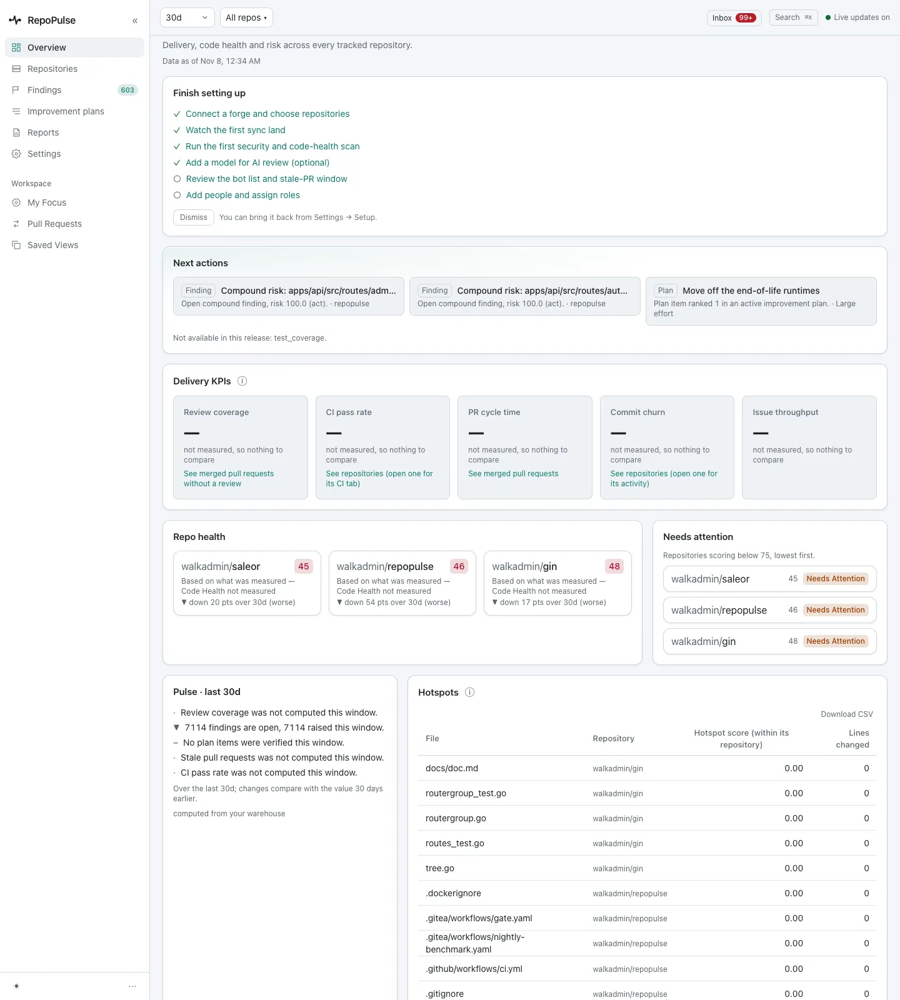
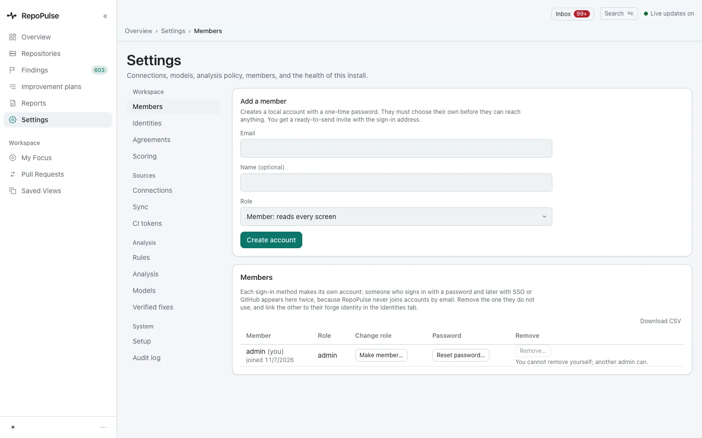
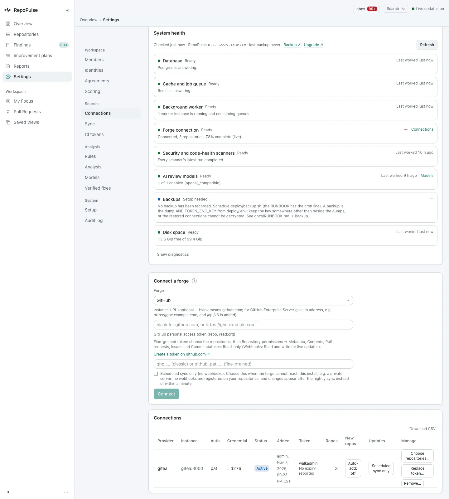
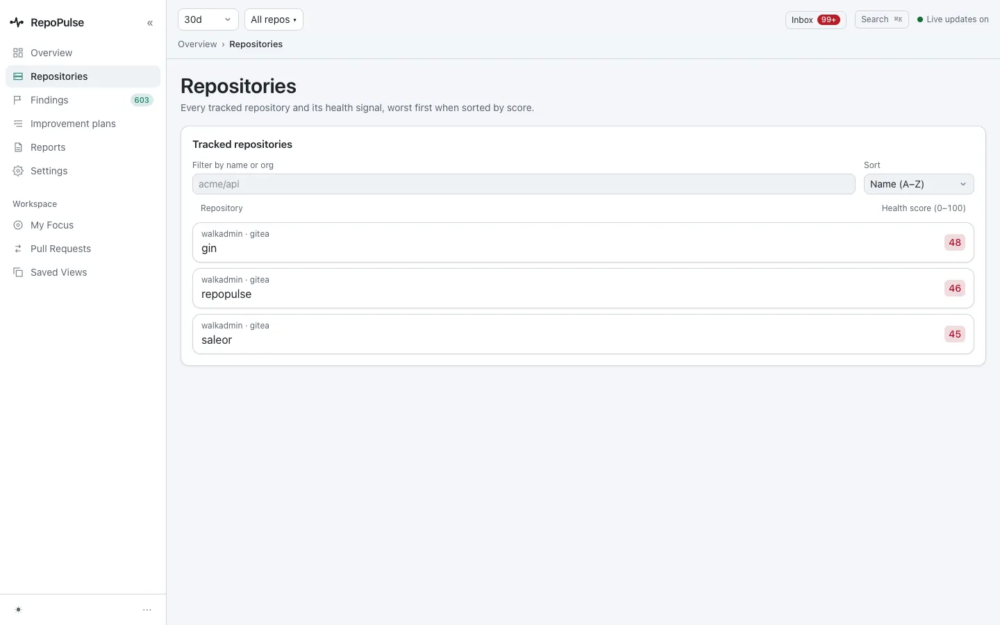
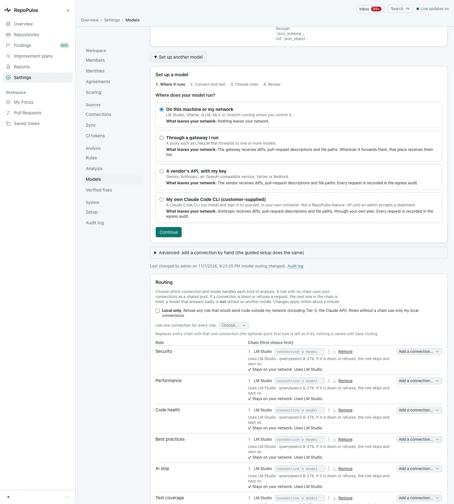
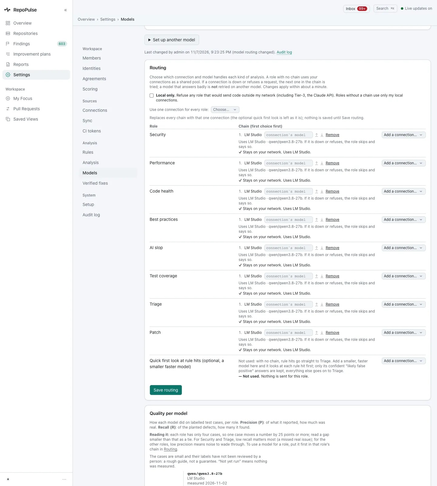
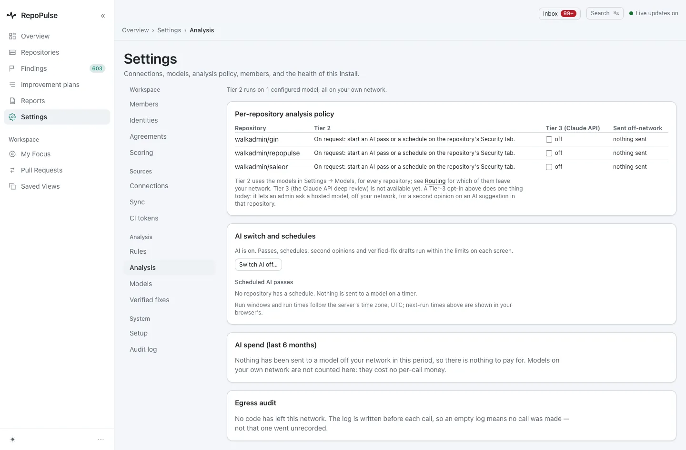

# Install and set up RepoPulse

From the install script to a working install: connect a forge, choose repositories, decide where your models run and which ones each kind of analysis uses, and check what is allowed to leave your network.

**For:** Admin · **10 steps** · [All tours](README.md)

> Real screens from a RepoPulse test install built from the current main branch (0.2.1 in development). It tracks copies of three open-source projects on a local Gitea: gin (Go), saleor (Python) and RepoPulse's own code (TypeScript), with the qwen3.8-27b model running in LM Studio on the same network.

## 1. Install, then sign in

The install script checks every file in the bundle, writes the configuration and starts the stack. The first account is the administrator you named, and its generated password must be changed at first sign-in.

## 2. A checklist instead of an empty dashboard

Until setup is finished, the overview opens on **Finish setting up**: connect a forge, watch the first sync, run the first scan, add a model, review the bot list and add people. Here four of six are done. Dismiss it and it comes back from Settings → Setup.

## 3. Every setting in four groups

Settings is one grouped menu: **Workspace** (members, identities, agreements, scoring), **Sources** (connections, sync, CI tokens), **Analysis** (rules, analysis, models, verified fixes) and **System** (setup, audit log). The old links still work.

## 4. Connect a forge with a read-only token

**Settings → Connections** connects GitHub, GitLab or Gitea, including one behind your own certificate authority. The form says which token permissions are needed, all of them read-only: RepoPulse never writes to your repositories. Here one Gitea connection tracks 3 repositories on a scheduled sync.

## 5. Choose the repositories

History is read through the forge API, never cloned. This install tracks gin (health 48), RepoPulse itself (46) and saleor (45). The list sorts by name or by health, best or worst first.

## 6. Decide where your model runs

**Settings → Models → Set up another model** has four steps: where it runs, connect and test, choose roles, review. The first asks where the model runs: on this machine or your network (LM Studio, Ollama, vLLM, MLX or Unsloth), through a gateway you run, a vendor's API with your key, or your own Claude Code CLI, and says what leaves your network for each. Rule-based scans need no model at all.

## 7. Route each kind of analysis to a model

Every role has its own chain of models to try in order: security, performance, code health, best practices, AI slop, test coverage, triage, patch, and the **quick first look**. Here each uses qwen3.8-27b in LM Studio, marked **Stays on your network**, and **Local only** refuses any role that would send code off the network.

## 8. Set the analysis policy

**Settings → Analysis** says where Tier 2 runs (here, one model on your own network) and the policy per repository: all three run AI on request, with the hosted Tier 3 off and nothing sent. One switch turns all AI off.

## 9. Check the health of the install

**System health** names the version and every part: database, queue, worker, forge (3 repositories, live), scanners and models all Ready, backups **Setup needed**, and the free disk. Problems are named, not hidden.

## 10. Confirm the install is complete

**Settings → Setup** lists which install steps are done and which configuration is set, never the values: 3 repositories, 568 scan runs, 1 model. One step is left: remove `ADMIN_PASSWORD` from the environment now that the password is changed.

---

Next tour: [See where every repository stands](overview.md) · [All tours](README.md)
