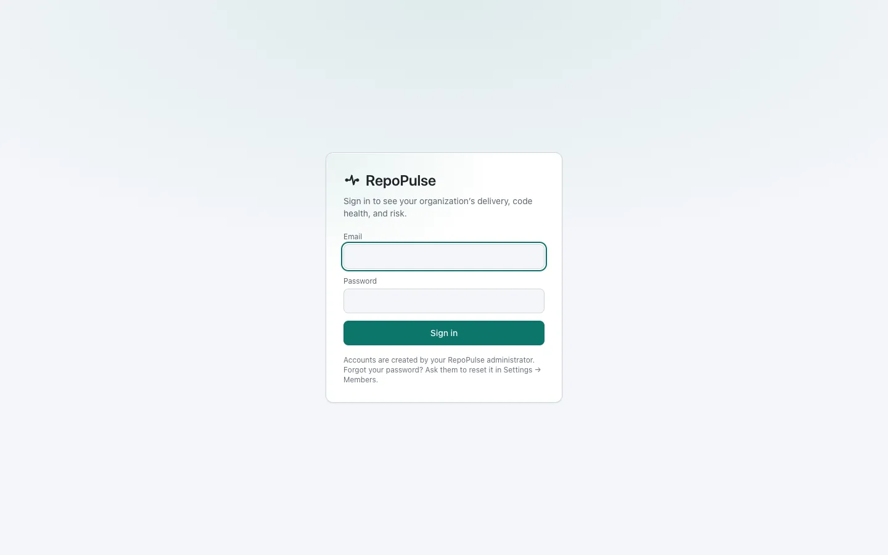
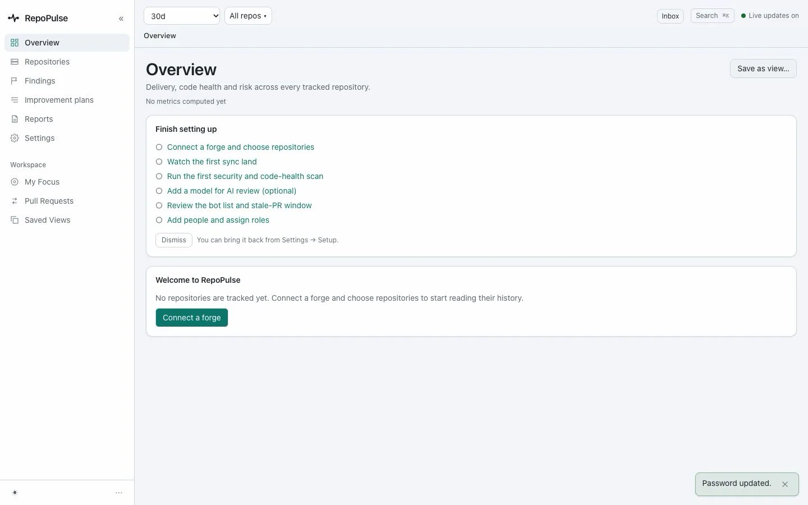
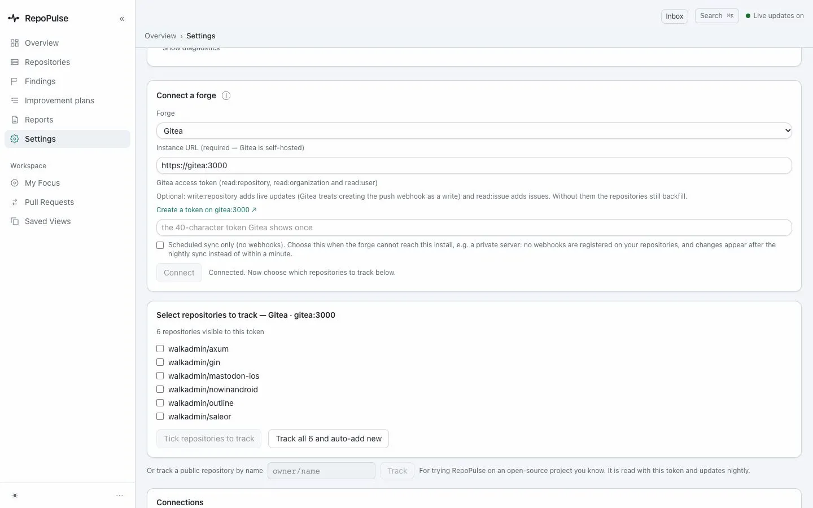
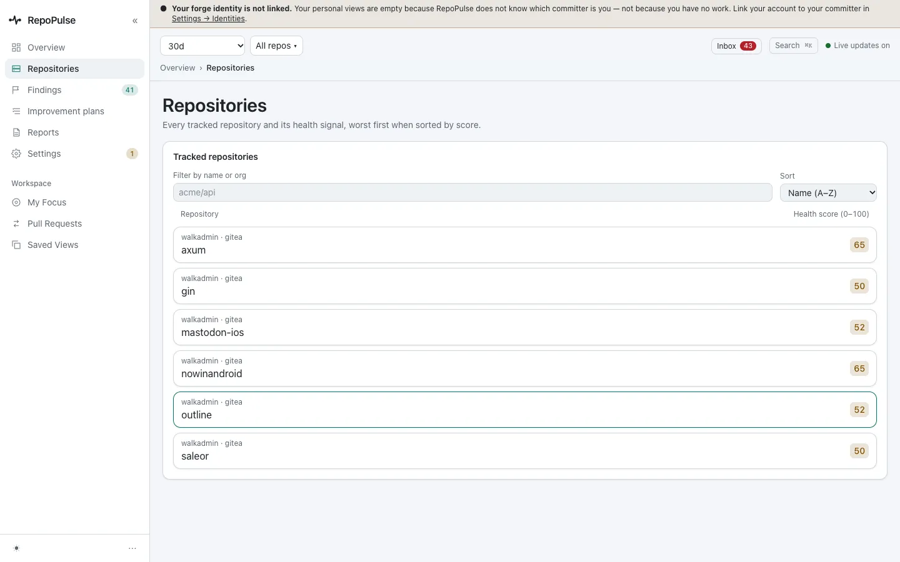
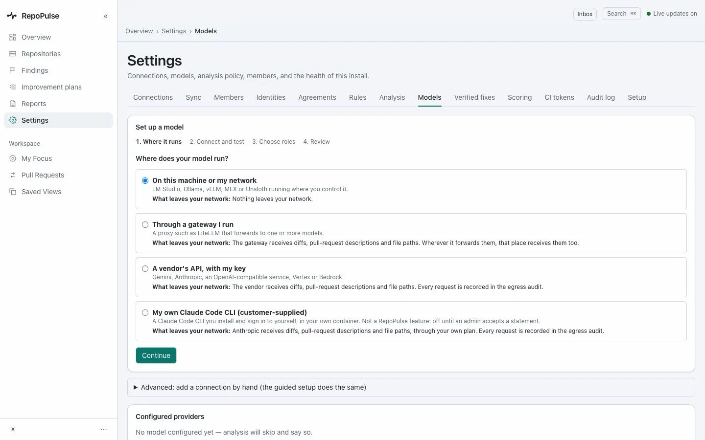
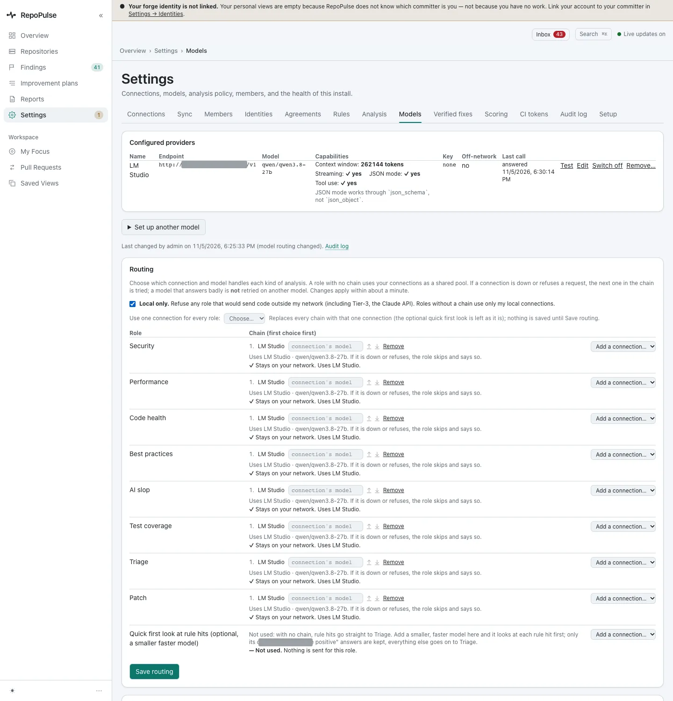
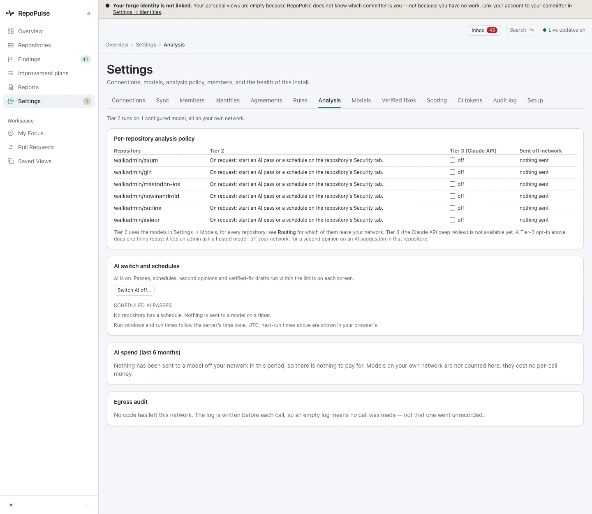
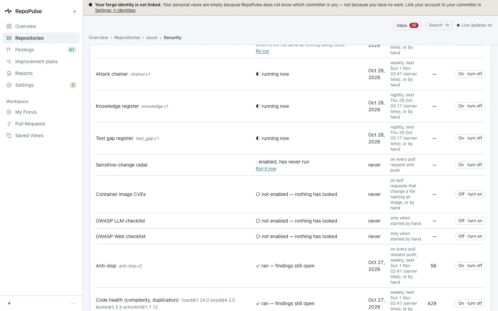
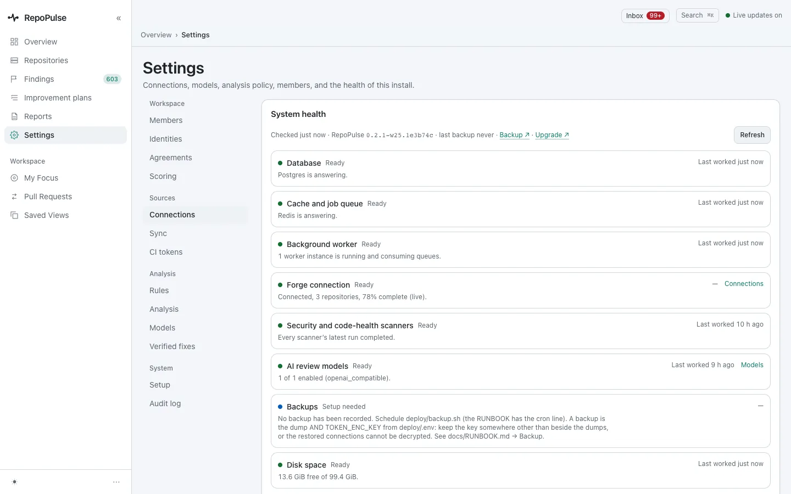
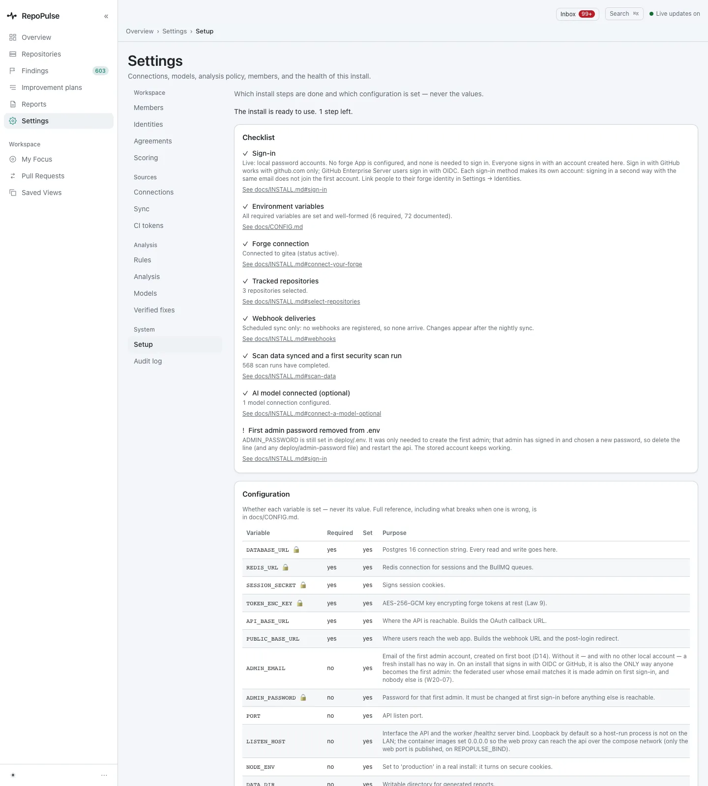

# Install and set up RepoPulse

From the install script to a working install: connect a forge, choose repositories, decide where your models run and which ones each kind of analysis uses, and check what is allowed to leave your network.

**For:** Admin · **10 steps** · [All tours](README.md)

> Real screens from a fresh RepoPulse 0.2.0 install that scanned copies of six public open-source projects (axum, gin, mastodon-ios, nowinandroid, outline and saleor) on a local Gitea over https, with models running in LM Studio on the same network.

## 1. Install, then sign in

The install script checks every file in the bundle, writes the configuration and starts the stack; on this Mac it took 15 seconds. The first account is the administrator you named, and its generated password must be changed at first sign-in.

## 2. A checklist instead of an empty dashboard

Before there is any data, the overview says **Finish setting up** and lists what to do next: connect a forge, watch the first sync, run the first scan, and optionally add a model.

## 3. Connect a forge with a read-only token

GitHub, GitLab or Gitea, including one behind your own certificate authority: add the CA file as INSTALL.md describes and the same token connects. The token needs read access only; RepoPulse never writes to your repositories.

## 4. Choose the repositories

History is read through the forge API, never cloned. Here, copies of six public projects in Rust, Go, Swift, Kotlin, Python and TypeScript, with health scores from 50 to 65.

## 5. Decide where your model runs

**Settings → Models** starts by asking where the model runs: on your own machine or network (LM Studio, Ollama, vLLM, MLX or Unsloth), through a gateway you run, a vendor's API with your key, or your own Claude Code CLI. Each choice says exactly what leaves your network. Rule-based scans need no model at all.

## 6. Route each kind of analysis to a model

This install has one LM Studio connection on the local network. **Local only** is on, so any role that would send code off the network is refused, and every role uses the local model. Each role has a chain of models to try in order if one is down.

## 7. Set the analysis policy and limits

**Settings → Analysis** shows, per repository, when AI passes run and whether the hosted Tier 3 is allowed. It is off for all six here, so nothing is sent off the network. One switch turns all AI off.

## 8. Run the first scans

**Run scans now** starts every enabled scanner on a snapshot in a sandbox with no network. Each row shows its state while it runs, and scans also repeat on their own schedule.

_Screen from the pre-0.2.0 walkthrough (0.9.17). The 0.2.0 capture is waiting on the local model's AI review and will replace it._

## 9. Check the health of the install

**Settings → Connections** opens on system health: database, queue, worker, forge, scanners, models and backups. Problems are named, not hidden. Here 6 parts are ready, one saleor scanner run failed and the page says which, and backups still need setting up.

## 10. Confirm the install is complete

**Settings → Setup** lists which install steps are done and which configuration is set, never the values. This install is ready to use with 1 step left: remove `ADMIN_PASSWORD` from the environment now that the password is changed.

---

Next tour: [See where every repository stands](overview.md) · [All tours](README.md)
